# Velearn Enterprise Database Architecture & Technical Specification

**Project Name:** Velearn LMS, CRM & Placement Platform  
**Backend Framework:** Laravel 11.x (PHP 8.2+)  
**Database Management System:** MySQL 8.0+ / MariaDB (InnoDB Engine, UTF-8 Unicode `utf8mb4_unicode_ci`)  
**Total Database Tables:** 91 Tables  
**Total Migrations Covered:** 99 Migrations  
**Specification Level:** Exhaustive Enterprise Data Architecture & Field-by-Field Reference  
**Date:** October 12, 2026  

---

## Table of Contents

1. [Domain 1: Identity, RBAC & Core Administration](#domain-1-identity-rbac-core-administration)
2. [Domain 2: CRM, Telecalling & Lead Acquisition Engine](#domain-2-crm-telecalling-lead-acquisition-engine)
3. [Domain 3: LMS Academic Catalog & Multimedia Streaming](#domain-3-lms-academic-catalog-multimedia-streaming)
4. [Domain 4: Batch Cohorts, Live Schedules & Attendance](#domain-4-batch-cohorts-live-schedules-attendance)
5. [Domain 5: Assessments, Rubrics & Grading Engines](#domain-5-assessments-rubrics-grading-engines)
6. [Domain 6: Admissions, Billing, Invoicing & Gateways](#domain-6-admissions-billing-invoicing-gateways)
7. [Domain 7: Corporate Hiring, Placement Drives & Interviews](#domain-7-corporate-hiring-placement-drives-interviews)
8. [Domain 8: Support Desk, Knowledge Resources & Webinars](#domain-8-support-desk-knowledge-resources-webinars)
9. [Domain 9: System Infrastructure, Queueing & Cache](#domain-9-system-infrastructure-queueing-cache)
10. [Global Entity-Relationship Architecture Diagram](#global-entity-relationship-architecture-diagram)
11. [Cross-Domain Data Flow & End-to-End State Lifecycles](#cross-domain-data-flow--end-to-end-state-lifecycles)
12. [Complete Relational Cardinality & Referential Integrity Matrix](#complete-relational-cardinality--referential-integrity-matrix)
13. [Enterprise Optimization, Indexing & Storage Guidelines](#enterprise-optimization-indexing--storage-guidelines)

---

## Executive Architectural Flowchart

The following high-level flowchart illustrates how the multi-domain platform operates from an architectural, operational, and data flow perspective:

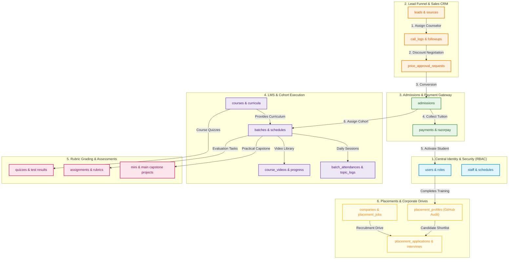

---
## Domain 1: Identity, RBAC & Core Administration

> **Domain Summary:** Manages authentication credentials, user demographic details, granular Spatie roles and permissions, internal employee staffing, mentor schedules, and team meetings.


### Domain 1 Architectural Flowchart
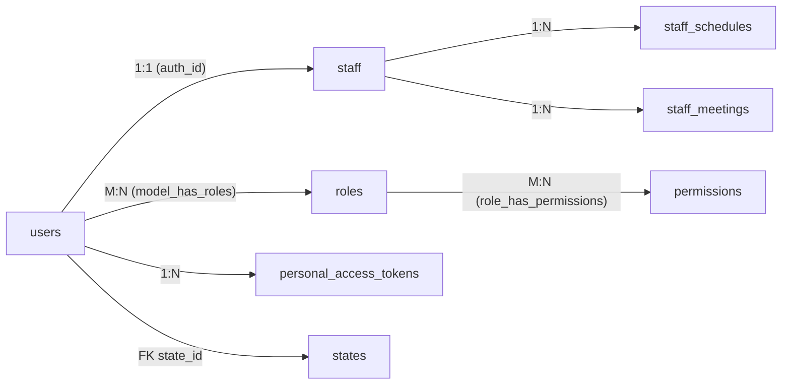

### Table: `users`
- **Description & Business Semantics:** Primary user identity table for students, instructors, counselors, and system administrators.
- **Created In Migration:** `database/migrations/0001_01_01_000000_create_users_table.php`
- **Storage Engine:** InnoDB | **Collation:** `utf8mb4_unicode_ci`

#### Detailed Column Specifications
| Column Name | Data Type & Length | Nullable | Default Value | Constraints & Blueprint Definition |
| :--- | :--- | :---: | :---: | :--- |
| `id` | `BIGINT UNSIGNED (PK, AI)` | `NO` | `-` | `$table-&gt;id()` |
| `name` | `STRING` | `NO` | `-` | `$table-&gt;string(&#039;name&#039;)` |
| `first_name` | `STRING` | `YES` | `-` | `$table-&gt;string(&#039;first_name&#039;)-&gt;nullable()` |
| `last_name` | `STRING` | `YES` | `-` | `$table-&gt;string(&#039;last_name&#039;)-&gt;nullable()` |
| `date_of_birth` | `DATE` | `YES` | `-` | `$table-&gt;date(&#039;date_of_birth&#039;)-&gt;nullable()` |
| `gender` | `STRING` | `YES` | `-` | `$table-&gt;string(&#039;gender&#039;)-&gt;nullable()` |
| `education` | `STRING` | `YES` | `-` | `$table-&gt;string(&#039;education&#039;)-&gt;nullable()` |
| `designation` | `STRING` | `YES` | `-` | `$table-&gt;string(&#039;designation&#039;)-&gt;nullable()` |
| `address` | `TEXT` | `YES` | `-` | `$table-&gt;text(&#039;address&#039;)-&gt;nullable()` |
| `email` | `STRING` | `NO` | `-` | `$table-&gt;string(&#039;email&#039;)-&gt;unique()` |
| `image` | `STRING` | `YES` | `-` | `$table-&gt;string(&#039;image&#039;)-&gt;nullable()` |
| `email_verified_at` | `TIMESTAMP` | `YES` | `-` | `$table-&gt;timestamp(&#039;email_verified_at&#039;)-&gt;nullable()` |
| `password` | `STRING` | `NO` | `-` | `$table-&gt;string(&#039;password&#039;)` |
| `phonenumber` | `STRING` | `YES` | `-` | `$table-&gt;string(&#039;phonenumber&#039;)-&gt;nullable()` |
| `secondary_phone` | `STRING` | `YES` | `-` | `$table-&gt;string(&#039;secondary_phone&#039;)-&gt;nullable()` |
| `lead_source` | `STRING` | `YES` | `-` | `$table-&gt;string(&#039;lead_source&#039;)-&gt;nullable()` |
| `fcm_token` | `STRING` | `YES` | `-` | `$table-&gt;string(&#039;fcm_token&#039;)-&gt;nullable()` |
| `remember_token` | `VARCHAR(100)` | `YES` | `-` | `$table-&gt;rememberToken()` |
| `created_at, updated_at` | `TIMESTAMP` | `YES` | `-` | `$table-&gt;timestamps()` |
| `deleted_at` | `TIMESTAMP` | `YES` | `-` | `$table-&gt;softDeletes()` |
| `state_id` | `FOREIGNID` | `YES` | `-` | `$table-&gt;foreignId(&#039;state_id&#039;)-&gt;nullable()` |
| `city` | `STRING` | `YES` | `-` | `$table-&gt;string(&#039;city&#039;)-&gt;nullable()` |
| `zip_code` | `STRING` | `YES` | `-` | `$table-&gt;string(&#039;zip_code&#039;)-&gt;nullable()` |

---

### Table: `password_reset_tokens`
- **Description & Business Semantics:** Secure temporary tokens for account password resets.
- **Created In Migration:** `database/migrations/0001_01_01_000000_create_users_table.php`
- **Storage Engine:** InnoDB | **Collation:** `utf8mb4_unicode_ci`

#### Detailed Column Specifications
| Column Name | Data Type & Length | Nullable | Default Value | Constraints & Blueprint Definition |
| :--- | :--- | :---: | :---: | :--- |
| `email` | `STRING` | `NO` | `-` | `$table-&gt;string(&#039;email&#039;)-&gt;primary()` |
| `token` | `STRING` | `NO` | `-` | `$table-&gt;string(&#039;token&#039;)` |
| `created_at` | `TIMESTAMP` | `YES` | `-` | `$table-&gt;timestamp(&#039;created_at&#039;)-&gt;nullable()` |

---

### Table: `sessions`
- **Description & Business Semantics:** HTTP database session store containing payload and user agent details.
- **Created In Migration:** `database/migrations/0001_01_01_000000_create_users_table.php`
- **Storage Engine:** InnoDB | **Collation:** `utf8mb4_unicode_ci`

#### Detailed Column Specifications
| Column Name | Data Type & Length | Nullable | Default Value | Constraints & Blueprint Definition |
| :--- | :--- | :---: | :---: | :--- |
| `id` | `STRING` | `NO` | `-` | `$table-&gt;string(&#039;id&#039;)-&gt;primary()` |
| `user_id` | `FOREIGNID` | `YES` | `-` | `$table-&gt;foreignId(&#039;user_id&#039;)-&gt;nullable()-&gt;index()` |
| `ip_address` | `STRING` | `YES` | `-` | `$table-&gt;string(&#039;ip_address&#039;, 45)-&gt;nullable()` |
| `user_agent` | `TEXT` | `YES` | `-` | `$table-&gt;text(&#039;user_agent&#039;)-&gt;nullable()` |
| `payload` | `LONGTEXT` | `NO` | `-` | `$table-&gt;longText(&#039;payload&#039;)` |
| `last_activity` | `INTEGER` | `NO` | `-` | `$table-&gt;integer(&#039;last_activity&#039;)-&gt;index()` |

---

### Table: `personal_access_tokens`
- **Description & Business Semantics:** Laravel Sanctum API tokens for mobile app and SPA client authorization.
- **Created In Migration:** `database/migrations/2026_09_09_070845_create_personal_access_tokens_table.php`
- **Storage Engine:** InnoDB | **Collation:** `utf8mb4_unicode_ci`

#### Detailed Column Specifications
| Column Name | Data Type & Length | Nullable | Default Value | Constraints & Blueprint Definition |
| :--- | :--- | :---: | :---: | :--- |
| `id` | `BIGINT UNSIGNED (PK, AI)` | `NO` | `-` | `$table-&gt;id()` |
| `tokenable` | `MORPHS` | `NO` | `-` | `$table-&gt;morphs(&#039;tokenable&#039;)` |
| `name` | `TEXT` | `NO` | `-` | `$table-&gt;text(&#039;name&#039;)` |
| `token` | `STRING` | `NO` | `-` | `$table-&gt;string(&#039;token&#039;, 64)-&gt;unique()` |
| `abilities` | `TEXT` | `YES` | `-` | `$table-&gt;text(&#039;abilities&#039;)-&gt;nullable()` |
| `last_used_at` | `TIMESTAMP` | `YES` | `-` | `$table-&gt;timestamp(&#039;last_used_at&#039;)-&gt;nullable()` |
| `expires_at` | `TIMESTAMP` | `YES` | `-` | `$table-&gt;timestamp(&#039;expires_at&#039;)-&gt;nullable()-&gt;index()` |
| `created_at, updated_at` | `TIMESTAMP` | `YES` | `-` | `$table-&gt;timestamps()` |

---

### Table: `states`
- **Description & Business Semantics:** Geographical state lookup table for tax, location analytics, and CRM categorization.
- **Created In Migration:** `database/migrations/2026_09_09_011000_create_states_table.php`
- **Storage Engine:** InnoDB | **Collation:** `utf8mb4_unicode_ci`

#### Detailed Column Specifications
| Column Name | Data Type & Length | Nullable | Default Value | Constraints & Blueprint Definition |
| :--- | :--- | :---: | :---: | :--- |
| `id` | `BIGINT UNSIGNED (PK, AI)` | `NO` | `-` | `$table-&gt;id()` |
| `state_name` | `STRING` | `NO` | `-` | `$table-&gt;string(&#039;state_name&#039;)` |
| `created_at, updated_at` | `TIMESTAMP` | `YES` | `-` | `$table-&gt;timestamps()` |

---

### Table: `staff`
- **Description & Business Semantics:** Extended staff profile linked to authentication accounts with employee code, department, and joining date.
- **Created In Migration:** `database/migrations/2026_09_09_057000_create_staff_table.php`
- **Storage Engine:** InnoDB | **Collation:** `utf8mb4_unicode_ci`

#### Detailed Column Specifications
| Column Name | Data Type & Length | Nullable | Default Value | Constraints & Blueprint Definition |
| :--- | :--- | :---: | :---: | :--- |
| `id` | `BIGINT UNSIGNED (PK, AI)` | `NO` | `-` | `$table-&gt;id()` |
| `auth_id` | `FOREIGNID` | `NO` | `-` | `$table-&gt;foreignId(&#039;auth_id&#039;)` |
| `first_name` | `STRING` | `NO` | `-` | `$table-&gt;string(&#039;first_name&#039;)` |
| `last_name` | `STRING` | `NO` | `-` | `$table-&gt;string(&#039;last_name&#039;)` |
| `email` | `STRING` | `NO` | `-` | `$table-&gt;string(&#039;email&#039;)` |
| `primary_phone` | `STRING` | `NO` | `-` | `$table-&gt;string(&#039;primary_phone&#039;)` |
| `secondary_phone` | `STRING` | `YES` | `-` | `$table-&gt;string(&#039;secondary_phone&#039;)-&gt;nullable()` |
| `gender` | `STRING` | `YES` | `-` | `$table-&gt;string(&#039;gender&#039;)-&gt;nullable()` |
| `role_id` | `FOREIGNID` | `YES` | `-` | `$table-&gt;foreignId(&#039;role_id&#039;)-&gt;nullable()` |
| `date_of_birth` | `STRING` | `YES` | `-` | `$table-&gt;string(&#039;date_of_birth&#039;)-&gt;nullable()` |
| `education` | `STRING` | `YES` | `-` | `$table-&gt;string(&#039;education&#039;)-&gt;nullable()` |
| `address` | `TEXT` | `YES` | `-` | `$table-&gt;text(&#039;address&#039;)-&gt;nullable()` |
| `city` | `STRING` | `YES` | `-` | `$table-&gt;string(&#039;city&#039;)-&gt;nullable()` |
| `pincode` | `STRING` | `YES` | `-` | `$table-&gt;string(&#039;pincode&#039;)-&gt;nullable()` |
| `state_id` | `FOREIGNID` | `YES` | `-` | `$table-&gt;foreignId(&#039;state_id&#039;)-&gt;nullable()` |
| `status` | `INTEGER` | `NO` | `1` | `$table-&gt;integer(&#039;status&#039;)-&gt;default(1)` |
| `deleted_at` | `TIMESTAMP` | `YES` | `-` | `$table-&gt;softDeletes()` |
| `created_at, updated_at` | `TIMESTAMP` | `YES` | `-` | `$table-&gt;timestamps()` |

---

### Table: `staff_schedules`
- **Description & Business Semantics:** Staff operational calendar storing weekly shifts and availability.
- **Created In Migration:** `database/migrations/2026_09_09_058000_create_staff_schedules_table.php`
- **Storage Engine:** InnoDB | **Collation:** `utf8mb4_unicode_ci`

#### Detailed Column Specifications
| Column Name | Data Type & Length | Nullable | Default Value | Constraints & Blueprint Definition |
| :--- | :--- | :---: | :---: | :--- |
| `id` | `BIGINT UNSIGNED (PK, AI)` | `NO` | `-` | `$table-&gt;id()` |
| `staff_id` | `UNSIGNEDBIGINTEGER` | `NO` | `-` | `$table-&gt;unsignedBigInteger(&#039;staff_id&#039;)` |
| `day` | `STRING` | `NO` | `-` | `$table-&gt;string(&#039;day&#039;); // Monday, Tuesday, etc.` |
| `schedule_time` | `TIME` | `NO` | `-` | `$table-&gt;time(&#039;schedule_time&#039;)` |
| `status` | `STRING` | `NO` | `available` | `$table-&gt;string(&#039;status&#039;)-&gt;default(&#039;available&#039;); // available, busy, off` |
| `created_at, updated_at` | `TIMESTAMP` | `YES` | `-` | `$table-&gt;timestamps()` |
| `staff_id` | `FOREIGN` | `NO` | `-` | `$table-&gt;foreign(&#039;staff_id&#039;)-&gt;references(&#039;id&#039;)-&gt;on(&#039;staff&#039;)-&gt;onDelete(&#039;cascade&#039;)` |
| `-` | `Declaration` | `NO` | `-` | `$table-&gt;unique([&#039;staff_id&#039;, &#039;day&#039;, &#039;schedule_time&#039;])` |

---

### Table: `staff_meetings`
- **Description & Business Semantics:** Internal employee team meetings, calendar invites, and video links.
- **Created In Migration:** `database/migrations/2026_09_28_154946_create_staff_meetings_table.php`
- **Storage Engine:** InnoDB | **Collation:** `utf8mb4_unicode_ci`

#### Detailed Column Specifications
| Column Name | Data Type & Length | Nullable | Default Value | Constraints & Blueprint Definition |
| :--- | :--- | :---: | :---: | :--- |
| `id` | `BIGINT UNSIGNED (PK, AI)` | `NO` | `-` | `$table-&gt;id()` |
| `meeting_type` | `STRING` | `NO` | `Staff Meeting` | `$table-&gt;string(&#039;meeting_type&#039;)-&gt;default(&#039;Staff Meeting&#039;); // Staff Meeting or Group Meeting` |
| `title` | `STRING` | `NO` | `-` | `$table-&gt;string(&#039;title&#039;)` |
| `date` | `DATE` | `NO` | `-` | `$table-&gt;date(&#039;date&#039;)` |
| `time` | `TIME` | `NO` | `-` | `$table-&gt;time(&#039;time&#039;)` |
| `staff_id` | `UNSIGNEDBIGINTEGER` | `NO` | `-` | `$table-&gt;unsignedBigInteger(&#039;staff_id&#039;); // foreign key if needed` |
| `agenda` | `TEXT` | `YES` | `-` | `$table-&gt;text(&#039;agenda&#039;)-&gt;nullable()` |
| `meet_link` | `STRING` | `YES` | `-` | `$table-&gt;string(&#039;meet_link&#039;)-&gt;nullable()` |
| `created_at, updated_at` | `TIMESTAMP` | `YES` | `-` | `$table-&gt;timestamps()` |

---

## Domain 2: CRM, Telecalling & Lead Acquisition Engine

> **Domain Summary:** Powers student acquisition funnels, multi-channel lead tracking, telecaller assignments, call durations, audio recording storage, price discount approvals, and follow-up agendas.


### Domain 2 Architectural Flowchart (CRM & Telecalling)
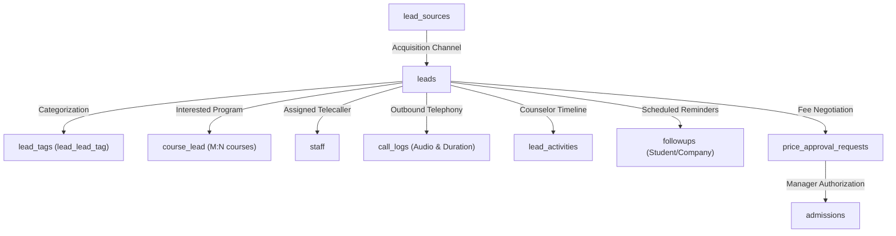

### Table: `leads`
- **Description & Business Semantics:** Core sales inquiry repository storing contact info, status, priority, and telecaller assignment.
- **Created In Migration:** `database/migrations/2026_09_15_143913_create_leads_table.php`
- **Storage Engine:** InnoDB | **Collation:** `utf8mb4_unicode_ci`

#### Detailed Column Specifications
| Column Name | Data Type & Length | Nullable | Default Value | Constraints & Blueprint Definition |
| :--- | :--- | :---: | :---: | :--- |
| `id` | `BIGINT UNSIGNED (PK, AI)` | `NO` | `-` | `$table-&gt;id()` |
| `name` | `STRING` | `NO` | `-` | `$table-&gt;string(&#039;name&#039;)` |
| `phone` | `STRING` | `YES` | `-` | `$table-&gt;string(&#039;phone&#039;)-&gt;nullable()` |
| `whatsapp` | `STRING` | `YES` | `-` | `$table-&gt;string(&#039;whatsapp&#039;)-&gt;nullable()` |
| `email` | `STRING` | `YES` | `-` | `$table-&gt;string(&#039;email&#039;)-&gt;nullable()` |
| `location` | `STRING` | `YES` | `-` | `$table-&gt;string(&#039;location&#039;)-&gt;nullable()` |
| `lead_source_id` | `FOREIGNID` | `YES` | `-` | `$table-&gt;foreignId(&#039;lead_source_id&#039;)-&gt;nullable()-&gt;constrained(&#039;lead_sources&#039;)-&gt;nullOnDelete()` |
| `lead_status_id` | `FOREIGNID` | `YES` | `-` | `$table-&gt;foreignId(&#039;lead_status_id&#039;)-&gt;nullable()-&gt;constrained(&#039;lead_statuses&#039;)-&gt;nullOnDelete()` |
| `priority` | `STRING` | `YES` | `Medium` | `$table-&gt;string(&#039;priority&#039;)-&gt;nullable()-&gt;default(&#039;Medium&#039;)` |
| `assigned_to` | `FOREIGNID` | `YES` | `-` | `$table-&gt;foreignId(&#039;assigned_to&#039;)-&gt;nullable()-&gt;constrained(&#039;staff&#039;)-&gt;nullOnDelete()` |
| `expected_close_date` | `DATE` | `YES` | `-` | `$table-&gt;date(&#039;expected_close_date&#039;)-&gt;nullable()` |
| `converted_date` | `DATE` | `YES` | `-` | `$table-&gt;date(&#039;converted_date&#039;)-&gt;nullable()` |
| `created_at, updated_at` | `TIMESTAMP` | `YES` | `-` | `$table-&gt;timestamps()` |

---

### Table: `lead_sources`
- **Description & Business Semantics:** Acquisition channels (e.g., Google Ads, Meta Ads, Organic, Campus Walk-in).
- **Created In Migration:** `database/migrations/2026_09_09_012000_create_lead_sources_table.php`
- **Storage Engine:** InnoDB | **Collation:** `utf8mb4_unicode_ci`

#### Detailed Column Specifications
| Column Name | Data Type & Length | Nullable | Default Value | Constraints & Blueprint Definition |
| :--- | :--- | :---: | :---: | :--- |
| `id` | `BIGINT UNSIGNED (PK, AI)` | `NO` | `-` | `$table-&gt;id()` |
| `name` | `STRING` | `NO` | `-` | `$table-&gt;string(&#039;name&#039;)` |
| `slug` | `STRING` | `NO` | `-` | `$table-&gt;string(&#039;slug&#039;)` |
| `created_at, updated_at` | `TIMESTAMP` | `YES` | `-` | `$table-&gt;timestamps()` |

---

### Table: `lead_statuses`
- **Description & Business Semantics:** Multi-stage sales pipeline status stages (New, Contacted, Demo, Followup, Converted, Lost).
- **Created In Migration:** `database/migrations/2026_09_15_143912_create_lead_statuses_table.php`
- **Storage Engine:** InnoDB | **Collation:** `utf8mb4_unicode_ci`

#### Detailed Column Specifications
| Column Name | Data Type & Length | Nullable | Default Value | Constraints & Blueprint Definition |
| :--- | :--- | :---: | :---: | :--- |
| `id` | `BIGINT UNSIGNED (PK, AI)` | `NO` | `-` | `$table-&gt;id()` |
| `name` | `STRING` | `NO` | `-` | `$table-&gt;string(&#039;name&#039;)` |
| `color` | `STRING` | `NO` | `#000000` | `$table-&gt;string(&#039;color&#039;)-&gt;default(&#039;#000000&#039;)` |
| `created_at, updated_at` | `TIMESTAMP` | `YES` | `-` | `$table-&gt;timestamps()` |

---

### Table: `lead_tags`
- **Description & Business Semantics:** Custom tags for lead qualification and behavioral segmentation.
- **Created In Migration:** `database/migrations/2026_09_09_013000_create_lead_tags_table.php`
- **Storage Engine:** InnoDB | **Collation:** `utf8mb4_unicode_ci`

#### Detailed Column Specifications
| Column Name | Data Type & Length | Nullable | Default Value | Constraints & Blueprint Definition |
| :--- | :--- | :---: | :---: | :--- |
| `id` | `BIGINT UNSIGNED (PK, AI)` | `NO` | `-` | `$table-&gt;id()` |
| `name` | `STRING` | `NO` | `-` | `$table-&gt;string(&#039;name&#039;)` |
| `slug` | `STRING` | `NO` | `-` | `$table-&gt;string(&#039;slug&#039;)` |
| `created_at, updated_at` | `TIMESTAMP` | `YES` | `-` | `$table-&gt;timestamps()` |

---

### Table: `lead_source_role`
- **Description & Business Semantics:** Role-based access rules determining which staff roles can view specific lead sources.
- **Created In Migration:** `database/migrations/2026_09_09_044000_create_lead_source_role_table.php`
- **Storage Engine:** InnoDB | **Collation:** `utf8mb4_unicode_ci`

#### Detailed Column Specifications
| Column Name | Data Type & Length | Nullable | Default Value | Constraints & Blueprint Definition |
| :--- | :--- | :---: | :---: | :--- |
| `id` | `BIGINT UNSIGNED (PK, AI)` | `NO` | `-` | `$table-&gt;id()` |
| `lead_source_id` | `FOREIGNID` | `NO` | `-` | `$table-&gt;foreignId(&#039;lead_source_id&#039;)` |
| `role_id` | `FOREIGNID` | `NO` | `-` | `$table-&gt;foreignId(&#039;role_id&#039;)` |
| `created_at, updated_at` | `TIMESTAMP` | `YES` | `-` | `$table-&gt;timestamps()` |

---

### Table: `lead_status_role`
- **Description & Business Semantics:** Visibility permissions determining which staff roles can access specific lead stages.
- **Created In Migration:** `database/migrations/2026_09_16_164238_create_lead_status_role_table.php`
- **Storage Engine:** InnoDB | **Collation:** `utf8mb4_unicode_ci`

#### Detailed Column Specifications
| Column Name | Data Type & Length | Nullable | Default Value | Constraints & Blueprint Definition |
| :--- | :--- | :---: | :---: | :--- |
| `id` | `BIGINT UNSIGNED (PK, AI)` | `NO` | `-` | `$table-&gt;id()` |
| `lead_status_id` | `FOREIGNID` | `NO` | `-` | `$table-&gt;foreignId(&#039;lead_status_id&#039;)-&gt;constrained()-&gt;cascadeOnDelete()` |
| `role_id` | `FOREIGNID` | `NO` | `-` | `$table-&gt;foreignId(&#039;role_id&#039;)-&gt;constrained(&#039;roles&#039;)-&gt;cascadeOnDelete()` |
| `created_at, updated_at` | `TIMESTAMP` | `YES` | `-` | `$table-&gt;timestamps()` |

---

### Table: `lead_tag_role`
- **Description & Business Semantics:** Role-scoped access permissions for lead tags.
- **Created In Migration:** `database/migrations/2026_09_09_045000_create_lead_tag_role_table.php`
- **Storage Engine:** InnoDB | **Collation:** `utf8mb4_unicode_ci`

#### Detailed Column Specifications
| Column Name | Data Type & Length | Nullable | Default Value | Constraints & Blueprint Definition |
| :--- | :--- | :---: | :---: | :--- |
| `id` | `BIGINT UNSIGNED (PK, AI)` | `NO` | `-` | `$table-&gt;id()` |
| `lead_tag_id` | `FOREIGNID` | `NO` | `-` | `$table-&gt;foreignId(&#039;lead_tag_id&#039;)` |
| `role_id` | `FOREIGNID` | `NO` | `-` | `$table-&gt;foreignId(&#039;role_id&#039;)` |
| `created_at, updated_at` | `TIMESTAMP` | `YES` | `-` | `$table-&gt;timestamps()` |

---

### Table: `lead_lead_tag`
- **Description & Business Semantics:** Many-to-Many pivot table associating tags with leads.
- **Created In Migration:** `database/migrations/2026_09_15_143928_create_lead_lead_tag_table.php`
- **Storage Engine:** InnoDB | **Collation:** `utf8mb4_unicode_ci`

#### Detailed Column Specifications
| Column Name | Data Type & Length | Nullable | Default Value | Constraints & Blueprint Definition |
| :--- | :--- | :---: | :---: | :--- |
| `id` | `BIGINT UNSIGNED (PK, AI)` | `NO` | `-` | `$table-&gt;id()` |
| `lead_id` | `FOREIGNID` | `NO` | `-` | `$table-&gt;foreignId(&#039;lead_id&#039;)-&gt;constrained(&#039;leads&#039;)-&gt;onDelete(&#039;cascade&#039;)` |
| `lead_tag_id` | `FOREIGNID` | `NO` | `-` | `$table-&gt;foreignId(&#039;lead_tag_id&#039;)-&gt;constrained(&#039;lead_tags&#039;)-&gt;onDelete(&#039;cascade&#039;)` |
| `-` | `Declaration` | `NO` | `-` | `$table-&gt;unique([&#039;lead_id&#039;, &#039;lead_tag_id&#039;])` |
| `created_at, updated_at` | `TIMESTAMP` | `YES` | `-` | `$table-&gt;timestamps()` |

---

### Table: `course_lead`
- **Description & Business Semantics:** Many-to-Many pivot table linking prospective leads to courses of interest.
- **Created In Migration:** `database/migrations/2026_09_19_145842_create_course_lead_table.php`
- **Storage Engine:** InnoDB | **Collation:** `utf8mb4_unicode_ci`

#### Detailed Column Specifications
| Column Name | Data Type & Length | Nullable | Default Value | Constraints & Blueprint Definition |
| :--- | :--- | :---: | :---: | :--- |
| `id` | `BIGINT UNSIGNED (PK, AI)` | `NO` | `-` | `$table-&gt;id()` |
| `course_id` | `FOREIGNID` | `NO` | `-` | `$table-&gt;foreignId(&#039;course_id&#039;)-&gt;constrained()-&gt;cascadeOnDelete()` |
| `lead_id` | `FOREIGNID` | `NO` | `-` | `$table-&gt;foreignId(&#039;lead_id&#039;)-&gt;constrained()-&gt;cascadeOnDelete()` |
| `created_at, updated_at` | `TIMESTAMP` | `YES` | `-` | `$table-&gt;timestamps()` |

---

### Table: `call_logs`
- **Description & Business Semantics:** Voice call activity records storing call type, duration, status, audio recording URL, and telecaller notes.
- **Created In Migration:** `database/migrations/2026_09_09_026000_create_call_logs_table.php`
- **Storage Engine:** InnoDB | **Collation:** `utf8mb4_unicode_ci`

#### Detailed Column Specifications
| Column Name | Data Type & Length | Nullable | Default Value | Constraints & Blueprint Definition |
| :--- | :--- | :---: | :---: | :--- |
| `id` | `BIGINT UNSIGNED (PK, AI)` | `NO` | `-` | `$table-&gt;id()` |
| `contact_id` | `FOREIGNID` | `YES` | `-` | `$table-&gt;foreignId(&#039;contact_id&#039;)-&gt;nullable()` |
| `caller_number` | `STRING` | `YES` | `-` | `$table-&gt;string(&#039;caller_number&#039;, 20)-&gt;nullable()` |
| `call_duration` | `STRING` | `YES` | `-` | `$table-&gt;string(&#039;call_duration&#039;, 50)-&gt;nullable()` |
| `department` | `STRING` | `YES` | `-` | `$table-&gt;string(&#039;department&#039;, 100)-&gt;nullable()` |
| `recording_url` | `TEXT` | `YES` | `-` | `$table-&gt;text(&#039;recording_url&#039;)-&gt;nullable()` |
| `status` | `STRING` | `YES` | `-` | `$table-&gt;string(&#039;status&#039;, 50)-&gt;nullable()` |
| `call_start` | `STRING` | `YES` | `-` | `$table-&gt;string(&#039;call_start&#039;)-&gt;nullable()` |
| `call_end` | `STRING` | `YES` | `-` | `$table-&gt;string(&#039;call_end&#039;)-&gt;nullable()` |
| `full_log` | `LONGTEXT` | `YES` | `-` | `$table-&gt;longText(&#039;full_log&#039;)-&gt;nullable()` |
| `note` | `TEXT` | `YES` | `-` | `$table-&gt;text(&#039;note&#039;)-&gt;nullable()` |
| `zoom_meet_link` | `TEXT` | `YES` | `-` | `$table-&gt;text(&#039;zoom_meet_link&#039;)-&gt;nullable()` |
| `zoom_meeting_id` | `STRING` | `YES` | `-` | `$table-&gt;string(&#039;zoom_meeting_id&#039;)-&gt;nullable()` |
| `followup_note` | `TEXT` | `YES` | `-` | `$table-&gt;text(&#039;followup_note&#039;)-&gt;nullable()` |
| `demo_date` | `STRING` | `YES` | `-` | `$table-&gt;string(&#039;demo_date&#039;)-&gt;nullable()` |
| `demo_time` | `STRING` | `YES` | `-` | `$table-&gt;string(&#039;demo_time&#039;, 20)-&gt;nullable()` |
| `demo_status` | `STRING` | `YES` | `-` | `$table-&gt;string(&#039;demo_status&#039;, 50)-&gt;nullable()` |
| `followup_date` | `STRING` | `YES` | `-` | `$table-&gt;string(&#039;followup_date&#039;)-&gt;nullable()` |
| `followup_time` | `STRING` | `YES` | `-` | `$table-&gt;string(&#039;followup_time&#039;, 20)-&gt;nullable()` |
| `assigned_staff_id` | `FOREIGNID` | `YES` | `-` | `$table-&gt;foreignId(&#039;assigned_staff_id&#039;)-&gt;nullable()` |
| `staff_id` | `FOREIGNID` | `YES` | `-` | `$table-&gt;foreignId(&#039;staff_id&#039;)-&gt;nullable()` |
| `followup_status` | `STRING` | `YES` | `-` | `$table-&gt;string(&#039;followup_status&#039;, 50)-&gt;nullable()` |
| `direction` | `STRING` | `YES` | `-` | `$table-&gt;string(&#039;direction&#039;, 50)-&gt;nullable()` |
| `lead_tag` | `STRING` | `YES` | `-` | `$table-&gt;string(&#039;lead_tag&#039;)-&gt;nullable()` |
| `created_at, updated_at` | `TIMESTAMP` | `YES` | `-` | `$table-&gt;timestamps()` |
| `lead_id` | `UNSIGNEDBIGINTEGER` | `YES` | `-` | `$table-&gt;unsignedBigInteger(&#039;lead_id&#039;)-&gt;nullable()-&gt;after(&#039;contact_id&#039;); /* Altered in 2026_09_15_161704_add_lead_id_to_call_logs_table.php */` |

---

### Table: `lead_activities`
- **Description & Business Semantics:** Historical log of counselor interactions, note taking, and scheduled follow-up dates.
- **Created In Migration:** `database/migrations/2026_09_15_143914_create_lead_activities_table.php`
- **Storage Engine:** InnoDB | **Collation:** `utf8mb4_unicode_ci`

#### Detailed Column Specifications
| Column Name | Data Type & Length | Nullable | Default Value | Constraints & Blueprint Definition |
| :--- | :--- | :---: | :---: | :--- |
| `id` | `BIGINT UNSIGNED (PK, AI)` | `NO` | `-` | `$table-&gt;id()` |
| `lead_id` | `FOREIGNID` | `NO` | `-` | `$table-&gt;foreignId(&#039;lead_id&#039;)-&gt;constrained(&#039;leads&#039;)-&gt;cascadeOnDelete()` |
| `staff_id` | `FOREIGNID` | `YES` | `-` | `$table-&gt;foreignId(&#039;staff_id&#039;)-&gt;nullable()-&gt;constrained(&#039;staff&#039;)-&gt;nullOnDelete()` |
| `type` | `STRING` | `NO` | `-` | `$table-&gt;string(&#039;type&#039;)` |
| `direction` | `STRING` | `YES` | `-` | `$table-&gt;string(&#039;direction&#039;)-&gt;nullable()` |
| `outcome` | `STRING` | `YES` | `-` | `$table-&gt;string(&#039;outcome&#039;)-&gt;nullable()` |
| `note` | `TEXT` | `NO` | `-` | `$table-&gt;text(&#039;note&#039;)` |
| `next_action` | `STRING` | `YES` | `-` | `$table-&gt;string(&#039;next_action&#039;)-&gt;nullable()` |
| `next_followup_date` | `DATETIME` | `YES` | `-` | `$table-&gt;dateTime(&#039;next_followup_date&#039;)-&gt;nullable()` |
| `created_at, updated_at` | `TIMESTAMP` | `YES` | `-` | `$table-&gt;timestamps()` |
| `tag_id` | `UNSIGNEDBIGINTEGER` | `YES` | `-` | `$table-&gt;unsignedBigInteger(&#039;tag_id&#039;)-&gt;nullable()-&gt;after(&#039;staff_id&#039;); /* Altered in 2026_09_19_163502_add_tag_id_and_status_id_to_lead_activities_table.php */` |
| `status_id` | `UNSIGNEDBIGINTEGER` | `YES` | `-` | `$table-&gt;unsignedBigInteger(&#039;status_id&#039;)-&gt;nullable()-&gt;after(&#039;tag_id&#039;); /* Altered in 2026_09_19_163502_add_tag_id_and_status_id_to_lead_activities_table.php */` |

---

### Table: `lead_pipeline_logs`
- **Description & Business Semantics:** Automated audit trail logging lead pipeline stage transitions over time.
- **Created In Migration:** `database/migrations/2026_09_19_162845_create_lead_pipeline_logs_table.php`
- **Storage Engine:** InnoDB | **Collation:** `utf8mb4_unicode_ci`

#### Detailed Column Specifications
| Column Name | Data Type & Length | Nullable | Default Value | Constraints & Blueprint Definition |
| :--- | :--- | :---: | :---: | :--- |
| `id` | `BIGINT UNSIGNED (PK, AI)` | `NO` | `-` | `$table-&gt;id()` |
| `lead_id` | `FOREIGNID` | `NO` | `-` | `$table-&gt;foreignId(&#039;lead_id&#039;)-&gt;constrained(&#039;leads&#039;)-&gt;onDelete(&#039;cascade&#039;)` |
| `changed_by` | `FOREIGNID` | `YES` | `-` | `$table-&gt;foreignId(&#039;changed_by&#039;)-&gt;nullable()-&gt;constrained(&#039;staff&#039;)-&gt;nullOnDelete()` |
| `old_status_id` | `UNSIGNEDBIGINTEGER` | `YES` | `-` | `$table-&gt;unsignedBigInteger(&#039;old_status_id&#039;)-&gt;nullable()` |
| `new_status_id` | `UNSIGNEDBIGINTEGER` | `YES` | `-` | `$table-&gt;unsignedBigInteger(&#039;new_status_id&#039;)-&gt;nullable()` |
| `old_tag_id` | `UNSIGNEDBIGINTEGER` | `YES` | `-` | `$table-&gt;unsignedBigInteger(&#039;old_tag_id&#039;)-&gt;nullable()` |
| `new_tag_id` | `UNSIGNEDBIGINTEGER` | `YES` | `-` | `$table-&gt;unsignedBigInteger(&#039;new_tag_id&#039;)-&gt;nullable()` |
| `created_at, updated_at` | `TIMESTAMP` | `YES` | `-` | `$table-&gt;timestamps()` |

---

### Table: `followups`
- **Description & Business Semantics:** Multi-target follow-up task engine coordinating outbound calls for both student prospects and corporate HRs.
- **Created In Migration:** `database/migrations/2026_10_12_114000_create_followups_table.php`
- **Storage Engine:** InnoDB | **Collation:** `utf8mb4_unicode_ci`

#### Detailed Column Specifications
| Column Name | Data Type & Length | Nullable | Default Value | Constraints & Blueprint Definition |
| :--- | :--- | :---: | :---: | :--- |
| `id` | `BIGINT UNSIGNED (PK, AI)` | `NO` | `-` | `$table-&gt;id()` |
| `followup_code` | `STRING` | `NO` | `-` | `$table-&gt;string(&#039;followup_code&#039;)-&gt;unique()` |
| `type` | `STRING` | `NO` | `student` | `$table-&gt;string(&#039;type&#039;)-&gt;default(&#039;student&#039;); // &#039;student&#039; or &#039;company&#039;` |
| `student_id` | `UNSIGNEDBIGINTEGER` | `YES` | `-` | `$table-&gt;unsignedBigInteger(&#039;student_id&#039;)-&gt;nullable()` |
| `student_name` | `STRING` | `NO` | `-` | `$table-&gt;string(&#039;student_name&#039;)` |
| `phone` | `STRING` | `YES` | `-` | `$table-&gt;string(&#039;phone&#039;)-&gt;nullable()` |
| `course` | `STRING` | `YES` | `-` | `$table-&gt;string(&#039;course&#039;)-&gt;nullable()` |
| `company_id` | `UNSIGNEDBIGINTEGER` | `YES` | `-` | `$table-&gt;unsignedBigInteger(&#039;company_id&#039;)-&gt;nullable()` |
| `company_name` | `STRING` | `NO` | `-` | `$table-&gt;string(&#039;company_name&#039;)` |
| `hr_name` | `STRING` | `YES` | `-` | `$table-&gt;string(&#039;hr_name&#039;)-&gt;nullable()` |
| `hr_phone` | `STRING` | `YES` | `-` | `$table-&gt;string(&#039;hr_phone&#039;)-&gt;nullable()` |
| `role` | `STRING` | `YES` | `-` | `$table-&gt;string(&#039;role&#039;)-&gt;nullable()` |
| `purpose` | `STRING` | `NO` | `-` | `$table-&gt;string(&#039;purpose&#039;)` |
| `call_date` | `DATE` | `NO` | `-` | `$table-&gt;date(&#039;call_date&#039;)` |
| `notes` | `TEXT` | `YES` | `-` | `$table-&gt;text(&#039;notes&#039;)-&gt;nullable()` |
| `status` | `STRING` | `NO` | `completed` | `$table-&gt;string(&#039;status&#039;)-&gt;default(&#039;completed&#039;)` |
| `created_by` | `UNSIGNEDBIGINTEGER` | `YES` | `-` | `$table-&gt;unsignedBigInteger(&#039;created_by&#039;)-&gt;nullable()` |
| `created_at, updated_at` | `TIMESTAMP` | `YES` | `-` | `$table-&gt;timestamps()` |

---

### Table: `price_approval_requests`
- **Description & Business Semantics:** Formal discount approval workflow where counselors request management authorization for price concessions.
- **Created In Migration:** `database/migrations/2026_09_09_055000_create_price_approval_requests_table.php`
- **Storage Engine:** InnoDB | **Collation:** `utf8mb4_unicode_ci`

#### Detailed Column Specifications
| Column Name | Data Type & Length | Nullable | Default Value | Constraints & Blueprint Definition |
| :--- | :--- | :---: | :---: | :--- |
| `id` | `BIGINT UNSIGNED (PK, AI)` | `NO` | `-` | `$table-&gt;id()` |
| `course_id` | `FOREIGNID` | `NO` | `-` | `$table-&gt;foreignId(&#039;course_id&#039;)` |
| `requested_by` | `FOREIGNID` | `NO` | `-` | `$table-&gt;foreignId(&#039;requested_by&#039;)` |
| `requested_price` | `STRING` | `NO` | `-` | `$table-&gt;string(&#039;requested_price&#039;)` |
| `reason` | `TEXT` | `YES` | `-` | `$table-&gt;text(&#039;reason&#039;)-&gt;nullable()` |
| `status` | `STRING` | `NO` | `pending` | `$table-&gt;string(&#039;status&#039;)-&gt;default(&#039;pending&#039;)` |
| `approved_by` | `FOREIGNID` | `YES` | `-` | `$table-&gt;foreignId(&#039;approved_by&#039;)-&gt;nullable()` |
| `created_at, updated_at` | `TIMESTAMP` | `YES` | `-` | `$table-&gt;timestamps()` |

---

## Domain 3: LMS Academic Catalog & Multimedia Streaming

> **Domain Summary:** Houses the academic course library, 3-tier curriculum structure, video lecture streaming, student watch progress, in-video note taking, and marketing collateral.


### Domain 3 Architectural Flowchart (LMS Content Hierarchy)
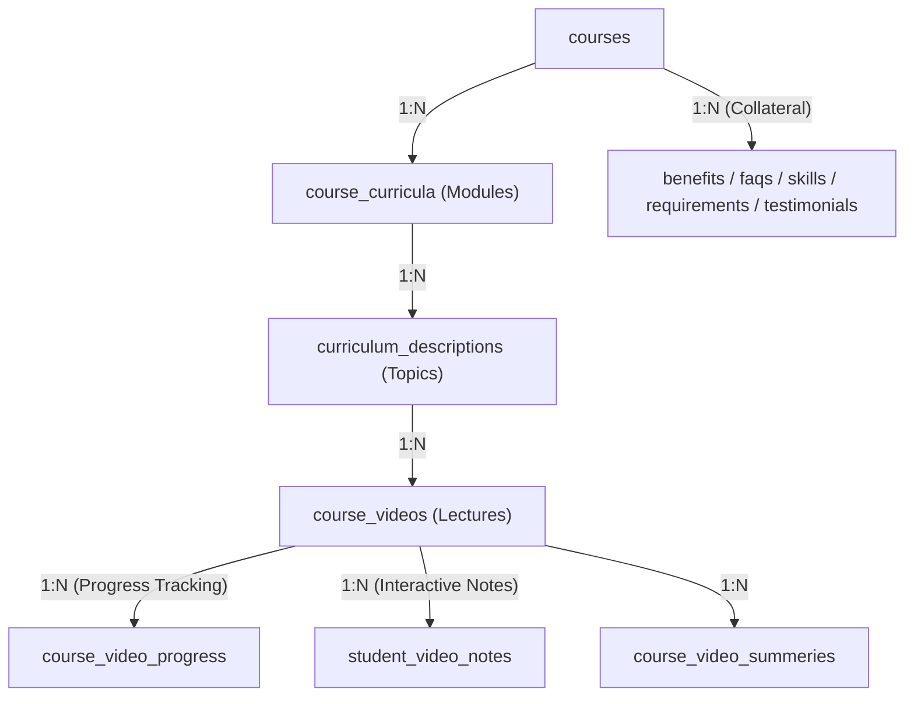

### Table: `courses`
- **Description & Business Semantics:** Master course catalog holding titles, pricing, course types (live/recorded/hybrid), and syllabus assets.
- **Created In Migration:** `database/migrations/2026_09_09_016000_create_courses_table.php`
- **Storage Engine:** InnoDB | **Collation:** `utf8mb4_unicode_ci`

#### Detailed Column Specifications
| Column Name | Data Type & Length | Nullable | Default Value | Constraints & Blueprint Definition |
| :--- | :--- | :---: | :---: | :--- |
| `id` | `BIGINT UNSIGNED (PK, AI)` | `NO` | `-` | `$table-&gt;id()` |
| `course_code` | `STRING` | `YES` | `-` | `$table-&gt;string(&#039;course_code&#039;)-&gt;nullable()` |
| `syllabus_pdf` | `STRING` | `YES` | `-` | `$table-&gt;string(&#039;syllabus_pdf&#039;)-&gt;nullable()` |
| `release_date` | `STRING` | `YES` | `-` | `$table-&gt;string(&#039;release_date&#039;)-&gt;nullable()` |
| `image` | `STRING` | `YES` | `-` | `$table-&gt;string(&#039;image&#039;)-&gt;nullable()` |
| `course_pdf` | `STRING` | `YES` | `-` | `$table-&gt;string(&#039;course_pdf&#039;)-&gt;nullable()` |
| `slug` | `STRING` | `NO` | `-` | `$table-&gt;string(&#039;slug&#039;)` |
| `title` | `STRING` | `NO` | `-` | `$table-&gt;string(&#039;title&#039;)` |
| `sub_description` | `TEXT` | `YES` | `-` | `$table-&gt;text(&#039;sub_description&#039;)-&gt;nullable()` |
| `with_certificate` | `INTEGER` | `NO` | `0` | `$table-&gt;integer(&#039;with_certificate&#039;)-&gt;default(0)` |
| `recorded_content` | `INTEGER` | `NO` | `0` | `$table-&gt;integer(&#039;recorded_content&#039;)-&gt;default(0)` |
| `language` | `STRING` | `YES` | `-` | `$table-&gt;string(&#039;language&#039;)-&gt;nullable()` |
| `cour_language` | `STRING` | `YES` | `-` | `$table-&gt;string(&#039;cour_language&#039;)-&gt;nullable()` |
| `categories` | `TEXT` | `YES` | `-` | `$table-&gt;text(&#039;categories&#039;)-&gt;nullable()` |
| `about_course` | `LONGTEXT` | `YES` | `-` | `$table-&gt;longText(&#039;about_course&#039;)-&gt;nullable()` |
| `mrp_price` | `STRING` | `NO` | `-` | `$table-&gt;string(&#039;mrp_price&#039;)` |
| `buy_price` | `STRING` | `NO` | `-` | `$table-&gt;string(&#039;buy_price&#039;)` |
| `single_student_price` | `STRING` | `NO` | `-` | `$table-&gt;string(&#039;single_student_price&#039;)` |
| `group_student_price` | `STRING` | `NO` | `-` | `$table-&gt;string(&#039;group_student_price&#039;)` |
| `offer_price` | `STRING` | `NO` | `-` | `$table-&gt;string(&#039;offer_price&#039;)` |
| `course_type` | `STRING` | `NO` | `-` | `$table-&gt;string(&#039;course_type&#039;)` |
| `combo_course_type` | `STRING` | `YES` | `-` | `$table-&gt;string(&#039;combo_course_type&#039;)-&gt;nullable()` |
| `status` | `BOOLEAN` | `NO` | `1` | `$table-&gt;boolean(&#039;status&#039;)-&gt;default(1)` |
| `duration` | `STRING` | `YES` | `-` | `$table-&gt;string(&#039;duration&#039;)-&gt;nullable()` |
| `end_card_title` | `STRING` | `YES` | `-` | `$table-&gt;string(&#039;end_card_title&#039;)-&gt;nullable()` |
| `end_card_description` | `TEXT` | `YES` | `-` | `$table-&gt;text(&#039;end_card_description&#039;)-&gt;nullable()` |
| `live_course_type` | `STRING` | `YES` | `-` | `$table-&gt;string(&#039;live_course_type&#039;)-&gt;nullable()` |
| `split_count` | `INTEGER` | `YES` | `-` | `$table-&gt;integer(&#039;split_count&#039;)-&gt;nullable()` |
| `combo_type` | `STRING` | `YES` | `-` | `$table-&gt;string(&#039;combo_type&#039;)-&gt;nullable()` |
| `learning_title` | `STRING` | `YES` | `-` | `$table-&gt;string(&#039;learning_title&#039;)-&gt;nullable()` |
| `learning_description` | `TEXT` | `YES` | `-` | `$table-&gt;text(&#039;learning_description&#039;)-&gt;nullable()` |
| `why_us_title` | `STRING` | `YES` | `-` | `$table-&gt;string(&#039;why_us_title&#039;)-&gt;nullable()` |
| `why_us_description` | `TEXT` | `YES` | `-` | `$table-&gt;text(&#039;why_us_description&#039;)-&gt;nullable()` |
| `why_us_heading_1` | `STRING` | `YES` | `-` | `$table-&gt;string(&#039;why_us_heading_1&#039;)-&gt;nullable()` |
| `why_us_desc_1` | `TEXT` | `YES` | `-` | `$table-&gt;text(&#039;why_us_desc_1&#039;)-&gt;nullable()` |
| `why_us_heading_2` | `STRING` | `YES` | `-` | `$table-&gt;string(&#039;why_us_heading_2&#039;)-&gt;nullable()` |
| `why_us_desc_2` | `TEXT` | `YES` | `-` | `$table-&gt;text(&#039;why_us_desc_2&#039;)-&gt;nullable()` |
| `why_us_heading_3` | `STRING` | `YES` | `-` | `$table-&gt;string(&#039;why_us_heading_3&#039;)-&gt;nullable()` |
| `why_us_desc_3` | `TEXT` | `YES` | `-` | `$table-&gt;text(&#039;why_us_desc_3&#039;)-&gt;nullable()` |
| `why_us_heading_4` | `STRING` | `YES` | `-` | `$table-&gt;string(&#039;why_us_heading_4&#039;)-&gt;nullable()` |
| `why_us_desc_4` | `TEXT` | `YES` | `-` | `$table-&gt;text(&#039;why_us_desc_4&#039;)-&gt;nullable()` |
| `skills_title` | `STRING` | `YES` | `-` | `$table-&gt;string(&#039;skills_title&#039;)-&gt;nullable()` |
| `skills_description` | `TEXT` | `YES` | `-` | `$table-&gt;text(&#039;skills_description&#039;)-&gt;nullable()` |
| `created_at, updated_at` | `TIMESTAMP` | `YES` | `-` | `$table-&gt;timestamps()` |

---

### Table: `course_curricula`
- **Description & Business Semantics:** Level 1 curriculum modules organizing the subject matter.
- **Created In Migration:** `database/migrations/2026_09_09_029000_create_course_curricula_table.php`
- **Storage Engine:** InnoDB | **Collation:** `utf8mb4_unicode_ci`

#### Detailed Column Specifications
| Column Name | Data Type & Length | Nullable | Default Value | Constraints & Blueprint Definition |
| :--- | :--- | :---: | :---: | :--- |
| `id` | `BIGINT UNSIGNED (PK, AI)` | `NO` | `-` | `$table-&gt;id()` |
| `course_id` | `FOREIGNID` | `NO` | `-` | `$table-&gt;foreignId(&#039;course_id&#039;)` |
| `title` | `STRING` | `NO` | `-` | `$table-&gt;string(&#039;title&#039;)` |
| `description` | `STRING` | `YES` | `-` | `$table-&gt;string(&#039;description&#039;)-&gt;nullable()` |
| `created_at, updated_at` | `TIMESTAMP` | `YES` | `-` | `$table-&gt;timestamps()` |

---

### Table: `curriculum_descriptions`
- **Description & Business Semantics:** Level 2 curriculum topics and chapters within modules.
- **Created In Migration:** `database/migrations/2026_09_09_030000_create_curriculum_descriptions_table.php`
- **Storage Engine:** InnoDB | **Collation:** `utf8mb4_unicode_ci`

#### Detailed Column Specifications
| Column Name | Data Type & Length | Nullable | Default Value | Constraints & Blueprint Definition |
| :--- | :--- | :---: | :---: | :--- |
| `id` | `BIGINT UNSIGNED (PK, AI)` | `NO` | `-` | `$table-&gt;id()` |
| `course_curriculum_id` | `FOREIGNID` | `NO` | `-` | `$table-&gt;foreignId(&#039;course_curriculum_id&#039;)` |
| `description` | `TEXT` | `NO` | `-` | `$table-&gt;text(&#039;description&#039;)` |
| `created_at, updated_at` | `TIMESTAMP` | `YES` | `-` | `$table-&gt;timestamps()` |

---

### Table: `course_videos`
- **Description & Business Semantics:** Level 3 video lecture entities containing video URLs, duration in seconds, and free preview flags.
- **Created In Migration:** `database/migrations/2026_09_09_038000_create_course_videos_table.php`
- **Storage Engine:** InnoDB | **Collation:** `utf8mb4_unicode_ci`

#### Detailed Column Specifications
| Column Name | Data Type & Length | Nullable | Default Value | Constraints & Blueprint Definition |
| :--- | :--- | :---: | :---: | :--- |
| `id` | `BIGINT UNSIGNED (PK, AI)` | `NO` | `-` | `$table-&gt;id()` |
| `course_id` | `FOREIGNID` | `NO` | `-` | `$table-&gt;foreignId(&#039;course_id&#039;)` |
| `title` | `STRING` | `NO` | `-` | `$table-&gt;string(&#039;title&#039;, 200)` |
| `video` | `TEXT` | `NO` | `-` | `$table-&gt;text(&#039;video&#039;)` |
| `subtitle_en` | `STRING` | `YES` | `-` | `$table-&gt;string(&#039;subtitle_en&#039;)-&gt;nullable()` |
| `subtitle_ta` | `STRING` | `YES` | `-` | `$table-&gt;string(&#039;subtitle_ta&#039;)-&gt;nullable()` |
| `script` | `LONGTEXT` | `YES` | `-` | `$table-&gt;longText(&#039;script&#039;)-&gt;nullable()` |
| `created_at, updated_at` | `TIMESTAMP` | `YES` | `-` | `$table-&gt;timestamps()` |

---

### Table: `course_video_progress`
- **Description & Business Semantics:** Student video playback telemetry tracking watched seconds and completion milestones.
- **Created In Migration:** `database/migrations/2026_09_09_040000_create_course_video_progress_table.php`
- **Storage Engine:** InnoDB | **Collation:** `utf8mb4_unicode_ci`

#### Detailed Column Specifications
| Column Name | Data Type & Length | Nullable | Default Value | Constraints & Blueprint Definition |
| :--- | :--- | :---: | :---: | :--- |
| `id` | `BIGINT UNSIGNED (PK, AI)` | `NO` | `-` | `$table-&gt;id()` |
| `auth_id` | `FOREIGNID` | `NO` | `-` | `$table-&gt;foreignId(&#039;auth_id&#039;)` |
| `course_video_id` | `FOREIGNID` | `NO` | `-` | `$table-&gt;foreignId(&#039;course_video_id&#039;)` |
| `last_position` | `STRING` | `NO` | `0` | `$table-&gt;string(&#039;last_position&#039;)-&gt;default(0)` |
| `is_completed` | `BOOLEAN` | `NO` | `0` | `$table-&gt;boolean(&#039;is_completed&#039;)-&gt;default(0)` |
| `created_at, updated_at` | `TIMESTAMP` | `YES` | `-` | `$table-&gt;timestamps()` |

---

### Table: `student_video_notes`
- **Description & Business Semantics:** Timestamped bookmark notes taken by students while watching video lectures.
- **Created In Migration:** `database/migrations/2026_10_06_124938_create_student_video_notes_table.php`
- **Storage Engine:** InnoDB | **Collation:** `utf8mb4_unicode_ci`

#### Detailed Column Specifications
| Column Name | Data Type & Length | Nullable | Default Value | Constraints & Blueprint Definition |
| :--- | :--- | :---: | :---: | :--- |
| `id` | `BIGINT UNSIGNED (PK, AI)` | `NO` | `-` | `$table-&gt;id()` |
| `student_id` | `FOREIGNID` | `NO` | `-` | `$table-&gt;foreignId(&#039;student_id&#039;)-&gt;constrained(&#039;users&#039;)-&gt;onDelete(&#039;cascade&#039;)` |
| `batch_topic_log_id` | `FOREIGNID` | `NO` | `-` | `$table-&gt;foreignId(&#039;batch_topic_log_id&#039;)-&gt;constrained(&#039;batch_topic_logs&#039;)-&gt;onDelete(&#039;cascade&#039;)` |
| `title` | `STRING` | `YES` | `-` | `$table-&gt;string(&#039;title&#039;)-&gt;nullable()` |
| `content` | `TEXT` | `NO` | `-` | `$table-&gt;text(&#039;content&#039;)` |
| `created_at, updated_at` | `TIMESTAMP` | `YES` | `-` | `$table-&gt;timestamps()` |

---

### Table: `course_video_summeries`
- **Description & Business Semantics:** Structured summary notes and cheat sheets for lecture videos.
- **Created In Migration:** `database/migrations/2026_09_09_041000_create_course_video_summeries_table.php`
- **Storage Engine:** InnoDB | **Collation:** `utf8mb4_unicode_ci`

#### Detailed Column Specifications
| Column Name | Data Type & Length | Nullable | Default Value | Constraints & Blueprint Definition |
| :--- | :--- | :---: | :---: | :--- |
| `id` | `BIGINT UNSIGNED (PK, AI)` | `NO` | `-` | `$table-&gt;id()` |
| `course_video_id` | `FOREIGNID` | `NO` | `-` | `$table-&gt;foreignId(&#039;course_video_id&#039;)` |
| `summary` | `TEXT` | `NO` | `-` | `$table-&gt;text(&#039;summary&#039;)` |
| `created_at, updated_at` | `TIMESTAMP` | `YES` | `-` | `$table-&gt;timestamps()` |

---

### Table: `course_combos`
- **Description & Business Semantics:** Special bundled course packages sold together.
- **Created In Migration:** `database/migrations/2026_09_09_028000_create_course_combos_table.php`
- **Storage Engine:** InnoDB | **Collation:** `utf8mb4_unicode_ci`

#### Detailed Column Specifications
| Column Name | Data Type & Length | Nullable | Default Value | Constraints & Blueprint Definition |
| :--- | :--- | :---: | :---: | :--- |
| `id` | `BIGINT UNSIGNED (PK, AI)` | `NO` | `-` | `$table-&gt;id()` |
| `course_id` | `FOREIGNID` | `NO` | `-` | `$table-&gt;foreignId(&#039;course_id&#039;)` |
| `class_id` | `FOREIGNID` | `NO` | `-` | `$table-&gt;foreignId(&#039;class_id&#039;)` |
| `created_at, updated_at` | `TIMESTAMP` | `YES` | `-` | `$table-&gt;timestamps()` |

---

### Table: `course_benefits`
- **Description & Business Semantics:** Highlight points and key benefits of enrolling in the course.
- **Created In Migration:** `database/migrations/2026_09_09_027000_create_course_benefits_table.php`
- **Storage Engine:** InnoDB | **Collation:** `utf8mb4_unicode_ci`

#### Detailed Column Specifications
| Column Name | Data Type & Length | Nullable | Default Value | Constraints & Blueprint Definition |
| :--- | :--- | :---: | :---: | :--- |
| `id` | `BIGINT UNSIGNED (PK, AI)` | `NO` | `-` | `$table-&gt;id()` |
| `course_id` | `FOREIGNID` | `NO` | `-` | `$table-&gt;foreignId(&#039;course_id&#039;)` |
| `description` | `TEXT` | `NO` | `-` | `$table-&gt;text(&#039;description&#039;)` |
| `created_at, updated_at` | `TIMESTAMP` | `YES` | `-` | `$table-&gt;timestamps()` |

---

### Table: `course_faqs`
- **Description & Business Semantics:** Frequently asked questions and answers for course detail pages.
- **Created In Migration:** `database/migrations/2026_09_09_031000_create_course_faqs_table.php`
- **Storage Engine:** InnoDB | **Collation:** `utf8mb4_unicode_ci`

#### Detailed Column Specifications
| Column Name | Data Type & Length | Nullable | Default Value | Constraints & Blueprint Definition |
| :--- | :--- | :---: | :---: | :--- |
| `id` | `BIGINT UNSIGNED (PK, AI)` | `NO` | `-` | `$table-&gt;id()` |
| `course_id` | `FOREIGNID` | `NO` | `-` | `$table-&gt;foreignId(&#039;course_id&#039;)` |
| `question` | `TEXT` | `NO` | `-` | `$table-&gt;text(&#039;question&#039;)` |
| `answer` | `TEXT` | `NO` | `-` | `$table-&gt;text(&#039;answer&#039;)` |
| `created_at, updated_at` | `TIMESTAMP` | `YES` | `-` | `$table-&gt;timestamps()` |

---

### Table: `course_leans`
- **Description & Business Semantics:** Key learning outcomes and takeaways acquired from the course.
- **Created In Migration:** `database/migrations/2026_09_09_032000_create_course_leans_table.php`
- **Storage Engine:** InnoDB | **Collation:** `utf8mb4_unicode_ci`

#### Detailed Column Specifications
| Column Name | Data Type & Length | Nullable | Default Value | Constraints & Blueprint Definition |
| :--- | :--- | :---: | :---: | :--- |
| `id` | `BIGINT UNSIGNED (PK, AI)` | `NO` | `-` | `$table-&gt;id()` |
| `course_id` | `FOREIGNID` | `NO` | `-` | `$table-&gt;foreignId(&#039;course_id&#039;)` |
| `title` | `STRING` | `NO` | `-` | `$table-&gt;string(&#039;title&#039;, 200)` |
| `description` | `TEXT` | `NO` | `-` | `$table-&gt;text(&#039;description&#039;)` |
| `created_at, updated_at` | `TIMESTAMP` | `YES` | `-` | `$table-&gt;timestamps()` |

---

### Table: `course_practices`
- **Description & Business Semantics:** Practical hands-on lab exercises and software tools taught.
- **Created In Migration:** `database/migrations/2026_09_09_033000_create_course_practices_table.php`
- **Storage Engine:** InnoDB | **Collation:** `utf8mb4_unicode_ci`

#### Detailed Column Specifications
| Column Name | Data Type & Length | Nullable | Default Value | Constraints & Blueprint Definition |
| :--- | :--- | :---: | :---: | :--- |
| `id` | `BIGINT UNSIGNED (PK, AI)` | `NO` | `-` | `$table-&gt;id()` |
| `main_title` | `STRING` | `NO` | `-` | `$table-&gt;string(&#039;main_title&#039;)` |
| `language` | `STRING` | `YES` | `-` | `$table-&gt;string(&#039;language&#039;)-&gt;nullable()` |
| `level` | `STRING` | `YES` | `-` | `$table-&gt;string(&#039;level&#039;)-&gt;nullable()` |
| `question` | `TEXT` | `NO` | `-` | `$table-&gt;text(&#039;question&#039;)` |
| `input` | `TEXT` | `YES` | `-` | `$table-&gt;text(&#039;input&#039;)-&gt;nullable()` |
| `actual_output` | `TEXT` | `YES` | `-` | `$table-&gt;text(&#039;actual_output&#039;)-&gt;nullable()` |
| `status` | `INTEGER` | `NO` | `1` | `$table-&gt;integer(&#039;status&#039;)-&gt;default(1)` |
| `created_at, updated_at` | `TIMESTAMP` | `YES` | `-` | `$table-&gt;timestamps()` |

---

### Table: `course_requirements`
- **Description & Business Semantics:** Prerequisites and required skills prior to course enrollment.
- **Created In Migration:** `database/migrations/2026_09_09_034000_create_course_requirements_table.php`
- **Storage Engine:** InnoDB | **Collation:** `utf8mb4_unicode_ci`

#### Detailed Column Specifications
| Column Name | Data Type & Length | Nullable | Default Value | Constraints & Blueprint Definition |
| :--- | :--- | :---: | :---: | :--- |
| `id` | `BIGINT UNSIGNED (PK, AI)` | `NO` | `-` | `$table-&gt;id()` |
| `course_id` | `FOREIGNID` | `NO` | `-` | `$table-&gt;foreignId(&#039;course_id&#039;)` |
| `description` | `STRING` | `NO` | `-` | `$table-&gt;string(&#039;description&#039;, 200)` |
| `created_at, updated_at` | `TIMESTAMP` | `YES` | `-` | `$table-&gt;timestamps()` |

---

### Table: `course_skills`
- **Description & Business Semantics:** Specific technical and soft skills gained by completing the course.
- **Created In Migration:** `database/migrations/2026_09_09_035000_create_course_skills_table.php`
- **Storage Engine:** InnoDB | **Collation:** `utf8mb4_unicode_ci`

#### Detailed Column Specifications
| Column Name | Data Type & Length | Nullable | Default Value | Constraints & Blueprint Definition |
| :--- | :--- | :---: | :---: | :--- |
| `id` | `BIGINT UNSIGNED (PK, AI)` | `NO` | `-` | `$table-&gt;id()` |
| `course_id` | `FOREIGNID` | `NO` | `-` | `$table-&gt;foreignId(&#039;course_id&#039;)` |
| `name` | `STRING` | `YES` | `-` | `$table-&gt;string(&#039;name&#039;)-&gt;nullable()` |
| `created_at, updated_at` | `TIMESTAMP` | `YES` | `-` | `$table-&gt;timestamps()` |

---

### Table: `course_testimonials`
- **Description & Business Semantics:** Student reviews, testimonials, ratings, and social proof.
- **Created In Migration:** `database/migrations/2026_09_09_036000_create_course_testimonials_table.php`
- **Storage Engine:** InnoDB | **Collation:** `utf8mb4_unicode_ci`

#### Detailed Column Specifications
| Column Name | Data Type & Length | Nullable | Default Value | Constraints & Blueprint Definition |
| :--- | :--- | :---: | :---: | :--- |
| `id` | `BIGINT UNSIGNED (PK, AI)` | `NO` | `-` | `$table-&gt;id()` |
| `course_id` | `FOREIGNID` | `NO` | `-` | `$table-&gt;foreignId(&#039;course_id&#039;)` |
| `name` | `STRING` | `NO` | `-` | `$table-&gt;string(&#039;name&#039;)` |
| `image` | `STRING` | `YES` | `-` | `$table-&gt;string(&#039;image&#039;)-&gt;nullable()` |
| `content` | `TEXT` | `NO` | `-` | `$table-&gt;text(&#039;content&#039;)` |
| `rating` | `STRING` | `YES` | `-` | `$table-&gt;string(&#039;rating&#039;)-&gt;nullable()` |
| `created_at, updated_at` | `TIMESTAMP` | `YES` | `-` | `$table-&gt;timestamps()` |

---

### Table: `course_users`
- **Description & Business Semantics:** Direct user-course access and enrollment associations.
- **Created In Migration:** `database/migrations/2026_09_09_037000_create_course_users_table.php`
- **Storage Engine:** InnoDB | **Collation:** `utf8mb4_unicode_ci`

#### Detailed Column Specifications
| Column Name | Data Type & Length | Nullable | Default Value | Constraints & Blueprint Definition |
| :--- | :--- | :---: | :---: | :--- |
| `id` | `BIGINT UNSIGNED (PK, AI)` | `NO` | `-` | `$table-&gt;id()` |
| `auth_id` | `FOREIGNID` | `NO` | `-` | `$table-&gt;foreignId(&#039;auth_id&#039;)` |
| `course_id` | `FOREIGNID` | `NO` | `-` | `$table-&gt;foreignId(&#039;course_id&#039;)` |
| `batch_id` | `FOREIGNID` | `YES` | `-` | `$table-&gt;foreignId(&#039;batch_id&#039;)-&gt;nullable()` |
| `status` | `STRING` | `NO` | `ongoing` | `$table-&gt;string(&#039;status&#039;)-&gt;default(&#039;ongoing&#039;)` |
| `completed_at` | `STRING` | `YES` | `-` | `$table-&gt;string(&#039;completed_at&#039;)-&gt;nullable()` |
| `created_at, updated_at` | `TIMESTAMP` | `YES` | `-` | `$table-&gt;timestamps()` |

---

## Domain 4: Batch Cohorts, Live Schedules & Attendance

> **Domain Summary:** Executes cohort-based live education, instructor assignments, day-to-day session syllabus coverage logging, student attendance, and 1-on-1 mentor booking sessions.


### Domain 4 Architectural Flowchart (Cohort & Attendance)
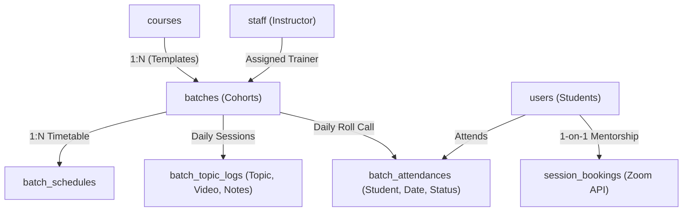

### Table: `batches`
- **Description & Business Semantics:** Cohort batches with scheduled dates, times, instructor mapping, capacity limits, and video conference links.
- **Created In Migration:** `database/migrations/2026_09_09_017000_create_batches_table.php`
- **Storage Engine:** InnoDB | **Collation:** `utf8mb4_unicode_ci`

#### Detailed Column Specifications
| Column Name | Data Type & Length | Nullable | Default Value | Constraints & Blueprint Definition |
| :--- | :--- | :---: | :---: | :--- |
| `id` | `BIGINT UNSIGNED (PK, AI)` | `NO` | `-` | `$table-&gt;id()` |
| `course_id` | `FOREIGNID` | `NO` | `-` | `$table-&gt;foreignId(&#039;course_id&#039;)` |
| `batch_name` | `STRING` | `NO` | `-` | `$table-&gt;string(&#039;batch_name&#039;)` |
| `batch_code` | `STRING` | `NO` | `-` | `$table-&gt;string(&#039;batch_code&#039;)` |
| `batch_type` | `STRING` | `NO` | `Weekday` | `$table-&gt;string(&#039;batch_type&#039;)-&gt;default(&#039;Weekday&#039;)` |
| `batch_track` | `STRING` | `NO` | `Normal` | `$table-&gt;string(&#039;batch_track&#039;)-&gt;default(&#039;Normal&#039;)` |
| `instructor_id` | `FOREIGNID` | `YES` | `-` | `$table-&gt;foreignId(&#039;instructor_id&#039;)-&gt;nullable()` |
| `start_date` | `STRING` | `NO` | `-` | `$table-&gt;string(&#039;start_date&#039;)` |
| `end_date` | `STRING` | `YES` | `-` | `$table-&gt;string(&#039;end_date&#039;)-&gt;nullable()` |
| `batch_from_time` | `STRING` | `NO` | `-` | `$table-&gt;string(&#039;batch_from_time&#039;)` |
| `batch_to_time` | `STRING` | `NO` | `-` | `$table-&gt;string(&#039;batch_to_time&#039;)` |
| `class_duration` | `STRING` | `YES` | `-` | `$table-&gt;string(&#039;class_duration&#039;)-&gt;nullable()` |
| `join_deadline` | `STRING` | `YES` | `-` | `$table-&gt;string(&#039;join_deadline&#039;)-&gt;nullable()` |
| `joined_student_count` | `INTEGER` | `NO` | `0` | `$table-&gt;integer(&#039;joined_student_count&#039;)-&gt;default(0)` |
| `meeting_link` | `STRING` | `YES` | `-` | `$table-&gt;string(&#039;meeting_link&#039;)-&gt;nullable()` |
| `max_students` | `INTEGER` | `NO` | `50` | `$table-&gt;integer(&#039;max_students&#039;)-&gt;default(50)` |
| `status` | `STRING` | `NO` | `pending` | `$table-&gt;string(&#039;status&#039;)-&gt;default(&#039;pending&#039;)` |
| `created_at, updated_at` | `TIMESTAMP` | `YES` | `-` | `$table-&gt;timestamps()` |
| `batch_status` | `STRING` | `NO` | `Running` | `$table-&gt;string(&#039;batch_status&#039;)-&gt;default(&#039;Running&#039;)-&gt;after(&#039;status&#039;); /* Altered in 2026_10_02_125128_add_batch_status_to_batches_table.php */` |

---

### Table: `batch_schedules`
- **Description & Business Semantics:** Recurring weekly timetable slots for batches.
- **Created In Migration:** `database/migrations/2026_09_09_023000_create_batch_schedules_table.php`
- **Storage Engine:** InnoDB | **Collation:** `utf8mb4_unicode_ci`

#### Detailed Column Specifications
| Column Name | Data Type & Length | Nullable | Default Value | Constraints & Blueprint Definition |
| :--- | :--- | :---: | :---: | :--- |
| `id` | `BIGINT UNSIGNED (PK, AI)` | `NO` | `-` | `$table-&gt;id()` |
| `batch_id` | `FOREIGNID` | `NO` | `-` | `$table-&gt;foreignId(&#039;batch_id&#039;)` |
| `date` | `STRING` | `NO` | `-` | `$table-&gt;string(&#039;date&#039;)` |
| `start_time` | `STRING` | `NO` | `-` | `$table-&gt;string(&#039;start_time&#039;)` |
| `end_time` | `STRING` | `NO` | `-` | `$table-&gt;string(&#039;end_time&#039;)` |
| `meeting_link` | `TEXT` | `YES` | `-` | `$table-&gt;text(&#039;meeting_link&#039;)-&gt;nullable()` |
| `zoom_meeting_id` | `STRING` | `YES` | `-` | `$table-&gt;string(&#039;zoom_meeting_id&#039;)-&gt;nullable()` |
| `created_at, updated_at` | `TIMESTAMP` | `YES` | `-` | `$table-&gt;timestamps()` |

---

### Table: `batch_topic_logs`
- **Description & Business Semantics:** Daily classroom teaching log recording topics covered, session recording links, class notes, and dates.
- **Created In Migration:** `database/migrations/2026_10_02_171023_create_batch_topic_logs_table.php`
- **Storage Engine:** InnoDB | **Collation:** `utf8mb4_unicode_ci`

#### Detailed Column Specifications
| Column Name | Data Type & Length | Nullable | Default Value | Constraints & Blueprint Definition |
| :--- | :--- | :---: | :---: | :--- |
| `id` | `BIGINT UNSIGNED (PK, AI)` | `NO` | `-` | `$table-&gt;id()` |
| `batch_id` | `UNSIGNEDBIGINTEGER` | `NO` | `-` | `$table-&gt;unsignedBigInteger(&#039;batch_id&#039;)` |
| `batch_schedule_id` | `UNSIGNEDBIGINTEGER` | `YES` | `-` | `$table-&gt;unsignedBigInteger(&#039;batch_schedule_id&#039;)-&gt;nullable()` |
| `course_curriculum_id` | `UNSIGNEDBIGINTEGER` | `NO` | `-` | `$table-&gt;unsignedBigInteger(&#039;course_curriculum_id&#039;)` |
| `description` | `TEXT` | `YES` | `-` | `$table-&gt;text(&#039;description&#039;)-&gt;nullable()` |
| `is_completed` | `BOOLEAN` | `NO` | `false` | `$table-&gt;boolean(&#039;is_completed&#039;)-&gt;default(false)` |
| `created_at, updated_at` | `TIMESTAMP` | `YES` | `-` | `$table-&gt;timestamps()` |
| `status` | `STRING` | `YES` | `Pending` | `$table-&gt;string(&#039;status&#039;)-&gt;nullable()-&gt;default(&#039;Pending&#039;)-&gt;after(&#039;is_completed&#039;); /* Altered in 2026_10_03_154515_add_status_to_batch_topic_logs_table.php */` |
| `date` | `DATE` | `YES` | `-` | `$table-&gt;date(&#039;date&#039;)-&gt;nullable()-&gt;after(&#039;status&#039;); /* Altered in 2026_10_03_164318_add_date_to_batch_topic_logs_table.php */` |
| `video` | `STRING` | `YES` | `-` | `$table-&gt;string(&#039;video&#039;)-&gt;nullable(); /* Altered in 2026_10_06_103750_add_video_and_note_to_batch_topic_logs_table.php */` |
| `note` | `TEXT` | `YES` | `-` | `$table-&gt;text(&#039;note&#039;)-&gt;nullable(); /* Altered in 2026_10_06_103750_add_video_and_note_to_batch_topic_logs_table.php */` |

---

### Table: `batch_attendances`
- **Description & Business Semantics:** Daily attendance registry recording student presence, absence, or tardiness per cohort session.
- **Created In Migration:** `database/migrations/2026_10_11_223000_create_batch_attendances_table.php`
- **Storage Engine:** InnoDB | **Collation:** `utf8mb4_unicode_ci`

#### Detailed Column Specifications
| Column Name | Data Type & Length | Nullable | Default Value | Constraints & Blueprint Definition |
| :--- | :--- | :---: | :---: | :--- |
| `id` | `BIGINT UNSIGNED (PK, AI)` | `NO` | `-` | `$table-&gt;id()` |
| `batch_id` | `FOREIGNID` | `NO` | `-` | `$table-&gt;foreignId(&#039;batch_id&#039;)-&gt;constrained(&#039;batches&#039;)-&gt;cascadeOnDelete()` |
| `batch_schedule_id` | `FOREIGNID` | `YES` | `-` | `$table-&gt;foreignId(&#039;batch_schedule_id&#039;)-&gt;nullable()-&gt;constrained(&#039;batch_schedules&#039;)-&gt;nullOnDelete()` |
| `student_id` | `FOREIGNID` | `YES` | `-` | `$table-&gt;foreignId(&#039;student_id&#039;)-&gt;nullable()-&gt;constrained(&#039;users&#039;)-&gt;nullOnDelete()` |
| `student_name` | `STRING` | `YES` | `-` | `$table-&gt;string(&#039;student_name&#039;)-&gt;nullable()` |
| `student_email` | `STRING` | `NO` | `-` | `$table-&gt;string(&#039;student_email&#039;)-&gt;index()` |
| `zoom_meeting_id` | `STRING` | `YES` | `-` | `$table-&gt;string(&#039;zoom_meeting_id&#039;)-&gt;nullable()-&gt;index()` |
| `date` | `DATE` | `NO` | `-` | `$table-&gt;date(&#039;date&#039;)-&gt;index()` |
| `meeting_duration_minutes` | `INTEGER` | `NO` | `0` | `$table-&gt;integer(&#039;meeting_duration_minutes&#039;)-&gt;default(0)` |
| `attended_duration_minutes` | `INTEGER` | `NO` | `0` | `$table-&gt;integer(&#039;attended_duration_minutes&#039;)-&gt;default(0)` |
| `attended_duration_seconds` | `INTEGER` | `NO` | `0` | `$table-&gt;integer(&#039;attended_duration_seconds&#039;)-&gt;default(0)` |
| `attendance_percentage` | `DECIMAL` | `NO` | `0.00` | `$table-&gt;decimal(&#039;attendance_percentage&#039;, 5, 2)-&gt;default(0.00)` |
| `status` | `ENUM` | `NO` | `Leave` | `$table-&gt;enum(&#039;status&#039;, [&#039;Present&#039;, &#039;Half Day&#039;, &#039;Leave&#039;])-&gt;default(&#039;Leave&#039;)` |
| `remarks` | `TEXT` | `YES` | `-` | `$table-&gt;text(&#039;remarks&#039;)-&gt;nullable()` |
| `join_time` | `TIMESTAMP` | `YES` | `-` | `$table-&gt;timestamp(&#039;join_time&#039;)-&gt;nullable()` |
| `leave_time` | `TIMESTAMP` | `YES` | `-` | `$table-&gt;timestamp(&#039;leave_time&#039;)-&gt;nullable()` |
| `created_at, updated_at` | `TIMESTAMP` | `YES` | `-` | `$table-&gt;timestamps()` |
| `-` | `Declaration` | `NO` | `-` | `$table-&gt;unique([&#039;batch_id&#039;, &#039;date&#039;, &#039;student_email&#039;], &#039;unique_batch_date_student&#039;)` |

---

### Table: `session_bookings`
- **Description & Business Semantics:** 1-on-1 mentoring and doubt-clearing sessions with Zoom integration.
- **Created In Migration:** `database/migrations/2026_09_09_059000_create_session_bookings_table.php`
- **Storage Engine:** InnoDB | **Collation:** `utf8mb4_unicode_ci`

#### Detailed Column Specifications
| Column Name | Data Type & Length | Nullable | Default Value | Constraints & Blueprint Definition |
| :--- | :--- | :---: | :---: | :--- |
| `id` | `BIGINT UNSIGNED (PK, AI)` | `NO` | `-` | `$table-&gt;id()` |
| `type` | `STRING` | `NO` | `-` | `$table-&gt;string(&#039;type&#039;)` |
| `staff_id` | `FOREIGNID` | `NO` | `-` | `$table-&gt;foreignId(&#039;staff_id&#039;)` |
| `admission_id` | `FOREIGNID` | `YES` | `-` | `$table-&gt;foreignId(&#039;admission_id&#039;)-&gt;nullable()` |
| `date` | `STRING` | `NO` | `-` | `$table-&gt;string(&#039;date&#039;)` |
| `time` | `STRING` | `NO` | `-` | `$table-&gt;string(&#039;time&#039;)` |
| `topic` | `STRING` | `YES` | `-` | `$table-&gt;string(&#039;topic&#039;)-&gt;nullable()` |
| `notes` | `TEXT` | `YES` | `-` | `$table-&gt;text(&#039;notes&#039;)-&gt;nullable()` |
| `status` | `STRING` | `NO` | `-` | `$table-&gt;string(&#039;status&#039;)` |
| `created_at, updated_at` | `TIMESTAMP` | `YES` | `-` | `$table-&gt;timestamps()` |
| `zoom_meeting_id` | `STRING` | `YES` | `-` | `$table-&gt;string(&#039;zoom_meeting_id&#039;)-&gt;nullable()-&gt;after(&#039;status&#039;); /* Altered in 2026_09_23_133255_add_zoom_columns_to_session_bookings_table.php */` |
| `zoom_meet_link` | `TEXT` | `YES` | `-` | `$table-&gt;text(&#039;zoom_meet_link&#039;)-&gt;nullable()-&gt;after(&#039;zoom_meeting_id&#039;); /* Altered in 2026_09_23_133255_add_zoom_columns_to_session_bookings_table.php */` |

---

## Domain 5: Assessments, Rubrics & Grading Engines

> **Domain Summary:** Comprehensive multi-tier assessment engine with quizzes, survey forms, and a standardized 4-tier rubric grading pipeline for assignments, mini-projects, and capstone projects.


### Domain 5 Architectural Flowchart (4-Tier Rubric Assessment Engine)
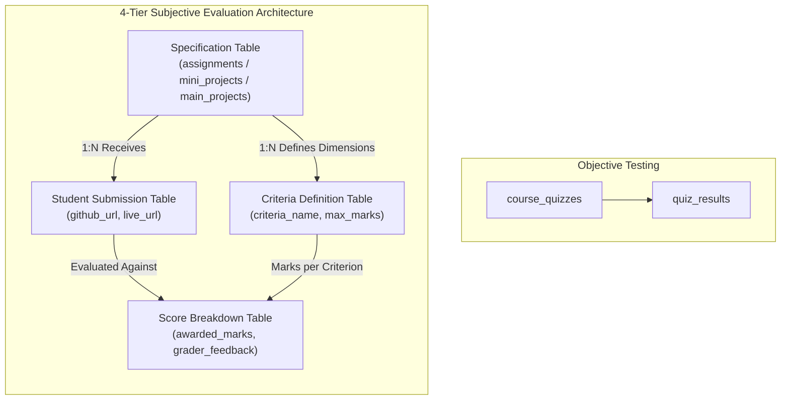

### Table: `course_quizzes`
- **Description & Business Semantics:** Timed objective multiple-choice quizzes linked to courses.
- **Created In Migration:** `database/migrations/2026_09_09_039000_create_course_quizzes_table.php`
- **Storage Engine:** InnoDB | **Collation:** `utf8mb4_unicode_ci`

#### Detailed Column Specifications
| Column Name | Data Type & Length | Nullable | Default Value | Constraints & Blueprint Definition |
| :--- | :--- | :---: | :---: | :--- |
| `id` | `BIGINT UNSIGNED (PK, AI)` | `NO` | `-` | `$table-&gt;id()` |
| `course_video_id` | `FOREIGNID` | `NO` | `-` | `$table-&gt;foreignId(&#039;course_video_id&#039;)` |
| `question` | `TEXT` | `NO` | `-` | `$table-&gt;text(&#039;question&#039;)` |
| `option1` | `STRING` | `NO` | `-` | `$table-&gt;string(&#039;option1&#039;)` |
| `option2` | `STRING` | `NO` | `-` | `$table-&gt;string(&#039;option2&#039;)` |
| `option3` | `STRING` | `YES` | `-` | `$table-&gt;string(&#039;option3&#039;)-&gt;nullable()` |
| `answer` | `STRING` | `NO` | `-` | `$table-&gt;string(&#039;answer&#039;)` |
| `created_at, updated_at` | `TIMESTAMP` | `YES` | `-` | `$table-&gt;timestamps()` |

---

### Table: `quiz_results`
- **Description & Business Semantics:** Student quiz attempts, score percentages, and pass/fail statuses.
- **Created In Migration:** `database/migrations/2026_10_01_133931_create_quiz_results_table.php`
- **Storage Engine:** InnoDB | **Collation:** `utf8mb4_unicode_ci`

#### Detailed Column Specifications
| Column Name | Data Type & Length | Nullable | Default Value | Constraints & Blueprint Definition |
| :--- | :--- | :---: | :---: | :--- |
| `id` | `BIGINT UNSIGNED (PK, AI)` | `NO` | `-` | `$table-&gt;id()` |
| `auth_id` | `UNSIGNEDBIGINTEGER` | `YES` | `-` | `$table-&gt;unsignedBigInteger(&#039;auth_id&#039;)-&gt;nullable(); // Depending on user logic` |
| `course_video_id` | `UNSIGNEDBIGINTEGER` | `NO` | `-` | `$table-&gt;unsignedBigInteger(&#039;course_video_id&#039;)` |
| `total_questions` | `INTEGER` | `NO` | `-` | `$table-&gt;integer(&#039;total_questions&#039;)` |
| `correct_answers` | `INTEGER` | `NO` | `-` | `$table-&gt;integer(&#039;correct_answers&#039;)` |
| `score` | `DECIMAL` | `NO` | `-` | `$table-&gt;decimal(&#039;score&#039;, 8, 2)` |
| `answers` | `JSON` | `NO` | `-` | `$table-&gt;json(&#039;answers&#039;)` |
| `created_at, updated_at` | `TIMESTAMP` | `YES` | `-` | `$table-&gt;timestamps()` |

---

### Table: `course_evaluation_questions`
- **Description & Business Semantics:** Course and mentor evaluation feedback survey questions.
- **Created In Migration:** `database/migrations/2026_10_03_105507_create_course_evaluation_questions_table.php`
- **Storage Engine:** InnoDB | **Collation:** `utf8mb4_unicode_ci`

#### Detailed Column Specifications
| Column Name | Data Type & Length | Nullable | Default Value | Constraints & Blueprint Definition |
| :--- | :--- | :---: | :---: | :--- |
| `id` | `BIGINT UNSIGNED (PK, AI)` | `NO` | `-` | `$table-&gt;id()` |
| `course_id` | `FOREIGNID` | `NO` | `-` | `$table-&gt;foreignId(&#039;course_id&#039;)-&gt;constrained()-&gt;onDelete(&#039;cascade&#039;)` |
| `question` | `TEXT` | `NO` | `-` | `$table-&gt;text(&#039;question&#039;)` |
| `marks` | `INTEGER` | `NO` | `1` | `$table-&gt;integer(&#039;marks&#039;)-&gt;default(1)` |
| `created_at, updated_at` | `TIMESTAMP` | `YES` | `-` | `$table-&gt;timestamps()` |

---

### Table: `course_evaluation_options`
- **Description & Business Semantics:** Multi-choice feedback options for evaluation surveys.
- **Created In Migration:** `database/migrations/2026_10_03_105508_create_course_evaluation_options_table.php`
- **Storage Engine:** InnoDB | **Collation:** `utf8mb4_unicode_ci`

#### Detailed Column Specifications
| Column Name | Data Type & Length | Nullable | Default Value | Constraints & Blueprint Definition |
| :--- | :--- | :---: | :---: | :--- |
| `id` | `BIGINT UNSIGNED (PK, AI)` | `NO` | `-` | `$table-&gt;id()` |
| `course_evaluation_question_id` | `FOREIGNID` | `NO` | `-` | `$table-&gt;foreignId(&#039;course_evaluation_question_id&#039;)-&gt;constrained()-&gt;onDelete(&#039;cascade&#039;)` |
| `option` | `STRING` | `NO` | `-` | `$table-&gt;string(&#039;option&#039;)` |
| `is_correct` | `BOOLEAN` | `NO` | `false` | `$table-&gt;boolean(&#039;is_correct&#039;)-&gt;default(false)` |
| `created_at, updated_at` | `TIMESTAMP` | `YES` | `-` | `$table-&gt;timestamps()` |

---

### Table: `assignments`
- **Description & Business Semantics:** Weekly assignment specifications with descriptions and deadlines.
- **Created In Migration:** `database/migrations/2026_09_09_019000_create_assignments_table.php`
- **Storage Engine:** InnoDB | **Collation:** `utf8mb4_unicode_ci`

#### Detailed Column Specifications
| Column Name | Data Type & Length | Nullable | Default Value | Constraints & Blueprint Definition |
| :--- | :--- | :---: | :---: | :--- |
| `id` | `BIGINT UNSIGNED (PK, AI)` | `NO` | `-` | `$table-&gt;id()` |
| `course_id` | `FOREIGNID` | `NO` | `-` | `$table-&gt;foreignId(&#039;course_id&#039;)` |
| `batch_id` | `FOREIGNID` | `YES` | `-` | `$table-&gt;foreignId(&#039;batch_id&#039;)-&gt;nullable()` |
| `module` | `STRING` | `NO` | `-` | `$table-&gt;string(&#039;module&#039;)` |
| `title` | `STRING` | `NO` | `-` | `$table-&gt;string(&#039;title&#039;)` |
| `description` | `TEXT` | `YES` | `-` | `$table-&gt;text(&#039;description&#039;)-&gt;nullable()` |
| `document` | `STRING` | `YES` | `-` | `$table-&gt;string(&#039;document&#039;)-&gt;nullable()` |
| `due_date` | `STRING` | `YES` | `-` | `$table-&gt;string(&#039;due_date&#039;)-&gt;nullable()` |
| `reveal_date` | `STRING` | `YES` | `-` | `$table-&gt;string(&#039;reveal_date&#039;)-&gt;nullable()` |
| `status` | `STRING` | `NO` | `pending` | `$table-&gt;string(&#039;status&#039;)-&gt;default(&#039;pending&#039;)` |
| `created_at, updated_at` | `TIMESTAMP` | `YES` | `-` | `$table-&gt;timestamps()` |

---

### Table: `assignment_criteria`
- **Description & Business Semantics:** Rubric evaluation criteria defining maximum marks per grading dimension.
- **Created In Migration:** `database/migrations/2026_09_09_020000_create_assignment_criteria_table.php`
- **Storage Engine:** InnoDB | **Collation:** `utf8mb4_unicode_ci`

#### Detailed Column Specifications
| Column Name | Data Type & Length | Nullable | Default Value | Constraints & Blueprint Definition |
| :--- | :--- | :---: | :---: | :--- |
| `id` | `BIGINT UNSIGNED (PK, AI)` | `NO` | `-` | `$table-&gt;id()` |
| `assignment_id` | `FOREIGNID` | `NO` | `-` | `$table-&gt;foreignId(&#039;assignment_id&#039;)` |
| `criterion` | `STRING` | `NO` | `-` | `$table-&gt;string(&#039;criterion&#039;)` |
| `maximum_mark` | `STRING` | `NO` | `-` | `$table-&gt;string(&#039;maximum_mark&#039;)` |
| `created_at, updated_at` | `TIMESTAMP` | `YES` | `-` | `$table-&gt;timestamps()` |

---

### Table: `assignment_submissions`
- **Description & Business Semantics:** Student assignment code/asset submissions and overall scores.
- **Created In Migration:** `database/migrations/2026_09_09_021000_create_assignment_submissions_table.php`
- **Storage Engine:** InnoDB | **Collation:** `utf8mb4_unicode_ci`

#### Detailed Column Specifications
| Column Name | Data Type & Length | Nullable | Default Value | Constraints & Blueprint Definition |
| :--- | :--- | :---: | :---: | :--- |
| `id` | `BIGINT UNSIGNED (PK, AI)` | `NO` | `-` | `$table-&gt;id()` |
| `assignment_id` | `FOREIGNID` | `NO` | `-` | `$table-&gt;foreignId(&#039;assignment_id&#039;)` |
| `user_id` | `FOREIGNID` | `NO` | `-` | `$table-&gt;foreignId(&#039;user_id&#039;)` |
| `status` | `STRING` | `NO` | `uploaded` | `$table-&gt;string(&#039;status&#039;)-&gt;default(&#039;uploaded&#039;)` |
| `file_path` | `STRING` | `YES` | `-` | `$table-&gt;string(&#039;file_path&#039;)-&gt;nullable()` |
| `attempts` | `INTEGER` | `NO` | `1` | `$table-&gt;integer(&#039;attempts&#039;)-&gt;default(1)` |
| `score` | `INTEGER` | `YES` | `-` | `$table-&gt;integer(&#039;score&#039;)-&gt;nullable()` |
| `attempts_history` | `LONGTEXT` | `YES` | `-` | `$table-&gt;longText(&#039;attempts_history&#039;)-&gt;nullable()` |
| `reupload_approved` | `STRING` | `NO` | `0` | `$table-&gt;string(&#039;reupload_approved&#039;)-&gt;default(0)` |
| `grade` | `STRING` | `YES` | `-` | `$table-&gt;string(&#039;grade&#039;)-&gt;nullable()` |
| `feedback` | `TEXT` | `YES` | `-` | `$table-&gt;text(&#039;feedback&#039;)-&gt;nullable()` |
| `evaluated_by` | `FOREIGNID` | `YES` | `-` | `$table-&gt;foreignId(&#039;evaluated_by&#039;)-&gt;nullable()` |
| `created_at, updated_at` | `TIMESTAMP` | `YES` | `-` | `$table-&gt;timestamps()` |

---

### Table: `assignment_score_breakdowns`
- **Description & Business Semantics:** Granular marks awarded and written feedback per assignment rubric criterion.
- **Created In Migration:** `database/migrations/2026_09_09_022000_create_assignment_score_breakdowns_table.php`
- **Storage Engine:** InnoDB | **Collation:** `utf8mb4_unicode_ci`

#### Detailed Column Specifications
| Column Name | Data Type & Length | Nullable | Default Value | Constraints & Blueprint Definition |
| :--- | :--- | :---: | :---: | :--- |
| `id` | `BIGINT UNSIGNED (PK, AI)` | `NO` | `-` | `$table-&gt;id()` |
| `assignment_submission_id` | `FOREIGNID` | `NO` | `-` | `$table-&gt;foreignId(&#039;assignment_submission_id&#039;)` |
| `criterion` | `STRING` | `NO` | `-` | `$table-&gt;string(&#039;criterion&#039;)` |
| `max_score` | `INTEGER` | `NO` | `-` | `$table-&gt;integer(&#039;max_score&#039;)` |
| `obtained_score` | `INTEGER` | `YES` | `-` | `$table-&gt;integer(&#039;obtained_score&#039;)-&gt;nullable()` |
| `created_at, updated_at` | `TIMESTAMP` | `YES` | `-` | `$table-&gt;timestamps()` |

---

### Table: `mini_projects`
- **Description & Business Semantics:** Mid-course practical project specifications.
- **Created In Migration:** `database/migrations/2026_09_09_050000_create_mini_projects_table.php`
- **Storage Engine:** InnoDB | **Collation:** `utf8mb4_unicode_ci`

#### Detailed Column Specifications
| Column Name | Data Type & Length | Nullable | Default Value | Constraints & Blueprint Definition |
| :--- | :--- | :---: | :---: | :--- |
| `id` | `BIGINT UNSIGNED (PK, AI)` | `NO` | `-` | `$table-&gt;id()` |
| `course_id` | `FOREIGNID` | `NO` | `-` | `$table-&gt;foreignId(&#039;course_id&#039;)` |
| `batch_id` | `FOREIGNID` | `YES` | `-` | `$table-&gt;foreignId(&#039;batch_id&#039;)-&gt;nullable()` |
| `module` | `STRING` | `NO` | `-` | `$table-&gt;string(&#039;module&#039;)` |
| `title` | `STRING` | `NO` | `-` | `$table-&gt;string(&#039;title&#039;)` |
| `description` | `TEXT` | `YES` | `-` | `$table-&gt;text(&#039;description&#039;)-&gt;nullable()` |
| `document` | `STRING` | `YES` | `-` | `$table-&gt;string(&#039;document&#039;)-&gt;nullable()` |
| `due_date` | `STRING` | `YES` | `-` | `$table-&gt;string(&#039;due_date&#039;)-&gt;nullable()` |
| `reveal_date` | `STRING` | `YES` | `-` | `$table-&gt;string(&#039;reveal_date&#039;)-&gt;nullable()` |
| `status` | `STRING` | `NO` | `active` | `$table-&gt;string(&#039;status&#039;)-&gt;default(&#039;active&#039;)` |
| `created_at, updated_at` | `TIMESTAMP` | `YES` | `-` | `$table-&gt;timestamps()` |

---

### Table: `mini_project_criteria`
- **Description & Business Semantics:** Rubric evaluation criteria for mini-projects.
- **Created In Migration:** `database/migrations/2026_09_09_051000_create_mini_project_criteria_table.php`
- **Storage Engine:** InnoDB | **Collation:** `utf8mb4_unicode_ci`

#### Detailed Column Specifications
| Column Name | Data Type & Length | Nullable | Default Value | Constraints & Blueprint Definition |
| :--- | :--- | :---: | :---: | :--- |
| `id` | `BIGINT UNSIGNED (PK, AI)` | `NO` | `-` | `$table-&gt;id()` |
| `mini_project_id` | `FOREIGNID` | `NO` | `-` | `$table-&gt;foreignId(&#039;mini_project_id&#039;)` |
| `criterion` | `STRING` | `NO` | `-` | `$table-&gt;string(&#039;criterion&#039;)` |
| `maximum_mark` | `STRING` | `NO` | `-` | `$table-&gt;string(&#039;maximum_mark&#039;)` |
| `created_at, updated_at` | `TIMESTAMP` | `YES` | `-` | `$table-&gt;timestamps()` |

---

### Table: `mini_project_submissions`
- **Description & Business Semantics:** Student project submissions containing GitHub repositories and live URLs.
- **Created In Migration:** `database/migrations/2026_09_09_052000_create_mini_project_submissions_table.php`
- **Storage Engine:** InnoDB | **Collation:** `utf8mb4_unicode_ci`

#### Detailed Column Specifications
| Column Name | Data Type & Length | Nullable | Default Value | Constraints & Blueprint Definition |
| :--- | :--- | :---: | :---: | :--- |
| `id` | `BIGINT UNSIGNED (PK, AI)` | `NO` | `-` | `$table-&gt;id()` |
| `mini_project_id` | `FOREIGNID` | `NO` | `-` | `$table-&gt;foreignId(&#039;mini_project_id&#039;)` |
| `user_id` | `FOREIGNID` | `NO` | `-` | `$table-&gt;foreignId(&#039;user_id&#039;)` |
| `status` | `STRING` | `NO` | `uploaded` | `$table-&gt;string(&#039;status&#039;)-&gt;default(&#039;uploaded&#039;)` |
| `file_path` | `STRING` | `YES` | `-` | `$table-&gt;string(&#039;file_path&#039;)-&gt;nullable()` |
| `attempts` | `INTEGER` | `NO` | `1` | `$table-&gt;integer(&#039;attempts&#039;)-&gt;default(1)` |
| `score` | `INTEGER` | `YES` | `-` | `$table-&gt;integer(&#039;score&#039;)-&gt;nullable()` |
| `attempts_history` | `LONGTEXT` | `YES` | `-` | `$table-&gt;longText(&#039;attempts_history&#039;)-&gt;nullable()` |
| `reupload_approved` | `STRING` | `NO` | `0` | `$table-&gt;string(&#039;reupload_approved&#039;)-&gt;default(0)` |
| `grade` | `STRING` | `YES` | `-` | `$table-&gt;string(&#039;grade&#039;)-&gt;nullable()` |
| `feedback` | `TEXT` | `YES` | `-` | `$table-&gt;text(&#039;feedback&#039;)-&gt;nullable()` |
| `evaluated_by` | `FOREIGNID` | `YES` | `-` | `$table-&gt;foreignId(&#039;evaluated_by&#039;)-&gt;nullable()` |
| `created_at, updated_at` | `TIMESTAMP` | `YES` | `-` | `$table-&gt;timestamps()` |

---

### Table: `mini_project_score_breakdowns`
- **Description & Business Semantics:** Itemized rubric score breakdowns for mini-project evaluations.
- **Created In Migration:** `database/migrations/2026_09_09_053000_create_mini_project_score_breakdowns_table.php`
- **Storage Engine:** InnoDB | **Collation:** `utf8mb4_unicode_ci`

#### Detailed Column Specifications
| Column Name | Data Type & Length | Nullable | Default Value | Constraints & Blueprint Definition |
| :--- | :--- | :---: | :---: | :--- |
| `id` | `BIGINT UNSIGNED (PK, AI)` | `NO` | `-` | `$table-&gt;id()` |
| `mini_project_submission_id` | `FOREIGNID` | `NO` | `-` | `$table-&gt;foreignId(&#039;mini_project_submission_id&#039;)` |
| `criterion` | `STRING` | `NO` | `-` | `$table-&gt;string(&#039;criterion&#039;)` |
| `max_score` | `INTEGER` | `NO` | `-` | `$table-&gt;integer(&#039;max_score&#039;)` |
| `obtained_score` | `INTEGER` | `YES` | `-` | `$table-&gt;integer(&#039;obtained_score&#039;)-&gt;nullable()` |
| `created_at, updated_at` | `TIMESTAMP` | `YES` | `-` | `$table-&gt;timestamps()` |

---

### Table: `main_projects`
- **Description & Business Semantics:** Capstone final project specifications bound to course cohorts.
- **Created In Migration:** `database/migrations/2026_09_09_046000_create_main_projects_table.php`
- **Storage Engine:** InnoDB | **Collation:** `utf8mb4_unicode_ci`

#### Detailed Column Specifications
| Column Name | Data Type & Length | Nullable | Default Value | Constraints & Blueprint Definition |
| :--- | :--- | :---: | :---: | :--- |
| `id` | `BIGINT UNSIGNED (PK, AI)` | `NO` | `-` | `$table-&gt;id()` |
| `course_id` | `FOREIGNID` | `NO` | `-` | `$table-&gt;foreignId(&#039;course_id&#039;)` |
| `batch_id` | `FOREIGNID` | `YES` | `-` | `$table-&gt;foreignId(&#039;batch_id&#039;)-&gt;nullable()` |
| `module` | `STRING` | `NO` | `-` | `$table-&gt;string(&#039;module&#039;)` |
| `title` | `STRING` | `NO` | `-` | `$table-&gt;string(&#039;title&#039;)` |
| `description` | `TEXT` | `YES` | `-` | `$table-&gt;text(&#039;description&#039;)-&gt;nullable()` |
| `document` | `STRING` | `YES` | `-` | `$table-&gt;string(&#039;document&#039;)-&gt;nullable()` |
| `review_1_title` | `STRING` | `YES` | `-` | `$table-&gt;string(&#039;review_1_title&#039;)-&gt;nullable()` |
| `review_1_deadline` | `STRING` | `YES` | `-` | `$table-&gt;string(&#039;review_1_deadline&#039;)-&gt;nullable()` |
| `review_2_title` | `STRING` | `YES` | `-` | `$table-&gt;string(&#039;review_2_title&#039;)-&gt;nullable()` |
| `review_2_deadline` | `STRING` | `YES` | `-` | `$table-&gt;string(&#039;review_2_deadline&#039;)-&gt;nullable()` |
| `review_3_title` | `STRING` | `YES` | `-` | `$table-&gt;string(&#039;review_3_title&#039;)-&gt;nullable()` |
| `review_3_deadline` | `STRING` | `YES` | `-` | `$table-&gt;string(&#039;review_3_deadline&#039;)-&gt;nullable()` |
| `reveal_date` | `STRING` | `YES` | `-` | `$table-&gt;string(&#039;reveal_date&#039;)-&gt;nullable()` |
| `status` | `STRING` | `NO` | `active` | `$table-&gt;string(&#039;status&#039;)-&gt;default(&#039;active&#039;)` |
| `created_at, updated_at` | `TIMESTAMP` | `YES` | `-` | `$table-&gt;timestamps()` |

---

### Table: `main_project_criteria`
- **Description & Business Semantics:** Comprehensive enterprise grading rubrics for capstone projects.
- **Created In Migration:** `database/migrations/2026_09_09_047000_create_main_project_criteria_table.php`
- **Storage Engine:** InnoDB | **Collation:** `utf8mb4_unicode_ci`

#### Detailed Column Specifications
| Column Name | Data Type & Length | Nullable | Default Value | Constraints & Blueprint Definition |
| :--- | :--- | :---: | :---: | :--- |
| `id` | `BIGINT UNSIGNED (PK, AI)` | `NO` | `-` | `$table-&gt;id()` |
| `main_project_id` | `FOREIGNID` | `NO` | `-` | `$table-&gt;foreignId(&#039;main_project_id&#039;)` |
| `criterion` | `STRING` | `NO` | `-` | `$table-&gt;string(&#039;criterion&#039;)` |
| `maximum_mark` | `STRING` | `NO` | `-` | `$table-&gt;string(&#039;maximum_mark&#039;)` |
| `created_at, updated_at` | `TIMESTAMP` | `YES` | `-` | `$table-&gt;timestamps()` |

---

### Table: `main_project_submissions`
- **Description & Business Semantics:** Student capstone project codebases and deployment links.
- **Created In Migration:** `database/migrations/2026_09_09_048000_create_main_project_submissions_table.php`
- **Storage Engine:** InnoDB | **Collation:** `utf8mb4_unicode_ci`

#### Detailed Column Specifications
| Column Name | Data Type & Length | Nullable | Default Value | Constraints & Blueprint Definition |
| :--- | :--- | :---: | :---: | :--- |
| `id` | `BIGINT UNSIGNED (PK, AI)` | `NO` | `-` | `$table-&gt;id()` |
| `main_project_id` | `FOREIGNID` | `NO` | `-` | `$table-&gt;foreignId(&#039;main_project_id&#039;)` |
| `user_id` | `FOREIGNID` | `NO` | `-` | `$table-&gt;foreignId(&#039;user_id&#039;)` |
| `review_number` | `STRING` | `NO` | `1` | `$table-&gt;string(&#039;review_number&#039;)-&gt;default(1)` |
| `status` | `STRING` | `NO` | `uploaded` | `$table-&gt;string(&#039;status&#039;)-&gt;default(&#039;uploaded&#039;)` |
| `file_path` | `STRING` | `YES` | `-` | `$table-&gt;string(&#039;file_path&#039;)-&gt;nullable()` |
| `attempts` | `INTEGER` | `NO` | `1` | `$table-&gt;integer(&#039;attempts&#039;)-&gt;default(1)` |
| `score` | `INTEGER` | `YES` | `-` | `$table-&gt;integer(&#039;score&#039;)-&gt;nullable()` |
| `attempts_history` | `LONGTEXT` | `YES` | `-` | `$table-&gt;longText(&#039;attempts_history&#039;)-&gt;nullable()` |
| `reupload_approved` | `STRING` | `NO` | `0` | `$table-&gt;string(&#039;reupload_approved&#039;)-&gt;default(0)` |
| `grade` | `STRING` | `YES` | `-` | `$table-&gt;string(&#039;grade&#039;)-&gt;nullable()` |
| `feedback` | `TEXT` | `YES` | `-` | `$table-&gt;text(&#039;feedback&#039;)-&gt;nullable()` |
| `evaluated_by` | `FOREIGNID` | `YES` | `-` | `$table-&gt;foreignId(&#039;evaluated_by&#039;)-&gt;nullable()` |
| `created_at, updated_at` | `TIMESTAMP` | `YES` | `-` | `$table-&gt;timestamps()` |

---

### Table: `main_project_score_breakdowns`
- **Description & Business Semantics:** Detailed scoring breakdowns per rubric dimension for capstone projects.
- **Created In Migration:** `database/migrations/2026_09_09_049000_create_main_project_score_breakdowns_table.php`
- **Storage Engine:** InnoDB | **Collation:** `utf8mb4_unicode_ci`

#### Detailed Column Specifications
| Column Name | Data Type & Length | Nullable | Default Value | Constraints & Blueprint Definition |
| :--- | :--- | :---: | :---: | :--- |
| `id` | `BIGINT UNSIGNED (PK, AI)` | `NO` | `-` | `$table-&gt;id()` |
| `main_project_submission_id` | `FOREIGNID` | `NO` | `-` | `$table-&gt;foreignId(&#039;main_project_submission_id&#039;)` |
| `criterion` | `STRING` | `NO` | `-` | `$table-&gt;string(&#039;criterion&#039;)` |
| `max_score` | `INTEGER` | `NO` | `-` | `$table-&gt;integer(&#039;max_score&#039;)` |
| `obtained_score` | `INTEGER` | `YES` | `-` | `$table-&gt;integer(&#039;obtained_score&#039;)-&gt;nullable()` |
| `created_at, updated_at` | `TIMESTAMP` | `YES` | `-` | `$table-&gt;timestamps()` |

---

## Domain 6: Admissions, Billing, Invoicing & Gateways

> **Domain Summary:** Manages the financial and operational conversion of leads into enrolled students, installment ledgers, payment modes, and payment gateway webhook logs.


### Domain 6 Architectural Flowchart (Admissions & Payment Processing)
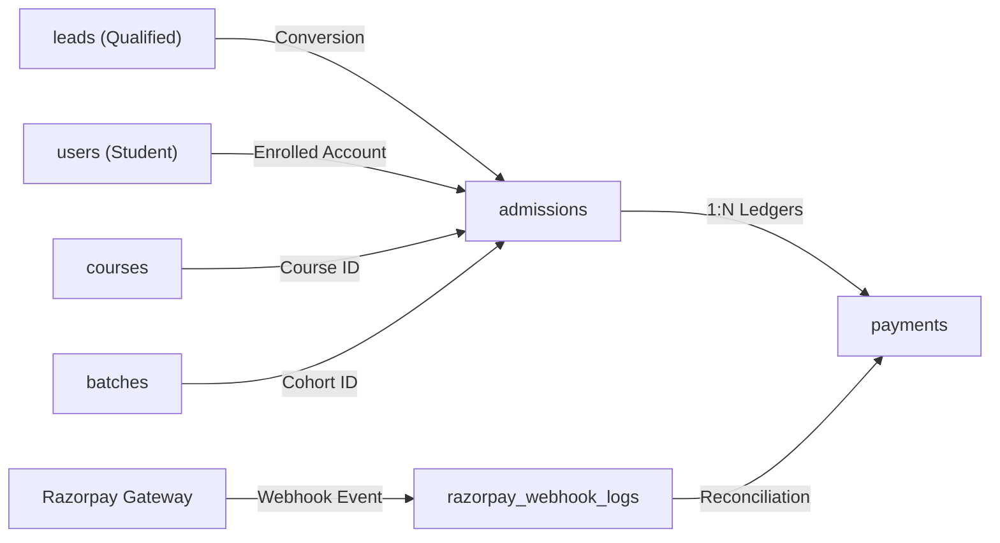

### Table: `admissions`
- **Description & Business Semantics:** Formal student admission contracts linking lead, student user, course, and batch.
- **Created In Migration:** `database/migrations/2026_09_09_018000_create_admissions_table.php`
- **Storage Engine:** InnoDB | **Collation:** `utf8mb4_unicode_ci`

#### Detailed Column Specifications
| Column Name | Data Type & Length | Nullable | Default Value | Constraints & Blueprint Definition |
| :--- | :--- | :---: | :---: | :--- |
| `id` | `BIGINT UNSIGNED (PK, AI)` | `NO` | `-` | `$table-&gt;id()` |
| `contact_id` | `FOREIGNID` | `NO` | `-` | `$table-&gt;foreignId(&#039;contact_id&#039;)` |
| `course_id` | `FOREIGNID` | `NO` | `-` | `$table-&gt;foreignId(&#039;course_id&#039;)` |
| `batch_id` | `FOREIGNID` | `YES` | `-` | `$table-&gt;foreignId(&#039;batch_id&#039;)-&gt;nullable()` |
| `batch_type` | `STRING` | `YES` | `-` | `$table-&gt;string(&#039;batch_type&#039;)-&gt;nullable()` |
| `course_fees` | `STRING` | `NO` | `-` | `$table-&gt;string(&#039;course_fees&#039;)` |
| `payment_mode` | `STRING` | `NO` | `-` | `$table-&gt;string(&#039;payment_mode&#039;)` |
| `status` | `STRING` | `NO` | `Active` | `$table-&gt;string(&#039;status&#039;)-&gt;default(&#039;Active&#039;)` |
| `created_at, updated_at` | `TIMESTAMP` | `YES` | `-` | `$table-&gt;timestamps()` |
| `lead_id` | `UNSIGNEDBIGINTEGER` | `YES` | `-` | `$table-&gt;unsignedBigInteger(&#039;lead_id&#039;)-&gt;nullable()-&gt;after(&#039;id&#039;); /* Altered in 2026_09_19_222610_add_lead_id_to_admissions_table.php */` |
| `lead_id` | `FOREIGN` | `NO` | `-` | `$table-&gt;foreign(&#039;lead_id&#039;)-&gt;references(&#039;id&#039;)-&gt;on(&#039;leads&#039;)-&gt;onDelete(&#039;cascade&#039;); /* Altered in 2026_09_19_222610_add_lead_id_to_admissions_table.php */` |

---

### Table: `payments`
- **Description & Business Semantics:** Ledger of installment payments, discounts, balance dues, payment methods, and receipt codes.
- **Created In Migration:** `database/migrations/2026_09_09_054000_create_payments_table.php`
- **Storage Engine:** InnoDB | **Collation:** `utf8mb4_unicode_ci`

#### Detailed Column Specifications
| Column Name | Data Type & Length | Nullable | Default Value | Constraints & Blueprint Definition |
| :--- | :--- | :---: | :---: | :--- |
| `id` | `BIGINT UNSIGNED (PK, AI)` | `NO` | `-` | `$table-&gt;id()` |
| `admission_id` | `FOREIGNID` | `NO` | `-` | `$table-&gt;foreignId(&#039;admission_id&#039;)` |
| `amount` | `STRING` | `NO` | `-` | `$table-&gt;string(&#039;amount&#039;)` |
| `payment_date` | `STRING` | `NO` | `-` | `$table-&gt;string(&#039;payment_date&#039;)` |
| `status` | `STRING` | `NO` | `Pending` | `$table-&gt;string(&#039;status&#039;)-&gt;default(&#039;Pending&#039;)` |
| `razorpay_order_id` | `STRING` | `YES` | `-` | `$table-&gt;string(&#039;razorpay_order_id&#039;)-&gt;nullable()` |
| `razorpay_payment_id` | `STRING` | `YES` | `-` | `$table-&gt;string(&#039;razorpay_payment_id&#039;)-&gt;nullable()` |
| `razorpay_signature` | `STRING` | `YES` | `-` | `$table-&gt;string(&#039;razorpay_signature&#039;)-&gt;nullable()` |
| `payment_method` | `STRING` | `YES` | `-` | `$table-&gt;string(&#039;payment_method&#039;)-&gt;nullable()` |
| `notes` | `TEXT` | `YES` | `-` | `$table-&gt;text(&#039;notes&#039;)-&gt;nullable()` |
| `razorpay_payment_link_id` | `STRING` | `YES` | `-` | `$table-&gt;string(&#039;razorpay_payment_link_id&#039;)-&gt;nullable()` |
| `payment_link_url` | `STRING` | `YES` | `-` | `$table-&gt;string(&#039;payment_link_url&#039;, 1000)-&gt;nullable()` |
| `payment_link_expires_at` | `STRING` | `YES` | `-` | `$table-&gt;string(&#039;payment_link_expires_at&#039;)-&gt;nullable()` |
| `payment_link_sent_at` | `STRING` | `YES` | `-` | `$table-&gt;string(&#039;payment_link_sent_at&#039;)-&gt;nullable()` |
| `created_at, updated_at` | `TIMESTAMP` | `YES` | `-` | `$table-&gt;timestamps()` |

---

### Table: `razorpay_webhook_logs`
- **Description & Business Semantics:** Idempotent capture of raw Razorpay webhook events to prevent double processing.
- **Created In Migration:** `database/migrations/2026_09_09_056000_create_razorpay_webhook_logs_table.php`
- **Storage Engine:** InnoDB | **Collation:** `utf8mb4_unicode_ci`

#### Detailed Column Specifications
| Column Name | Data Type & Length | Nullable | Default Value | Constraints & Blueprint Definition |
| :--- | :--- | :---: | :---: | :--- |
| `id` | `BIGINT UNSIGNED (PK, AI)` | `NO` | `-` | `$table-&gt;id()` |
| `event` | `STRING` | `NO` | `-` | `$table-&gt;string(&#039;event&#039;)` |
| `razorpay_order_id` | `STRING` | `YES` | `-` | `$table-&gt;string(&#039;razorpay_order_id&#039;)-&gt;nullable()` |
| `razorpay_payment_id` | `STRING` | `YES` | `-` | `$table-&gt;string(&#039;razorpay_payment_id&#039;)-&gt;nullable()` |
| `razorpay_refund_id` | `STRING` | `YES` | `-` | `$table-&gt;string(&#039;razorpay_refund_id&#039;)-&gt;nullable()` |
| `status` | `STRING` | `NO` | `received` | `$table-&gt;string(&#039;status&#039;)-&gt;default(&#039;received&#039;)` |
| `payload` | `LONGTEXT` | `NO` | `-` | `$table-&gt;longText(&#039;payload&#039;)` |
| `signature` | `STRING` | `YES` | `-` | `$table-&gt;string(&#039;signature&#039;)-&gt;nullable()` |
| `signature_valid` | `BOOLEAN` | `NO` | `0` | `$table-&gt;boolean(&#039;signature_valid&#039;)-&gt;default(0)` |
| `error_message` | `TEXT` | `YES` | `-` | `$table-&gt;text(&#039;error_message&#039;)-&gt;nullable()` |
| `created_at, updated_at` | `TIMESTAMP` | `YES` | `-` | `$table-&gt;timestamps()` |

---

## Domain 7: Corporate Hiring, Placement Drives & Interviews

> **Domain Summary:** End-to-end placement portal managing corporate partners, job drives, candidate resumes and GitHub audits, interview preparation, student applications, and multi-round interviews.


### Domain 7 Architectural Flowchart (Placement & Corporate Drives)
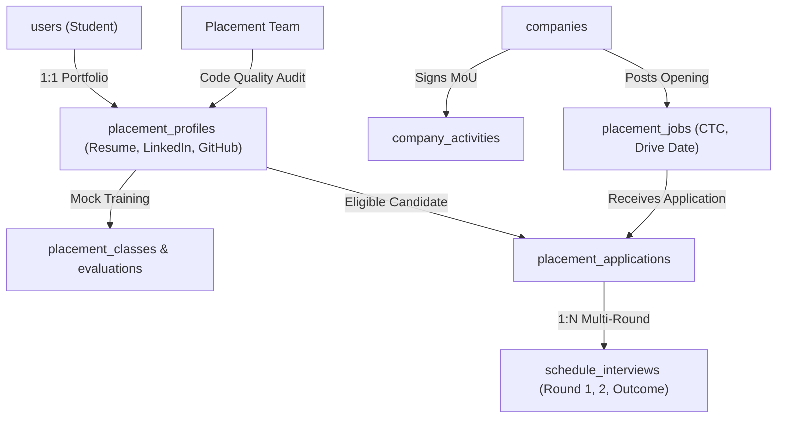

### Table: `companies`
- **Description & Business Semantics:** Corporate partner directory with HR contact details and company profiles.
- **Created In Migration:** `database/migrations/2026_09_16_162459_create_companies_table.php`
- **Storage Engine:** InnoDB | **Collation:** `utf8mb4_unicode_ci`

#### Detailed Column Specifications
| Column Name | Data Type & Length | Nullable | Default Value | Constraints & Blueprint Definition |
| :--- | :--- | :---: | :---: | :--- |
| `id` | `BIGINT UNSIGNED (PK, AI)` | `NO` | `-` | `$table-&gt;id()` |
| `company_name` | `STRING` | `NO` | `-` | `$table-&gt;string(&#039;company_name&#039;)` |
| `city_location` | `STRING` | `NO` | `-` | `$table-&gt;string(&#039;city_location&#039;)` |
| `industry_sector` | `STRING` | `NO` | `-` | `$table-&gt;string(&#039;industry_sector&#039;)` |
| `company_website` | `STRING` | `YES` | `-` | `$table-&gt;string(&#039;company_website&#039;)-&gt;nullable()` |
| `company_mail_id` | `STRING` | `NO` | `-` | `$table-&gt;string(&#039;company_mail_id&#039;)` |
| `hr_name` | `STRING` | `NO` | `-` | `$table-&gt;string(&#039;hr_name&#039;)` |
| `hr_contact_number` | `STRING` | `NO` | `-` | `$table-&gt;string(&#039;hr_contact_number&#039;)` |
| `hr_email_id` | `STRING` | `NO` | `-` | `$table-&gt;string(&#039;hr_email_id&#039;)` |
| `linkedin_url` | `STRING` | `YES` | `-` | `$table-&gt;string(&#039;linkedin_url&#039;)-&gt;nullable()` |
| `source_id` | `UNSIGNEDBIGINTEGER` | `NO` | `-` | `$table-&gt;unsignedBigInteger(&#039;source_id&#039;)` |
| `current_openings` | `BOOLEAN` | `NO` | `0` | `$table-&gt;boolean(&#039;current_openings&#039;)-&gt;default(0)` |
| `lead_tag_id` | `UNSIGNEDBIGINTEGER` | `YES` | `-` | `$table-&gt;unsignedBigInteger(&#039;lead_tag_id&#039;)-&gt;nullable()` |
| `notes` | `TEXT` | `YES` | `-` | `$table-&gt;text(&#039;notes&#039;)-&gt;nullable()` |
| `created_at, updated_at` | `TIMESTAMP` | `YES` | `-` | `$table-&gt;timestamps()` |

---

### Table: `company_activities`
- **Description & Business Semantics:** Corporate relationship interactions and outreach history.
- **Created In Migration:** `database/migrations/2026_09_28_182706_create_company_activities_table.php`
- **Storage Engine:** InnoDB | **Collation:** `utf8mb4_unicode_ci`

#### Detailed Column Specifications
| Column Name | Data Type & Length | Nullable | Default Value | Constraints & Blueprint Definition |
| :--- | :--- | :---: | :---: | :--- |
| `id` | `BIGINT UNSIGNED (PK, AI)` | `NO` | `-` | `$table-&gt;id()` |
| `company_id` | `FOREIGNID` | `NO` | `-` | `$table-&gt;foreignId(&#039;company_id&#039;)-&gt;constrained()-&gt;onDelete(&#039;cascade&#039;)` |
| `staff_id` | `FOREIGNID` | `YES` | `-` | `$table-&gt;foreignId(&#039;staff_id&#039;)-&gt;nullable()-&gt;constrained(&#039;staff&#039;)-&gt;onDelete(&#039;set null&#039;)` |
| `tag_id` | `FOREIGNID` | `YES` | `-` | `$table-&gt;foreignId(&#039;tag_id&#039;)-&gt;nullable()-&gt;constrained(&#039;lead_tags&#039;)-&gt;onDelete(&#039;set null&#039;)` |
| `type` | `STRING` | `NO` | `Call` | `$table-&gt;string(&#039;type&#039;)-&gt;default(&#039;Call&#039;)` |
| `direction` | `STRING` | `YES` | `-` | `$table-&gt;string(&#039;direction&#039;)-&gt;nullable()` |
| `outcome` | `STRING` | `YES` | `-` | `$table-&gt;string(&#039;outcome&#039;)-&gt;nullable()` |
| `note` | `TEXT` | `NO` | `-` | `$table-&gt;text(&#039;note&#039;)` |
| `next_followup_date` | `DATETIME` | `YES` | `-` | `$table-&gt;dateTime(&#039;next_followup_date&#039;)-&gt;nullable()` |
| `created_at, updated_at` | `TIMESTAMP` | `YES` | `-` | `$table-&gt;timestamps()` |

---

### Table: `current_openings`
- **Description & Business Semantics:** Public employment vacancies and career opportunities.
- **Created In Migration:** `database/migrations/2026_09_09_042000_create_current_openings_table.php`
- **Storage Engine:** InnoDB | **Collation:** `utf8mb4_unicode_ci`

#### Detailed Column Specifications
| Column Name | Data Type & Length | Nullable | Default Value | Constraints & Blueprint Definition |
| :--- | :--- | :---: | :---: | :--- |
| `id` | `BIGINT UNSIGNED (PK, AI)` | `NO` | `-` | `$table-&gt;id()` |
| `company_id` | `FOREIGNID` | `NO` | `-` | `$table-&gt;foreignId(&#039;company_id&#039;)` |
| `job_role` | `STRING` | `NO` | `-` | `$table-&gt;string(&#039;job_role&#039;)` |
| `company_mail_id` | `STRING` | `YES` | `-` | `$table-&gt;string(&#039;company_mail_id&#039;)-&gt;nullable()` |
| `hr_name` | `STRING` | `YES` | `-` | `$table-&gt;string(&#039;hr_name&#039;)-&gt;nullable()` |
| `hr_contact_number` | `STRING` | `YES` | `-` | `$table-&gt;string(&#039;hr_contact_number&#039;)-&gt;nullable()` |
| `hr_email_id` | `STRING` | `YES` | `-` | `$table-&gt;string(&#039;hr_email_id&#039;)-&gt;nullable()` |
| `job_location` | `STRING` | `NO` | `-` | `$table-&gt;string(&#039;job_location&#039;)` |
| `skills_required` | `STRING` | `YES` | `-` | `$table-&gt;string(&#039;skills_required&#039;)-&gt;nullable()` |
| `minimum_qualification` | `STRING` | `NO` | `-` | `$table-&gt;string(&#039;minimum_qualification&#039;)` |
| `experience_required` | `STRING` | `NO` | `-` | `$table-&gt;string(&#039;experience_required&#039;)` |
| `ctc_salary` | `STRING` | `NO` | `-` | `$table-&gt;string(&#039;ctc_salary&#039;)` |
| `number_of_openings` | `INTEGER` | `NO` | `1` | `$table-&gt;integer(&#039;number_of_openings&#039;)-&gt;default(1)` |
| `application_deadline` | `STRING` | `YES` | `-` | `$table-&gt;string(&#039;application_deadline&#039;)-&gt;nullable()` |
| `interview_mode` | `STRING` | `NO` | `Online` | `$table-&gt;string(&#039;interview_mode&#039;)-&gt;default(&#039;Online&#039;)` |
| `interview_process` | `STRING` | `YES` | `-` | `$table-&gt;string(&#039;interview_process&#039;)-&gt;nullable()` |
| `bond_service_agmt` | `STRING` | `YES` | `-` | `$table-&gt;string(&#039;bond_service_agmt&#039;)-&gt;nullable()` |
| `opening_status` | `STRING` | `NO` | `Active` | `$table-&gt;string(&#039;opening_status&#039;)-&gt;default(&#039;Active&#039;)` |
| `notes` | `TEXT` | `YES` | `-` | `$table-&gt;text(&#039;notes&#039;)-&gt;nullable()` |
| `created_at, updated_at` | `TIMESTAMP` | `YES` | `-` | `$table-&gt;timestamps()` |
| `job_description_type` | `ENUM` | `YES` | `-` | `$table-&gt;enum(&#039;job_description_type&#039;, [&#039;file&#039;, &#039;text&#039;])-&gt;nullable(); /* Altered in 2026_09_28_172225_add_job_description_to_current_openings_table.php */` |
| `job_description_file` | `STRING` | `YES` | `-` | `$table-&gt;string(&#039;job_description_file&#039;)-&gt;nullable(); /* Altered in 2026_09_28_172225_add_job_description_to_current_openings_table.php */` |
| `job_description_text` | `TEXT` | `YES` | `-` | `$table-&gt;text(&#039;job_description_text&#039;)-&gt;nullable(); /* Altered in 2026_09_28_172225_add_job_description_to_current_openings_table.php */` |

---

### Table: `placement_jobs`
- **Description & Business Semantics:** Exclusive campus recruitment drives and placement openings.
- **Created In Migration:** `database/migrations/2026_10_06_145126_create_placement_jobs_table.php`
- **Storage Engine:** InnoDB | **Collation:** `utf8mb4_unicode_ci`

#### Detailed Column Specifications
| Column Name | Data Type & Length | Nullable | Default Value | Constraints & Blueprint Definition |
| :--- | :--- | :---: | :---: | :--- |
| `id` | `BIGINT UNSIGNED (PK, AI)` | `NO` | `-` | `$table-&gt;id()` |
| `created_at, updated_at` | `TIMESTAMP` | `YES` | `-` | `$table-&gt;timestamps()` |

---

### Table: `placement_profiles`
- **Description & Business Semantics:** Student placement resumes, LinkedIn profiles, and verified GitHub audit records.
- **Created In Migration:** `database/migrations/2026_10_07_100115_create_placement_profiles_table.php`
- **Storage Engine:** InnoDB | **Collation:** `utf8mb4_unicode_ci`

#### Detailed Column Specifications
| Column Name | Data Type & Length | Nullable | Default Value | Constraints & Blueprint Definition |
| :--- | :--- | :---: | :---: | :--- |
| `id` | `BIGINT UNSIGNED (PK, AI)` | `NO` | `-` | `$table-&gt;id()` |
| `user_id` | `FOREIGNID` | `NO` | `-` | `$table-&gt;foreignId(&#039;user_id&#039;)-&gt;constrained(&#039;users&#039;)-&gt;onDelete(&#039;cascade&#039;)` |
| `upload_resume` | `STRING` | `YES` | `-` | `$table-&gt;string(&#039;upload_resume&#039;)-&gt;nullable()` |
| `resume_status` | `STRING` | `NO` | `pending` | `$table-&gt;string(&#039;resume_status&#039;)-&gt;default(&#039;pending&#039;); // pending, verified, changes_needed` |
| `resume_feedback` | `TEXT` | `YES` | `-` | `$table-&gt;text(&#039;resume_feedback&#039;)-&gt;nullable()` |
| `portfolio_url` | `STRING` | `YES` | `-` | `$table-&gt;string(&#039;portfolio_url&#039;)-&gt;nullable()` |
| `portfolio_status` | `STRING` | `NO` | `pending` | `$table-&gt;string(&#039;portfolio_status&#039;)-&gt;default(&#039;pending&#039;)` |
| `portfolio_feedback` | `TEXT` | `YES` | `-` | `$table-&gt;text(&#039;portfolio_feedback&#039;)-&gt;nullable()` |
| `upload_project_docs` | `STRING` | `YES` | `-` | `$table-&gt;string(&#039;upload_project_docs&#039;)-&gt;nullable()` |
| `project_docs_status` | `STRING` | `NO` | `pending` | `$table-&gt;string(&#039;project_docs_status&#039;)-&gt;default(&#039;pending&#039;)` |
| `project_docs_feedback` | `TEXT` | `YES` | `-` | `$table-&gt;text(&#039;project_docs_feedback&#039;)-&gt;nullable()` |
| `overall_status` | `STRING` | `NO` | `pending` | `$table-&gt;string(&#039;overall_status&#039;)-&gt;default(&#039;pending&#039;); // pending, all_verified` |
| `reviewed_at` | `TIMESTAMP` | `YES` | `-` | `$table-&gt;timestamp(&#039;reviewed_at&#039;)-&gt;nullable()` |
| `reviewed_by` | `STRING` | `YES` | `-` | `$table-&gt;string(&#039;reviewed_by&#039;)-&gt;nullable(); // Could be a staff ID` |
| `created_at, updated_at` | `TIMESTAMP` | `YES` | `-` | `$table-&gt;timestamps()` |
| `github_url` | `STRING` | `YES` | `-` | `$table-&gt;string(&#039;github_url&#039;)-&gt;nullable()-&gt;after(&#039;portfolio_url&#039;); /* Altered in 2026_10_07_142313_add_github_url_to_placement_profiles_table.php */` |
| `github_status` | `STRING` | `NO` | `pending` | `$table-&gt;string(&#039;github_status&#039;)-&gt;default(&#039;pending&#039;)-&gt;after(&#039;github_url&#039;); /* Altered in 2026_10_07_143736_add_github_status_and_feedback_to_placement_profiles_table.php */` |
| `github_feedback` | `TEXT` | `YES` | `-` | `$table-&gt;text(&#039;github_feedback&#039;)-&gt;nullable()-&gt;after(&#039;github_status&#039;); /* Altered in 2026_10_07_143736_add_github_status_and_feedback_to_placement_profiles_table.php */` |

---

### Table: `placement_classes`
- **Description & Business Semantics:** Placement training sessions and interview preparation video lectures.
- **Created In Migration:** `database/migrations/2026_10_06_231357_create_placement_classes_table.php`
- **Storage Engine:** InnoDB | **Collation:** `utf8mb4_unicode_ci`

#### Detailed Column Specifications
| Column Name | Data Type & Length | Nullable | Default Value | Constraints & Blueprint Definition |
| :--- | :--- | :---: | :---: | :--- |
| `id` | `BIGINT UNSIGNED (PK, AI)` | `NO` | `-` | `$table-&gt;id()` |
| `day` | `INTEGER` | `NO` | `-` | `$table-&gt;integer(&#039;day&#039;)` |
| `title` | `STRING` | `NO` | `-` | `$table-&gt;string(&#039;title&#039;)` |
| `video_url` | `STRING` | `YES` | `-` | `$table-&gt;string(&#039;video_url&#039;)-&gt;nullable()` |
| `created_at, updated_at` | `TIMESTAMP` | `YES` | `-` | `$table-&gt;timestamps()` |
| `video_path` | `STRING` | `YES` | `-` | `$table-&gt;string(&#039;video_path&#039;)-&gt;nullable()-&gt;after(&#039;video_url&#039;); /* Altered in 2026_10_06_235330_add_video_path_to_placement_classes_table.php */` |

---

### Table: `placement_class_questions`
- **Description & Business Semantics:** Technical and aptitude screening questions for placement training.
- **Created In Migration:** `database/migrations/2026_10_07_002148_create_placement_class_questions_table.php`
- **Storage Engine:** InnoDB | **Collation:** `utf8mb4_unicode_ci`

#### Detailed Column Specifications
| Column Name | Data Type & Length | Nullable | Default Value | Constraints & Blueprint Definition |
| :--- | :--- | :---: | :---: | :--- |
| `id` | `BIGINT UNSIGNED (PK, AI)` | `NO` | `-` | `$table-&gt;id()` |
| `placement_class_id` | `FOREIGNID` | `NO` | `-` | `$table-&gt;foreignId(&#039;placement_class_id&#039;)-&gt;constrained()-&gt;onDelete(&#039;cascade&#039;)` |
| `question` | `TEXT` | `NO` | `-` | `$table-&gt;text(&#039;question&#039;)` |
| `marks` | `INTEGER` | `NO` | `1` | `$table-&gt;integer(&#039;marks&#039;)-&gt;default(1)` |
| `created_at, updated_at` | `TIMESTAMP` | `YES` | `-` | `$table-&gt;timestamps()` |

---

### Table: `placement_class_options`
- **Description & Business Semantics:** Multiple choice options for placement class questions.
- **Created In Migration:** `database/migrations/2026_10_07_002150_create_placement_class_options_table.php`
- **Storage Engine:** InnoDB | **Collation:** `utf8mb4_unicode_ci`

#### Detailed Column Specifications
| Column Name | Data Type & Length | Nullable | Default Value | Constraints & Blueprint Definition |
| :--- | :--- | :---: | :---: | :--- |
| `id` | `BIGINT UNSIGNED (PK, AI)` | `NO` | `-` | `$table-&gt;id()` |
| `placement_class_question_id` | `FOREIGNID` | `NO` | `-` | `$table-&gt;foreignId(&#039;placement_class_question_id&#039;)-&gt;constrained(&#039;placement_class_questions&#039;)-&gt;onDelete(&#039;cascade&#039;)` |
| `option` | `STRING` | `NO` | `-` | `$table-&gt;string(&#039;option&#039;)` |
| `is_correct` | `BOOLEAN` | `NO` | `false` | `$table-&gt;boolean(&#039;is_correct&#039;)-&gt;default(false)` |
| `created_at, updated_at` | `TIMESTAMP` | `YES` | `-` | `$table-&gt;timestamps()` |

---

### Table: `placement_evaluations`
- **Description & Business Semantics:** Faculty evaluations of student placement readiness.
- **Created In Migration:** `database/migrations/2026_10_06_145129_create_placement_evaluations_table.php`
- **Storage Engine:** InnoDB | **Collation:** `utf8mb4_unicode_ci`

#### Detailed Column Specifications
| Column Name | Data Type & Length | Nullable | Default Value | Constraints & Blueprint Definition |
| :--- | :--- | :---: | :---: | :--- |
| `id` | `BIGINT UNSIGNED (PK, AI)` | `NO` | `-` | `$table-&gt;id()` |
| `course_id` | `FOREIGNID` | `NO` | `-` | `$table-&gt;foreignId(&#039;course_id&#039;)-&gt;constrained()-&gt;onDelete(&#039;cascade&#039;)` |
| `title` | `STRING` | `YES` | `-` | `$table-&gt;string(&#039;title&#039;)-&gt;nullable()` |
| `test_timing` | `INTEGER` | `NO` | `-` | `$table-&gt;integer(&#039;test_timing&#039;)-&gt;comment(&#039;Duration in minutes&#039;)` |
| `correction_type` | `ENUM` | `NO` | `auto` | `$table-&gt;enum(&#039;correction_type&#039;, [&#039;auto&#039;, &#039;tutor&#039;])-&gt;default(&#039;auto&#039;)` |
| `created_at, updated_at` | `TIMESTAMP` | `YES` | `-` | `$table-&gt;timestamps()` |

---

### Table: `placement_evaluation_questions`
- **Description & Business Semantics:** Readiness evaluation rubric questions.
- **Created In Migration:** `database/migrations/2026_10_06_145129_create_placement_evaluations_table.php`
- **Storage Engine:** InnoDB | **Collation:** `utf8mb4_unicode_ci`

#### Detailed Column Specifications
| Column Name | Data Type & Length | Nullable | Default Value | Constraints & Blueprint Definition |
| :--- | :--- | :---: | :---: | :--- |
| `id` | `BIGINT UNSIGNED (PK, AI)` | `NO` | `-` | `$table-&gt;id()` |
| `placement_evaluation_id` | `FOREIGNID` | `NO` | `-` | `$table-&gt;foreignId(&#039;placement_evaluation_id&#039;)-&gt;constrained(&#039;placement_evaluations&#039;)-&gt;onDelete(&#039;cascade&#039;)` |
| `question` | `TEXT` | `NO` | `-` | `$table-&gt;text(&#039;question&#039;)` |
| `type` | `STRING` | `NO` | `mcq` | `$table-&gt;string(&#039;type&#039;)-&gt;default(&#039;mcq&#039;)-&gt;comment(&#039;mcq, coding, upload, etc.&#039;)` |
| `marks` | `INTEGER` | `NO` | `1` | `$table-&gt;integer(&#039;marks&#039;)-&gt;default(1)` |
| `created_at, updated_at` | `TIMESTAMP` | `YES` | `-` | `$table-&gt;timestamps()` |

---

### Table: `placement_evaluation_answers`
- **Description & Business Semantics:** Grading scale benchmarks for evaluation questions.
- **Created In Migration:** `database/migrations/2026_10_06_145129_create_placement_evaluations_table.php`
- **Storage Engine:** InnoDB | **Collation:** `utf8mb4_unicode_ci`

#### Detailed Column Specifications
| Column Name | Data Type & Length | Nullable | Default Value | Constraints & Blueprint Definition |
| :--- | :--- | :---: | :---: | :--- |
| `id` | `BIGINT UNSIGNED (PK, AI)` | `NO` | `-` | `$table-&gt;id()` |
| `placement_evaluation_question_id` | `UNSIGNEDBIGINTEGER` | `NO` | `-` | `$table-&gt;unsignedBigInteger(&#039;placement_evaluation_question_id&#039;)` |
| `answer` | `TEXT` | `NO` | `-` | `$table-&gt;text(&#039;answer&#039;)` |
| `is_correct` | `BOOLEAN` | `NO` | `false` | `$table-&gt;boolean(&#039;is_correct&#039;)-&gt;default(false)` |
| `created_at, updated_at` | `TIMESTAMP` | `YES` | `-` | `$table-&gt;timestamps()` |
| `placement_evaluation_question_id` | `FOREIGN` | `NO` | `-` | `$table-&gt;foreign(&#039;placement_evaluation_question_id&#039;, &#039;pea_peq_id_fk&#039;)` |

---

### Table: `placement_evaluation_student_answers`
- **Description & Business Semantics:** Student responses to placement evaluation questions.
- **Created In Migration:** `database/migrations/2026_10_06_145129_create_placement_evaluations_table.php`
- **Storage Engine:** InnoDB | **Collation:** `utf8mb4_unicode_ci`

#### Detailed Column Specifications
| Column Name | Data Type & Length | Nullable | Default Value | Constraints & Blueprint Definition |
| :--- | :--- | :---: | :---: | :--- |
| `id` | `BIGINT UNSIGNED (PK, AI)` | `NO` | `-` | `$table-&gt;id()` |
| `user_id` | `FOREIGNID` | `NO` | `-` | `$table-&gt;foreignId(&#039;user_id&#039;)-&gt;constrained()-&gt;onDelete(&#039;cascade&#039;)` |
| `course_id` | `FOREIGNID` | `NO` | `-` | `$table-&gt;foreignId(&#039;course_id&#039;)-&gt;constrained()-&gt;onDelete(&#039;cascade&#039;)` |
| `placement_evaluation_id` | `UNSIGNEDBIGINTEGER` | `NO` | `-` | `$table-&gt;unsignedBigInteger(&#039;placement_evaluation_id&#039;)` |
| `placement_evaluation_question_id` | `UNSIGNEDBIGINTEGER` | `NO` | `-` | `$table-&gt;unsignedBigInteger(&#039;placement_evaluation_question_id&#039;)` |
| `selected_answer_id` | `UNSIGNEDBIGINTEGER` | `YES` | `-` | `$table-&gt;unsignedBigInteger(&#039;selected_answer_id&#039;)-&gt;nullable()` |
| `text_answer` | `TEXT` | `YES` | `-` | `$table-&gt;text(&#039;text_answer&#039;)-&gt;nullable()` |
| `marks_obtained` | `INTEGER` | `YES` | `-` | `$table-&gt;integer(&#039;marks_obtained&#039;)-&gt;nullable()` |
| `created_at, updated_at` | `TIMESTAMP` | `YES` | `-` | `$table-&gt;timestamps()` |
| `placement_evaluation_id` | `FOREIGN` | `NO` | `-` | `$table-&gt;foreign(&#039;placement_evaluation_id&#039;, &#039;pesa_pe_id_fk&#039;)` |
| `placement_evaluation_question_id` | `FOREIGN` | `NO` | `-` | `$table-&gt;foreign(&#039;placement_evaluation_question_id&#039;, &#039;pesa_peq_id_fk&#039;)` |
| `selected_answer_id` | `FOREIGN` | `NO` | `-` | `$table-&gt;foreign(&#039;selected_answer_id&#039;, &#039;pesa_pea_id_fk&#039;)` |

---

### Table: `placement_applications`
- **Description & Business Semantics:** Student job drive applications with status workflow.
- **Created In Migration:** `database/migrations/2026_10_06_145128_create_placement_applications_table.php`
- **Storage Engine:** InnoDB | **Collation:** `utf8mb4_unicode_ci`

#### Detailed Column Specifications
| Column Name | Data Type & Length | Nullable | Default Value | Constraints & Blueprint Definition |
| :--- | :--- | :---: | :---: | :--- |
| `id` | `BIGINT UNSIGNED (PK, AI)` | `NO` | `-` | `$table-&gt;id()` |
| `created_at, updated_at` | `TIMESTAMP` | `YES` | `-` | `$table-&gt;timestamps()` |
| `opening_id` | `UNSIGNEDBIGINTEGER` | `YES` | `-` | `$table-&gt;unsignedBigInteger(&#039;opening_id&#039;)-&gt;nullable()-&gt;index()-&gt;after(&#039;id&#039;); /* Altered in 2026_10_07_195640_add_fields_to_placement_applications_table.php */` |
| `user_id` | `UNSIGNEDBIGINTEGER` | `YES` | `-` | `$table-&gt;unsignedBigInteger(&#039;user_id&#039;)-&gt;nullable()-&gt;index()-&gt;after(&#039;opening_id&#039;); /* Altered in 2026_10_07_195640_add_fields_to_placement_applications_table.php */` |
| `course_user_id` | `UNSIGNEDBIGINTEGER` | `YES` | `-` | `$table-&gt;unsignedBigInteger(&#039;course_user_id&#039;)-&gt;nullable()-&gt;index()-&gt;after(&#039;user_id&#039;); /* Altered in 2026_10_07_195640_add_fields_to_placement_applications_table.php */` |
| `status` | `STRING` | `NO` | `applied` | `$table-&gt;string(&#039;status&#039;)-&gt;default(&#039;applied&#039;)-&gt;after(&#039;course_user_id&#039;); /* Altered in 2026_10_07_195640_add_fields_to_placement_applications_table.php */` |
| `is_new` | `BOOLEAN` | `NO` | `true` | `$table-&gt;boolean(&#039;is_new&#039;)-&gt;default(true)-&gt;after(&#039;status&#039;); /* Altered in 2026_10_07_195640_add_fields_to_placement_applications_table.php */` |
| `sent_to_hr_at` | `TIMESTAMP` | `YES` | `-` | `$table-&gt;timestamp(&#039;sent_to_hr_at&#039;)-&gt;nullable()-&gt;after(&#039;is_new&#039;); /* Altered in 2026_10_07_195640_add_fields_to_placement_applications_table.php */` |
| `notes` | `TEXT` | `YES` | `-` | `$table-&gt;text(&#039;notes&#039;)-&gt;nullable()-&gt;after(&#039;sent_to_hr_at&#039;); /* Altered in 2026_10_07_195640_add_fields_to_placement_applications_table.php */` |

---

### Table: `schedule_interviews`
- **Description & Business Semantics:** Individual recruitment interview rounds with dates, interviewer notes, and outcomes.
- **Created In Migration:** `database/migrations/2026_10_07_160525_create_schedule_interviews_table.php`
- **Storage Engine:** InnoDB | **Collation:** `utf8mb4_unicode_ci`

#### Detailed Column Specifications
| Column Name | Data Type & Length | Nullable | Default Value | Constraints & Blueprint Definition |
| :--- | :--- | :---: | :---: | :--- |
| `id` | `BIGINT UNSIGNED (PK, AI)` | `NO` | `-` | `$table-&gt;id()` |
| `user_id` | `UNSIGNEDBIGINTEGER` | `YES` | `-` | `$table-&gt;unsignedBigInteger(&#039;user_id&#039;)-&gt;nullable()` |
| `name` | `STRING` | `NO` | `-` | `$table-&gt;string(&#039;name&#039;)` |
| `phone` | `STRING` | `NO` | `-` | `$table-&gt;string(&#039;phone&#039;)` |
| `email` | `STRING` | `NO` | `-` | `$table-&gt;string(&#039;email&#039;)` |
| `course` | `STRING` | `NO` | `-` | `$table-&gt;string(&#039;course&#039;)` |
| `duration` | `STRING` | `NO` | `-` | `$table-&gt;string(&#039;duration&#039;)` |
| `batch_code` | `STRING` | `NO` | `-` | `$table-&gt;string(&#039;batch_code&#039;)` |
| `batch_type` | `STRING` | `NO` | `-` | `$table-&gt;string(&#039;batch_type&#039;)` |
| `company` | `STRING` | `NO` | `-` | `$table-&gt;string(&#039;company&#039;)` |
| `role` | `STRING` | `YES` | `-` | `$table-&gt;string(&#039;role&#039;)-&gt;nullable()` |
| `location` | `STRING` | `YES` | `-` | `$table-&gt;string(&#039;location&#039;)-&gt;nullable()` |
| `date` | `DATE` | `NO` | `-` | `$table-&gt;date(&#039;date&#039;)` |
| `time` | `TIME` | `NO` | `-` | `$table-&gt;time(&#039;time&#039;)` |
| `interview_mode` | `STRING` | `NO` | `-` | `$table-&gt;string(&#039;interview_mode&#039;)` |
| `meeting_link` | `STRING` | `YES` | `-` | `$table-&gt;string(&#039;meeting_link&#039;)-&gt;nullable()` |
| `status` | `STRING` | `NO` | `scheduled` | `$table-&gt;string(&#039;status&#039;)-&gt;default(&#039;scheduled&#039;)` |
| `created_at, updated_at` | `TIMESTAMP` | `YES` | `-` | `$table-&gt;timestamps()` |
| `attendance` | `STRING` | `YES` | `-` | `$table-&gt;string(&#039;attendance&#039;)-&gt;nullable()-&gt;after(&#039;status&#039;); /* Altered in 2026_10_07_162746_add_outcome_fields_to_schedule_interviews_table.php */` |
| `reason` | `TEXT` | `YES` | `-` | `$table-&gt;text(&#039;reason&#039;)-&gt;nullable()-&gt;after(&#039;attendance&#039;); /* Altered in 2026_10_07_162746_add_outcome_fields_to_schedule_interviews_table.php */` |
| `result` | `STRING` | `YES` | `-` | `$table-&gt;string(&#039;result&#039;)-&gt;nullable()-&gt;after(&#039;reason&#039;); /* Altered in 2026_10_07_162746_add_outcome_fields_to_schedule_interviews_table.php */` |
| `hr_feedback` | `TEXT` | `YES` | `-` | `$table-&gt;text(&#039;hr_feedback&#039;)-&gt;nullable()-&gt;after(&#039;result&#039;); /* Altered in 2026_10_07_162746_add_outcome_fields_to_schedule_interviews_table.php */` |

---

## Domain 8: Support Desk, Knowledge Resources & Webinars

> **Domain Summary:** Customer support tickets, public contact inquiries, downloadable learning resources, SEO blogs, and live marketing webinars.

### Table: `support_tickets`
- **Description & Business Semantics:** Student support and grievance tickets categorized by priority and subject.
- **Created In Migration:** `database/migrations/2026_09_09_060000_create_support_tickets_table.php`
- **Storage Engine:** InnoDB | **Collation:** `utf8mb4_unicode_ci`

#### Detailed Column Specifications
| Column Name | Data Type & Length | Nullable | Default Value | Constraints & Blueprint Definition |
| :--- | :--- | :---: | :---: | :--- |
| `id` | `BIGINT UNSIGNED (PK, AI)` | `NO` | `-` | `$table-&gt;id()` |
| `user_id` | `FOREIGNID` | `NO` | `-` | `$table-&gt;foreignId(&#039;user_id&#039;)` |
| `reference_id` | `STRING` | `NO` | `-` | `$table-&gt;string(&#039;reference_id&#039;)` |
| `type` | `STRING` | `NO` | `-` | `$table-&gt;string(&#039;type&#039;)` |
| `category` | `STRING` | `YES` | `-` | `$table-&gt;string(&#039;category&#039;)-&gt;nullable()` |
| `subject` | `STRING` | `YES` | `-` | `$table-&gt;string(&#039;subject&#039;)-&gt;nullable()` |
| `title` | `STRING` | `YES` | `-` | `$table-&gt;string(&#039;title&#039;)-&gt;nullable()` |
| `description` | `TEXT` | `NO` | `-` | `$table-&gt;text(&#039;description&#039;)` |
| `preferred_date` | `STRING` | `YES` | `-` | `$table-&gt;string(&#039;preferred_date&#039;)-&gt;nullable()` |
| `preferred_slot` | `STRING` | `YES` | `-` | `$table-&gt;string(&#039;preferred_slot&#039;)-&gt;nullable()` |
| `attachment` | `STRING` | `YES` | `-` | `$table-&gt;string(&#039;attachment&#039;)-&gt;nullable()` |
| `assigned_staff_id` | `FOREIGNID` | `YES` | `-` | `$table-&gt;foreignId(&#039;assigned_staff_id&#039;)-&gt;nullable()` |
| `allocated_date` | `STRING` | `YES` | `-` | `$table-&gt;string(&#039;allocated_date&#039;)-&gt;nullable()` |
| `allocated_slot` | `STRING` | `YES` | `-` | `$table-&gt;string(&#039;allocated_slot&#039;)-&gt;nullable()` |
| `notes` | `TEXT` | `YES` | `-` | `$table-&gt;text(&#039;notes&#039;)-&gt;nullable()` |
| `status` | `STRING` | `NO` | `-` | `$table-&gt;string(&#039;status&#039;)` |
| `created_at, updated_at` | `TIMESTAMP` | `YES` | `-` | `$table-&gt;timestamps()` |

---

### Table: `support_ticket_allocations`
- **Description & Business Semantics:** Routing and assignment of support tickets to staff members.
- **Created In Migration:** `database/migrations/2026_09_09_061000_create_support_ticket_allocations_table.php`
- **Storage Engine:** InnoDB | **Collation:** `utf8mb4_unicode_ci`

#### Detailed Column Specifications
| Column Name | Data Type & Length | Nullable | Default Value | Constraints & Blueprint Definition |
| :--- | :--- | :---: | :---: | :--- |
| `id` | `BIGINT UNSIGNED (PK, AI)` | `NO` | `-` | `$table-&gt;id()` |
| `support_ticket_id` | `FOREIGNID` | `NO` | `-` | `$table-&gt;foreignId(&#039;support_ticket_id&#039;)` |
| `staff_id` | `FOREIGNID` | `NO` | `-` | `$table-&gt;foreignId(&#039;staff_id&#039;)` |
| `allocated_date` | `STRING` | `NO` | `-` | `$table-&gt;string(&#039;allocated_date&#039;)` |
| `allocated_slot` | `STRING` | `NO` | `-` | `$table-&gt;string(&#039;allocated_slot&#039;)` |
| `notes` | `TEXT` | `YES` | `-` | `$table-&gt;text(&#039;notes&#039;)-&gt;nullable()` |
| `status` | `STRING` | `NO` | `Scheduled` | `$table-&gt;string(&#039;status&#039;)-&gt;default(&#039;Scheduled&#039;)` |
| `zoom_meet_link` | `TEXT` | `YES` | `-` | `$table-&gt;text(&#039;zoom_meet_link&#039;)-&gt;nullable()` |
| `zoom_meeting_id` | `STRING` | `YES` | `-` | `$table-&gt;string(&#039;zoom_meeting_id&#039;)-&gt;nullable()` |
| `created_at, updated_at` | `TIMESTAMP` | `YES` | `-` | `$table-&gt;timestamps()` |

---

### Table: `contacts`
- **Description & Business Semantics:** General inquiries submitted through website contact forms.
- **Created In Migration:** `database/migrations/2026_09_09_015000_create_contacts_table.php`
- **Storage Engine:** InnoDB | **Collation:** `utf8mb4_unicode_ci`

#### Detailed Column Specifications
| Column Name | Data Type & Length | Nullable | Default Value | Constraints & Blueprint Definition |
| :--- | :--- | :---: | :---: | :--- |
| `id` | `BIGINT UNSIGNED (PK, AI)` | `NO` | `-` | `$table-&gt;id()` |
| `register_number` | `STRING` | `YES` | `-` | `$table-&gt;string(&#039;register_number&#039;)-&gt;nullable()` |
| `my_operator_id` | `STRING` | `YES` | `-` | `$table-&gt;string(&#039;my_operator_id&#039;, 100)-&gt;nullable()` |
| `caller_number` | `STRING` | `YES` | `-` | `$table-&gt;string(&#039;caller_number&#039;, 20)-&gt;nullable()` |
| `secondary_number` | `STRING` | `YES` | `-` | `$table-&gt;string(&#039;secondary_number&#039;, 20)-&gt;nullable()` |
| `name` | `STRING` | `YES` | `-` | `$table-&gt;string(&#039;name&#039;, 100)-&gt;nullable()` |
| `email` | `STRING` | `YES` | `-` | `$table-&gt;string(&#039;email&#039;, 100)-&gt;nullable()` |
| `location` | `STRING` | `YES` | `-` | `$table-&gt;string(&#039;location&#039;)-&gt;nullable()` |
| `source` | `STRING` | `YES` | `-` | `$table-&gt;string(&#039;source&#039;)-&gt;nullable()` |
| `conversation_start_date` | `STRING` | `YES` | `-` | `$table-&gt;string(&#039;conversation_start_date&#039;)-&gt;nullable()` |
| `conversation_end_date` | `STRING` | `YES` | `-` | `$table-&gt;string(&#039;conversation_end_date&#039;)-&gt;nullable()` |
| `created_at, updated_at` | `TIMESTAMP` | `YES` | `-` | `$table-&gt;timestamps()` |

---

### Table: `ebooks`
- **Description & Business Semantics:** Downloadable technical ebooks and career preparation guides.
- **Created In Migration:** `database/migrations/2026_09_09_043000_create_ebooks_table.php`
- **Storage Engine:** InnoDB | **Collation:** `utf8mb4_unicode_ci`

#### Detailed Column Specifications
| Column Name | Data Type & Length | Nullable | Default Value | Constraints & Blueprint Definition |
| :--- | :--- | :---: | :---: | :--- |
| `id` | `BIGINT UNSIGNED (PK, AI)` | `NO` | `-` | `$table-&gt;id()` |
| `title` | `STRING` | `NO` | `-` | `$table-&gt;string(&#039;title&#039;)` |
| `author` | `STRING` | `YES` | `-` | `$table-&gt;string(&#039;author&#039;)-&gt;nullable()` |
| `description` | `TEXT` | `YES` | `-` | `$table-&gt;text(&#039;description&#039;)-&gt;nullable()` |
| `thumbnail` | `STRING` | `YES` | `-` | `$table-&gt;string(&#039;thumbnail&#039;)-&gt;nullable()` |
| `file_path` | `STRING` | `NO` | `-` | `$table-&gt;string(&#039;file_path&#039;)` |
| `is_free` | `BOOLEAN` | `NO` | `0` | `$table-&gt;boolean(&#039;is_free&#039;)-&gt;default(0)` |
| `price` | `STRING` | `NO` | `-` | `$table-&gt;string(&#039;price&#039;)` |
| `status` | `INTEGER` | `NO` | `1` | `$table-&gt;integer(&#039;status&#039;)-&gt;default(1)` |
| `created_at, updated_at` | `TIMESTAMP` | `YES` | `-` | `$table-&gt;timestamps()` |

---

### Table: `blogs`
- **Description & Business Semantics:** Public technical articles and SEO marketing posts.
- **Created In Migration:** `database/migrations/2026_09_09_024000_create_blogs_table.php`
- **Storage Engine:** InnoDB | **Collation:** `utf8mb4_unicode_ci`

#### Detailed Column Specifications
| Column Name | Data Type & Length | Nullable | Default Value | Constraints & Blueprint Definition |
| :--- | :--- | :---: | :---: | :--- |
| `id` | `BIGINT UNSIGNED (PK, AI)` | `NO` | `-` | `$table-&gt;id()` |
| `title` | `STRING` | `NO` | `-` | `$table-&gt;string(&#039;title&#039;)` |
| `author` | `STRING` | `YES` | `-` | `$table-&gt;string(&#039;author&#039;)-&gt;nullable()` |
| `published_date` | `STRING` | `YES` | `-` | `$table-&gt;string(&#039;published_date&#039;)-&gt;nullable()` |
| `image` | `STRING` | `YES` | `-` | `$table-&gt;string(&#039;image&#039;)-&gt;nullable()` |
| `status` | `STRING` | `NO` | `draft` | `$table-&gt;string(&#039;status&#039;)-&gt;default(&#039;draft&#039;)` |
| `created_at, updated_at` | `TIMESTAMP` | `YES` | `-` | `$table-&gt;timestamps()` |

---

### Table: `blog_infos`
- **Description & Business Semantics:** Metadata, author details, and read counts for blogs.
- **Created In Migration:** `database/migrations/2026_09_09_025000_create_blog_infos_table.php`
- **Storage Engine:** InnoDB | **Collation:** `utf8mb4_unicode_ci`

#### Detailed Column Specifications
| Column Name | Data Type & Length | Nullable | Default Value | Constraints & Blueprint Definition |
| :--- | :--- | :---: | :---: | :--- |
| `id` | `BIGINT UNSIGNED (PK, AI)` | `NO` | `-` | `$table-&gt;id()` |
| `blog_id` | `FOREIGNID` | `NO` | `-` | `$table-&gt;foreignId(&#039;blog_id&#039;)` |
| `descriptions` | `LONGTEXT` | `YES` | `-` | `$table-&gt;longText(&#039;descriptions&#039;)-&gt;nullable()` |
| `created_at, updated_at` | `TIMESTAMP` | `YES` | `-` | `$table-&gt;timestamps()` |

---

### Table: `webinars`
- **Description & Business Semantics:** Live workshops and masterclasses with Zoom video integration.
- **Created In Migration:** `database/migrations/2026_09_09_062000_create_webinars_table.php`
- **Storage Engine:** InnoDB | **Collation:** `utf8mb4_unicode_ci`

#### Detailed Column Specifications
| Column Name | Data Type & Length | Nullable | Default Value | Constraints & Blueprint Definition |
| :--- | :--- | :---: | :---: | :--- |
| `id` | `BIGINT UNSIGNED (PK, AI)` | `NO` | `-` | `$table-&gt;id()` |
| `image` | `STRING` | `YES` | `-` | `$table-&gt;string(&#039;image&#039;)-&gt;nullable()` |
| `title` | `STRING` | `NO` | `-` | `$table-&gt;string(&#039;title&#039;)` |
| `category` | `STRING` | `YES` | `-` | `$table-&gt;string(&#039;category&#039;)-&gt;nullable()` |
| `course_level` | `STRING` | `YES` | `-` | `$table-&gt;string(&#039;course_level&#039;)-&gt;nullable()` |
| `date` | `STRING` | `YES` | `-` | `$table-&gt;string(&#039;date&#039;)-&gt;nullable()` |
| `from_time` | `STRING` | `YES` | `-` | `$table-&gt;string(&#039;from_time&#039;)-&gt;nullable()` |
| `to_time` | `STRING` | `YES` | `-` | `$table-&gt;string(&#039;to_time&#039;)-&gt;nullable()` |
| `meeting_link` | `TEXT` | `YES` | `-` | `$table-&gt;text(&#039;meeting_link&#039;)-&gt;nullable()` |
| `seats` | `INTEGER` | `NO` | `0` | `$table-&gt;integer(&#039;seats&#039;)-&gt;default(0)` |
| `description` | `TEXT` | `YES` | `-` | `$table-&gt;text(&#039;description&#039;)-&gt;nullable()` |
| `professor` | `STRING` | `YES` | `-` | `$table-&gt;string(&#039;professor&#039;)-&gt;nullable()` |
| `professor_position` | `STRING` | `YES` | `-` | `$table-&gt;string(&#039;professor_position&#039;)-&gt;nullable()` |
| `professor_experience` | `STRING` | `YES` | `-` | `$table-&gt;string(&#039;professor_experience&#039;)-&gt;nullable()` |
| `requirements` | `TEXT` | `YES` | `-` | `$table-&gt;text(&#039;requirements&#039;)-&gt;nullable()` |
| `status` | `INTEGER` | `NO` | `1` | `$table-&gt;integer(&#039;status&#039;)-&gt;default(1)` |
| `created_at, updated_at` | `TIMESTAMP` | `YES` | `-` | `$table-&gt;timestamps()` |
| `zoom_meeting_id` | `STRING` | `YES` | `-` | `$table-&gt;string(&#039;zoom_meeting_id&#039;)-&gt;nullable()-&gt;after(&#039;meeting_link&#039;); /* Altered in 2026_10_02_142832_add_zoom_meeting_id_to_webinars_table.php */` |

---

### Table: `webinar_titles`
- **Description & Business Semantics:** Key highlight topics covered in webinars.
- **Created In Migration:** `database/migrations/2026_09_09_063000_create_webinar_titles_table.php`
- **Storage Engine:** InnoDB | **Collation:** `utf8mb4_unicode_ci`

#### Detailed Column Specifications
| Column Name | Data Type & Length | Nullable | Default Value | Constraints & Blueprint Definition |
| :--- | :--- | :---: | :---: | :--- |
| `id` | `BIGINT UNSIGNED (PK, AI)` | `NO` | `-` | `$table-&gt;id()` |
| `webinar_id` | `FOREIGNID` | `NO` | `-` | `$table-&gt;foreignId(&#039;webinar_id&#039;)` |
| `title` | `STRING` | `NO` | `-` | `$table-&gt;string(&#039;title&#039;)` |
| `created_at, updated_at` | `TIMESTAMP` | `YES` | `-` | `$table-&gt;timestamps()` |

---

### Table: `webinar_descriptions`
- **Description & Business Semantics:** Detailed session descriptions and agendas for webinars.
- **Created In Migration:** `database/migrations/2026_09_09_064000_create_webinar_descriptions_table.php`
- **Storage Engine:** InnoDB | **Collation:** `utf8mb4_unicode_ci`

#### Detailed Column Specifications
| Column Name | Data Type & Length | Nullable | Default Value | Constraints & Blueprint Definition |
| :--- | :--- | :---: | :---: | :--- |
| `id` | `BIGINT UNSIGNED (PK, AI)` | `NO` | `-` | `$table-&gt;id()` |
| `webinar_id` | `FOREIGNID` | `NO` | `-` | `$table-&gt;foreignId(&#039;webinar_id&#039;)` |
| `webinar_title_id` | `FOREIGNID` | `NO` | `-` | `$table-&gt;foreignId(&#039;webinar_title_id&#039;)` |
| `description` | `TEXT` | `NO` | `-` | `$table-&gt;text(&#039;description&#039;)` |
| `created_at, updated_at` | `TIMESTAMP` | `YES` | `-` | `$table-&gt;timestamps()` |

---

### Table: `webinar_users`
- **Description & Business Semantics:** Student registrations and attendance tracking for webinars.
- **Created In Migration:** `database/migrations/2026_09_09_065000_create_webinar_users_table.php`
- **Storage Engine:** InnoDB | **Collation:** `utf8mb4_unicode_ci`

#### Detailed Column Specifications
| Column Name | Data Type & Length | Nullable | Default Value | Constraints & Blueprint Definition |
| :--- | :--- | :---: | :---: | :--- |
| `id` | `BIGINT UNSIGNED (PK, AI)` | `NO` | `-` | `$table-&gt;id()` |
| `webinar_id` | `FOREIGNID` | `NO` | `-` | `$table-&gt;foreignId(&#039;webinar_id&#039;)` |
| `auth_id` | `FOREIGNID` | `YES` | `-` | `$table-&gt;foreignId(&#039;auth_id&#039;)-&gt;nullable()` |
| `name` | `STRING` | `YES` | `-` | `$table-&gt;string(&#039;name&#039;)-&gt;nullable()` |
| `email` | `STRING` | `NO` | `-` | `$table-&gt;string(&#039;email&#039;)` |
| `phone` | `STRING` | `YES` | `-` | `$table-&gt;string(&#039;phone&#039;)-&gt;nullable()` |
| `status` | `STRING` | `NO` | `joined` | `$table-&gt;string(&#039;status&#039;)-&gt;default(&#039;joined&#039;)` |
| `created_at, updated_at` | `TIMESTAMP` | `YES` | `-` | `$table-&gt;timestamps()` |

---

## Domain 9: System Infrastructure, Queueing & Cache

> **Domain Summary:** Underlying database engines for background asynchronous job queues and high-speed cache management.

### Table: `jobs`
- **Description & Business Semantics:** Asynchronous background worker queue table for emails, notifications, and heavy jobs.
- **Created In Migration:** `database/migrations/0001_01_01_000002_create_jobs_table.php`
- **Storage Engine:** InnoDB | **Collation:** `utf8mb4_unicode_ci`

#### Detailed Column Specifications
| Column Name | Data Type & Length | Nullable | Default Value | Constraints & Blueprint Definition |
| :--- | :--- | :---: | :---: | :--- |
| `id` | `BIGINT UNSIGNED (PK, AI)` | `NO` | `-` | `$table-&gt;id()` |
| `queue` | `STRING` | `NO` | `-` | `$table-&gt;string(&#039;queue&#039;)-&gt;index()` |
| `payload` | `LONGTEXT` | `NO` | `-` | `$table-&gt;longText(&#039;payload&#039;)` |
| `attempts` | `UNSIGNEDSMALLINTEGER` | `NO` | `-` | `$table-&gt;unsignedSmallInteger(&#039;attempts&#039;)` |
| `reserved_at` | `UNSIGNEDINTEGER` | `YES` | `-` | `$table-&gt;unsignedInteger(&#039;reserved_at&#039;)-&gt;nullable()` |
| `available_at` | `UNSIGNEDINTEGER` | `NO` | `-` | `$table-&gt;unsignedInteger(&#039;available_at&#039;)` |
| `created_at` | `UNSIGNEDINTEGER` | `NO` | `-` | `$table-&gt;unsignedInteger(&#039;created_at&#039;)` |

---

### Table: `job_batches`
- **Description & Business Semantics:** Batch job tracking and completion metrics.
- **Created In Migration:** `database/migrations/0001_01_01_000002_create_jobs_table.php`
- **Storage Engine:** InnoDB | **Collation:** `utf8mb4_unicode_ci`

#### Detailed Column Specifications
| Column Name | Data Type & Length | Nullable | Default Value | Constraints & Blueprint Definition |
| :--- | :--- | :---: | :---: | :--- |
| `id` | `STRING` | `NO` | `-` | `$table-&gt;string(&#039;id&#039;)-&gt;primary()` |
| `name` | `STRING` | `NO` | `-` | `$table-&gt;string(&#039;name&#039;)` |
| `total_jobs` | `INTEGER` | `NO` | `-` | `$table-&gt;integer(&#039;total_jobs&#039;)` |
| `pending_jobs` | `INTEGER` | `NO` | `-` | `$table-&gt;integer(&#039;pending_jobs&#039;)` |
| `failed_jobs` | `INTEGER` | `NO` | `-` | `$table-&gt;integer(&#039;failed_jobs&#039;)` |
| `failed_job_ids` | `LONGTEXT` | `NO` | `-` | `$table-&gt;longText(&#039;failed_job_ids&#039;)` |
| `options` | `MEDIUMTEXT` | `YES` | `-` | `$table-&gt;mediumText(&#039;options&#039;)-&gt;nullable()` |
| `cancelled_at` | `INTEGER` | `YES` | `-` | `$table-&gt;integer(&#039;cancelled_at&#039;)-&gt;nullable()` |
| `created_at` | `INTEGER` | `NO` | `-` | `$table-&gt;integer(&#039;created_at&#039;)` |
| `finished_at` | `INTEGER` | `YES` | `-` | `$table-&gt;integer(&#039;finished_at&#039;)-&gt;nullable()` |

---

### Table: `failed_jobs`
- **Description & Business Semantics:** Log of failed queue executions with exception stack traces.
- **Created In Migration:** `database/migrations/0001_01_01_000002_create_jobs_table.php`
- **Storage Engine:** InnoDB | **Collation:** `utf8mb4_unicode_ci`

#### Detailed Column Specifications
| Column Name | Data Type & Length | Nullable | Default Value | Constraints & Blueprint Definition |
| :--- | :--- | :---: | :---: | :--- |
| `id` | `BIGINT UNSIGNED (PK, AI)` | `NO` | `-` | `$table-&gt;id()` |
| `uuid` | `STRING` | `NO` | `-` | `$table-&gt;string(&#039;uuid&#039;)-&gt;unique()` |
| `connection` | `STRING` | `NO` | `-` | `$table-&gt;string(&#039;connection&#039;)` |
| `queue` | `STRING` | `NO` | `-` | `$table-&gt;string(&#039;queue&#039;)` |
| `payload` | `LONGTEXT` | `NO` | `-` | `$table-&gt;longText(&#039;payload&#039;)` |
| `exception` | `LONGTEXT` | `NO` | `-` | `$table-&gt;longText(&#039;exception&#039;)` |
| `failed_at` | `TIMESTAMP` | `NO` | `-` | `$table-&gt;timestamp(&#039;failed_at&#039;)-&gt;useCurrent()` |
| `-` | `Declaration` | `NO` | `-` | `$table-&gt;index([&#039;connection&#039;, &#039;queue&#039;, &#039;failed_at&#039;])` |

---

### Table: `cache`
- **Description & Business Semantics:** Atomic key-value data cache store.
- **Created In Migration:** `database/migrations/0001_01_01_000001_create_cache_table.php`
- **Storage Engine:** InnoDB | **Collation:** `utf8mb4_unicode_ci`

#### Detailed Column Specifications
| Column Name | Data Type & Length | Nullable | Default Value | Constraints & Blueprint Definition |
| :--- | :--- | :---: | :---: | :--- |
| `key` | `STRING` | `NO` | `-` | `$table-&gt;string(&#039;key&#039;)-&gt;primary()` |
| `value` | `MEDIUMTEXT` | `NO` | `-` | `$table-&gt;mediumText(&#039;value&#039;)` |
| `expiration` | `BIGINTEGER` | `NO` | `-` | `$table-&gt;bigInteger(&#039;expiration&#039;)-&gt;index()` |

---

### Table: `cache_locks`
- **Description & Business Semantics:** Atomic lock mutexes for concurrency control.
- **Created In Migration:** `database/migrations/0001_01_01_000001_create_cache_table.php`
- **Storage Engine:** InnoDB | **Collation:** `utf8mb4_unicode_ci`

#### Detailed Column Specifications
| Column Name | Data Type & Length | Nullable | Default Value | Constraints & Blueprint Definition |
| :--- | :--- | :---: | :---: | :--- |
| `key` | `STRING` | `NO` | `-` | `$table-&gt;string(&#039;key&#039;)-&gt;primary()` |
| `owner` | `STRING` | `NO` | `-` | `$table-&gt;string(&#039;owner&#039;)` |
| `expiration` | `BIGINTEGER` | `NO` | `-` | `$table-&gt;bigInteger(&#039;expiration&#039;)-&gt;index()` |

---

## Global Entity-Relationship Architecture Diagram

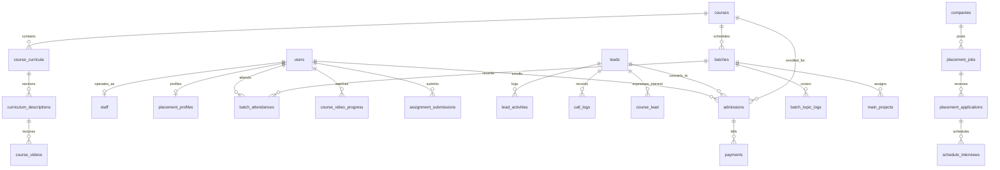

---

## Cross-Domain Data Flow & End-to-End State Lifecycles

### 1. Inbound Lead Acquisition to Enrolled Student Lifecycle
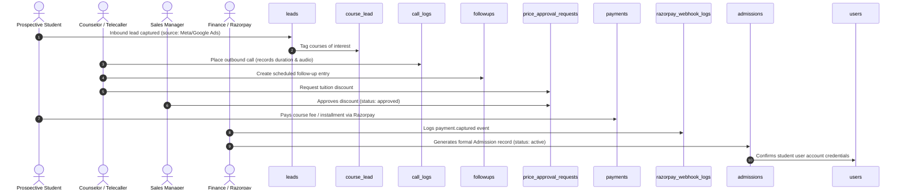

### 2. Academic Cohort Execution & Assessment Lifecycle
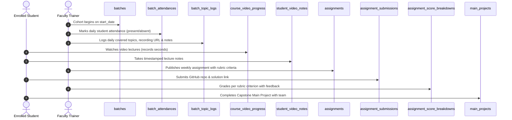

### 3. Talent Verification, Drive Application & Placement Lifecycle
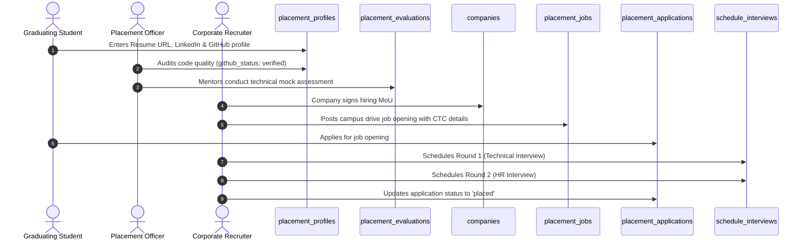

---

## Complete Relational Cardinality & Referential Integrity Matrix

| Parent Table | Relation | Child Table | Foreign Key Column | Action On Delete | Business Rationale |
| :--- | :---: | :--- | :--- | :---: | :--- |
| `users` | $1 : N$ | `admissions` | `admissions.user_id` | **RESTRICT** | Prevents deletion of student users with active admission and tuition contracts. |
| `users` | $1 : 1$ | `staff` | `staff.auth_id` | **CASCADE** | Deleting a staff account purges their internal employee record. |
| `users` | $1 : 1$ | `placement_profiles` | `placement_profiles.user_id` | **CASCADE** | Deleting a student removes their career profile and verification data. |
| `users` | $1 : N$ | `batch_attendances` | `batch_attendances.student_id` | **CASCADE** | Purges student attendance records if user account is permanently deleted. |
| `leads` | $1 : N$ | `lead_activities` | `lead_activities.lead_id` | **CASCADE** | Activity logs are strictly owned by the parent lead. |
| `leads` | $1 : N$ | `call_logs` | `call_logs.lead_id` | **SET NULL / CASCADE** | Retains telephony metrics while unlinking the lead, or cascades upon hard delete. |
| `courses` | $1 : N$ | `course_curricula` | `course_curricula.course_id` | **CASCADE** | Removing a course removes all top-level curriculum modules. |
| `course_curricula` | $1 : N$ | `curriculum_descriptions` | `curriculum_descriptions.course_curriculum_id` | **CASCADE** | Removing a curriculum module removes all subordinate chapters. |
| `curriculum_descriptions` | $1 : N$ | `course_videos` | `course_videos.curriculum_description_id` | **CASCADE** | Removing a chapter removes its video lecture records. |
| `courses` | $1 : N$ | `batches` | `batches.course_id` | **RESTRICT** | Prevents deletion of academic courses that have scheduled or ongoing cohorts. |
| `batches` | $1 : N$ | `batch_attendances` | `batch_attendances.batch_id` | **CASCADE** | Attendance records belong to that specific cohort batch. |
| `batches` | $1 : N$ | `batch_topic_logs` | `batch_topic_logs.batch_id` | **CASCADE** | Daily classroom logs belong to the batch. |
| `admissions` | $1 : N$ | `payments` | `payments.admission_id` | **RESTRICT** | Strictly prevents deleting admissions that possess payment ledger transactions. |
| `companies` | $1 : N$ | `placement_jobs` | `placement_jobs.company_id` | **CASCADE** | Job postings belong to the hiring company partner. |
| `placement_jobs` | $1 : N$ | `placement_applications` | `placement_applications.job_id` | **CASCADE** | Job applications belong to the job opening drive. |
| `placement_applications` | $1 : N$ | `schedule_interviews` | `schedule_interviews.application_id` | **CASCADE** | Interview rounds belong to that specific candidate job application. |

---

## Enterprise Optimization, Indexing & Storage Guidelines

### 1. Recommended High-Throughput Composite Indexes
```sql
-- Telecalling dashboard: Fast filtering of leads assigned to a specific counselor by pipeline stage
CREATE INDEX idx_leads_assignee_status ON leads (assigned_to, lead_status_id);

-- Attendance lookup: Speeds up student attendance checks and range reporting per batch
CREATE INDEX idx_attendance_batch_date ON batch_attendances (batch_id, date);

-- Video player resume: Instantaneous progress lookup during video playback start
CREATE INDEX idx_video_progress_lookup ON course_video_progress (auth_id, course_video_id);

-- Video notes: Fast chronological retrieval of notes taken during a lecture
CREATE INDEX idx_student_video_notes ON student_video_notes (user_id, video_id, timestamp_seconds);

-- Call log timeline: Chronological audio and call history retrieval for a lead
CREATE INDEX idx_call_logs_lead_date ON call_logs (lead_id, call_start DESC);

-- Placement dashboard: Fast candidate status lookup per recruitment drive
CREATE INDEX idx_placement_applications_job_student ON placement_applications (job_id, student_id);

-- Daily follow-ups: Telecaller agenda query for pending follow-ups today
CREATE INDEX idx_followups_date_status ON followups (call_date, status, created_by);
```

### 2. Monetary Precision & Audit Safety
- **Currency Representation:** Guarantee all monetary figures (`mrp_price`, `buy_price`, `amount_paid`, `balance_amount`, `discount`, `base_price`, `offered_price`) are stored using `DECIMAL(10, 2)` instead of `FLOAT` or `DOUBLE` to avoid IEEE 754 floating-point rounding discrepancies during financial auditing.
- **Webhook Idempotency:** The `razorpay_webhook_logs` table must be queried for existing `event_id` records before triggering downstream payment fulfillment logic to prevent duplicate payment crediting in concurrent webhook deliveries.

---
*End of Exhaustive Deep Architecture Specification — Velearn Platform*