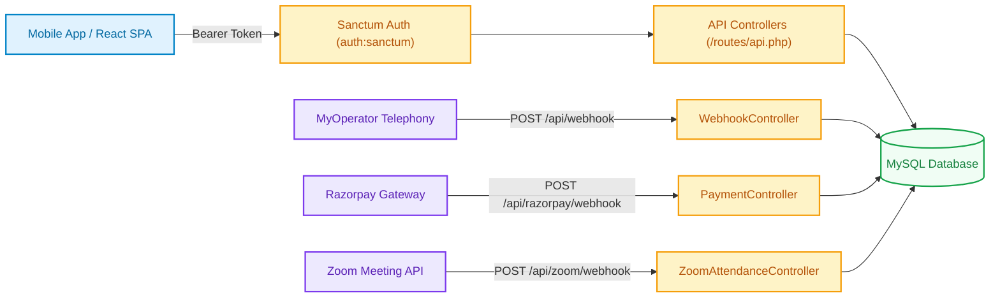

# Velearn Platform — Role Operations, Dashboard UI, Sidebar Navigation & Call Log Action Specification

**Project:** Velearn LMS, CRM & Placement Portal  
**Architecture Specification Level:** Production UI & Action-Level RBAC Blueprint  
**Verified Live Database:** `velearn-new-version` (Port `4306`)  
**Guard:** `web` (Spatie Laravel-Permission)  
**Total Verified Roles:** 13 Enterprise Roles  
**Date:** October 12, 2026  
**Document Target:** Full Operational & UI Workflow Documentation  

---

## Executive Summary & Governance Overview

In the **Velearn Platform**, every role is not just a collection of theoretical database permissions, but a **concrete operational workspace** equipped with:
1. **A Tailored Role Dashboard:** Displays role-specific KPI counter cards, progress meters, live charts, and today's action agenda.
2. **A Dedicated Role Sidebar Navigation:** Formatted with role-scoped navigation menus and `@can` authorization guards.
3. **Dedicated Operational Screens (e.g. Telecaller Call Log & History):** Specific data fields, disposition tags, audio playback links, and assignment drawers.
4. **Concrete Backend Controller Handlers & Routes:** Exact HTTP verbs and controllers executing the business logic and modifying database records.

---

## 1. Master Architectural Workflow & Role Navigation Flowchart

The following comprehensive architectural flowchart diagrams how each role navigates from authentication into their personalized dashboard, sidebar menus, and operational modules:

```mermaid
flowchart TD
    classDef auth fill:#e0f2fe,stroke:#0284c7,stroke-width:2px,color:#0369a1;
    classDef tele fill:#fef3c7,stroke:#f59e0b,stroke-width:2px,color:#b45309;
    classDef admin fill:#f0fdf4,stroke:#16a34a,stroke-width:2px,color:#15803d;
    classDef faculty fill:#ede9fe,stroke:#7c3aed,stroke-width:2px,color:#5b21b6;
    classDef place fill:#fee2e2,stroke:#ef4444,stroke-width:2px,color:#b91c1c;

    U["Authenticated User (users table)"]:::auth --> R{"Spatie Role Check<br/>(model_has_roles)"}

    %% Telecaller Path
    R -->|"Role: Tele Caller"| TCD["Telecaller Dashboard<br/>(/tele-caller/dashboard)"]:::tele
    TCD -->|"Sidebar: Inbound Calls"| IC["Inbound Calls Table<br/>(Contact, Phone, Source, Duration, Tag)"]:::tele
    TCD -->|"Sidebar: Outbound Calls"| OC["Outbound Calls Table<br/>(Duration, Recording Link, Disposition)"]:::tele
    TCD -->|"Sidebar: Call History"| CH["Master Call Log<br/>(Caller Number, Staff Grouping, Notes, Assignee)"]:::tele
    TCD -->|"Sidebar: Schedule Demo"| SD["Schedule Demo Grid<br/>(Mentor Slot Selector & Booking)"]:::tele
    TCD -->|"Sidebar: Follow-ups"| FU["Follow-ups Agenda<br/>(Scheduled Date & Overdue Alerts)"]:::tele

    %% Admission Officer Path
    R -->|"Role: Admission Officer"| AOD["Admission Officer Dashboard<br/>(/admission-officer/dashboard)"]:::admin
    AOD -->|"Sidebar: Lead Pipeline"| AL["Qualified Leads Table<br/>(Registration Status & Payment Slips)"]:::admin
    AOD -->|"Sidebar: Batch Allocation"| BA["Batch Allocation Workspace<br/>(Enroll Student into Cohort Roster)"]:::admin
    AOD -->|"Sidebar: Fee Payments"| FP["Fee Payments Ledger<br/>(Razorpay Webhook & Balance Auditing)"]:::admin

    %% Technical Staff Path
    R -->|"Role: Technical Staff"| TSD["Faculty Dashboard<br/>(/tech/dashboard)"]:::faculty
    TSD -->|"Sidebar: Batch System"| BS["Active Classroom Cockpit<br/>(Live Zoom Link & Roster)"]:::faculty
    TSD -->|"Sidebar: Batch Topic Logs"| BTL["Topic Covered Logger<br/>(Lecture Notes & Video Recording URL)"]:::faculty
    TSD -->|"Sidebar: Assignment Grading"| AG["Rubric Evaluation Screen<br/>(Itemized Breakdown Criteria & Marks)"]:::faculty
    TSD -->|"Sidebar: Doubt Sessions"| DS["1-on-1 Doubt Video Clinic<br/>(Code Debugging Sessions)"]:::faculty

    %% Placement Coordinator Path
    R -->|"Role: Placement Coordinator"| PCD["Placement Coordinator Dashboard<br/>(/placement-coordinator/dashboard)"]:::place
    PCD -->|"Sidebar: Company Database"| CD["Hiring Partner Directory<br/>(Corporate Recruiter Contacts & MoUs)"]:::place
    PCD -->|"Sidebar: Job Drives"| JO["Current Openings<br/>(Job CTC, Eligibility & Drive Date)"]:::place
    PCD -->|"Sidebar: Interview Tracker"| IS["Interview Status Funnel<br/>(Tech Round 1 & 2, HR Round, Offer)"]:::place
```

---

## 2. In-Depth Operational Example: Telecaller Role Architecture

The **Telecaller** workflow is an ideal operational case study demonstrating the end-to-end synchronization between **Dashboard**, **Sidebar Navigation**, **Call Details Screen**, **Permissions**, and **Executing Controller Actions**:

### 2.1 Telecaller Dashboard Details (`/tele-caller/dashboard`)
When a user with the **Tele Caller** role logs into the system, they are routed to `dashboards/tele-caller.blade.php`, presenting the following live operational metrics:

1. **KPI Metric Counter Cards:**
   - **Assigned Leads:** Displays active prospect inquiries assigned to this telecaller, with a **`+X today`** trend badge and progress percentage.
   - **Follow-ups Counter:** Displays total active callbacks, with an urgent **`X overdue`** alert badge if scheduled dates have elapsed.
   - **Demos Today:** Real-time count of scheduled trial demo sessions today, broken down into **🌅 Morning Slots** vs **🌆 Evening Slots**.
   - **Conversion Rate %:** Automatic calculation: `registeredCount / assignedLeadsCount * 100`.
   - **Registered Students:** Count of enrolled students who paid tuition through this telecaller's outreach.
2. **Telephony Volume Counters:**
   - **Total Inbound Leads:** All-time incoming calls from prospective students (+Today count).
   - **Total Outbound Leads:** All-time outgoing sales calls dialed (+Today count).
   - **Live Pulse Indicators:** Green pulsing beacon confirming active telephony synchronization.
3. **Lead Quality Donut Chart:**
   - Visual distribution of lead stages: `Hot` (high purchase intent), `Warm`, `Cold`, `Contacted`, `Demo Booked`, `Demo Attended`, `Demo Converted`, `Demo Lost`.
4. **Today's Follow-up Agenda:**
   - Chronological list of scheduled callbacks for the day with student names, phone numbers, scheduled times, and instant detail triggers.

---

### 2.2 Telecaller Sidebar Navigation & Permission Mapping

The sidebar dynamically renders menus governed by Spatie permissions (`@can` directives in `resources/views/includes/sidebar.blade.php` and `layouts/telecaller.blade.php`):

| Sidebar Menu Item | Icon | Route & URL | Required Permission | Executing Controller Action | What Action is Running (UI & DB Operation) |
| :--- | :---: | :--- | :--- | :--- | :--- |
| **Overview / Dashboard** | 📊 | `route('tele-caller.dashboard')` (`/tele-caller/dashboard`) | `Dashboard` | `DashboardController@teleCaller` | Queries `leads` and `call_logs` to calculate conversion rates and renders the telecaller KPI cockpit. |
| **Inbound Calls** | 📞 | `route('calls.inbound')` (`/calls/inbound`) | `Inbound Call List` | `InboundCallController@index` | Displays incoming call inquiries with caller number, source channel badge, and duration. |
| **Outbound Calls** | 📱 | `route('calls.outbound')` (`/calls/outbound`) | `Outbound Call List` | `OutboundCallController@index` | Displays outgoing dialing history with audio recording stream links and counselor notes. |
| **Call History (Master Call Log)** | 🕒 | `route('calls.history')` (`/calls/history`) | `Inbound Call List` / `Outbound Call List` | `CallLogController@index` | Comprehensive log of calls across all counselors and unassigned caller pools. |
| **Leads Pipeline** | 👥 | `route('leads.index')` (`/leads`) | `Lead List` | `LeadController@index` | CRM leads table with real-time search, source filtering, and temperature tags. |
| **Follow-ups** | ⏰ | `route('followups.index')` (`/followups`) | `Follow-up List` | `FollowupController@index` | Scheduled callback agenda highlighting overdue leads and recording follow-up promises. |
| **Schedule Demo** | 📅 | `route('schedules.index')` (`/schedules`) | `Schedule Demo` | `ScheduleController@index` | Calendar grid of mentor shift slots allowing telecallers to book live trial classes for leads. |
| **Demo Tracking** | 🎯 | `route('demo.tracking')` (`/demo-tracking`) | `Demo Tracking` | `DemoTrackingController@index` | Audits attendance of prospect students at demo sessions and logs feedback ratings. |
| **Batch System** | 📚 | `route('batches.index')` (`/batches`) | `Batch List` | `BatchController@index` | Read-only view of active cohort schedules to inform prospective students of upcoming start dates. |

---

### 2.3 Call Log Details & Call Information View Breakdown

When a telecaller clicks on a call row in **Inbound Calls**, **Outbound Calls**, or **Call History**, the platform opens the **Call Details Screen / Student Drawer** (`resources/views/calls/history.blade.php` and `calls/partials/call_rows.blade.php`).

The screen displays the following fields:

| Field Name | Database Source | UI Visual Element | Operational Semantics & User Capability |
| :--- | :--- | :--- | :--- |
| **Contact / Lead Name** | `contacts.first_name`, `leads.name` | Blue clickable link | Displays prospect name. Clicking opens full 360-degree lead profile drawer. |
| **Phone / Caller Number** | `call_logs.caller_number` | JetBrains Mono monospace font | Contact phone number dialed or received via cloud telephony (MyOperator). |
| **Call Source Channel** | `lead_sources.name` | Soft badge (e.g. MyOperator, Meta Ads) | Identifies marketing origin (e.g. Instagram, Google Ads, Referral, Website). |
| **Call Direction** | `call_logs.direction` | Green Incoming / Blue Outgoing / Red Missed badge | Visual badge with direction icon indicating incoming vs outgoing call. |
| **Call Duration** | `call_logs.call_duration` | Monospace timer (e.g. `04:32`) | Length of call in minutes and seconds. Unanswered calls display `—`. |
| **Call Outcome / Tag** | `call_logs.lead_tag`, `call_logs.status` | Color-coded pill badge | Temperature disposition: `Hot`, `Warm`, `Cold`, `Demo Booked`, `Demo Attended`, `Demo Converted`, `Lost`. |
| **Call Timestamp** | `call_logs.call_start` | Formatted date & time (e.g. `Apr 22, 09:14 AM`) | Exact chronological timestamp when call was logged. |
| **Audio Recording Link** | `call_logs.recording_url` | Green play button (`calls.get-recording`) | Streams telephony audio recording directly in the browser to audit conversation quality. |
| **Counselor Notes** | `call_logs.notes` | Multiline text area (`notes-input`) | Telecaller enters discussion summary, student course interest, and objections. |
| **Assignee Selector** | `call_logs.staff_id` | Dropdown menu (`assign-select`) | Telecaller assigns lead to **Self**, a **Faculty Trainer** (for trial demo), or an **Admission Officer** (for tuition payment). |

---

## 3. Comprehensive Specifications for All 13 Roles

### 3.2 Role: `Tele Caller`

- **Role Title:** **Tele Caller (Counselor / Telephony Operations)**
- **Database Identifier:** `roles.id = 2` | **Guard:** `web`
- **Live Database Permissions:** **12 Permissions**
- **Default Dashboard Route:** `/tele-caller/dashboard`
- **Dashboard View Template:** `dashboards/tele-caller.blade.php`

#### A. Role Dashboard Details & Widgets
| Dashboard Widget / KPI Card | What It Displays & How It Operates |
| :--- | :--- |
| **KPI Metric Counters** | Assigned Leads (+Today count), Overdue Follow-ups, Demos Today (Morning vs Evening slots), Conversion Rate %, and Registered Students. |
| **Call Volume Counters** | Total Inbound Leads (+Today Inbound), Total Outbound Leads (+Today Outbound), with live count pulse indicators. |
| **Lead Quality Donut Chart** | Visual breakdown of leads by temperature tags: Hot, Warm, Cold, Contacted, Demo Booked, Demo Attended, Demo Converted, Lost. |
| **Today's Follow-up Agenda** | Chronological timeline list of leads scheduled for callback today with time badges, contact numbers, and one-click dialer. |

#### B. Role Sidebar Navigation Items & Permitted Actions
| Sidebar Menu Item | Icon | Route & URL | Required Permission | What Action is Running (UI & DB Operation) |
| :--- | :---: | :--- | :--- | :--- |
| **Overview / Dashboard** | `fas fa-chart-pie` | `route('tele-caller.dashboard')` | `Dashboard` | Loads DashboardController@teleCaller. Displays assigned lead counters, call analytics, and daily agenda. |
| **Inbound Calls** | `fas fa-phone-alt` | `route('calls.inbound')` | `Inbound Call List` | Loads InboundCallController@index. Displays inbound leads table with caller number, source channel, call duration, and tag badge. |
| **Outbound Calls** | `fas fa-phone-volume` | `route('calls.outbound')` | `Outbound Call List` | Loads OutboundCallController@index. Displays outbound dialing history, duration timer, disposition status, and audio recording link. |
| **Call History (Master Call Log)** | `fas fa-history` | `route('calls.history')` | `Inbound Call List / Outbound Call List` | Loads CallLogController@index. Displays master log of calls grouped by staff member and unassigned caller pools. |
| **Leads Pipeline** | `fas fa-users` | `route('leads.index')` | `Lead List` | Loads LeadController@index. Displays leads with search, source filter, priority tags, and lead show drawer. |
| **Follow-ups** | `fas fa-clock` | `route('followups.index')` | `Follow-up List` | Loads FollowupController@index. Displays scheduled student and corporate callback dates, overdue alerts, and call notes. |
| **Schedule Demo** | `fas fa-calendar-plus` | `route('schedules.index')` | `Schedule Demo` | Loads ScheduleController@index. Grid of mentors and available demo slots to book live trial sessions for prospect leads. |
| **Demo Tracking** | `fas fa-tasks` | `route('demo.tracking')` | `Demo Tracking` | Loads DemoTrackingController@index. Audits student attendance at trial classes, feedback ratings, and conversion tags. |
| **Batch System** | `fas fa-layer-group` | `route('batches.index')` | `Batch List` | Loads BatchController@index. Views active and upcoming batch schedules to provide enrollment dates to prospective students. |

#### C. Operational Screen & Field Breakdown (Call Details & Call Log View (/calls/history & Student Detail Drawer))
| Field / Element | Database Source Column | Operational Details & Business Rules |
| :--- | :--- | :--- |
| **Contact Name** | `leads.name / contacts.name` | Name of the prospect student or corporate caller. |
| **Caller Number** | `call_logs.caller_number` | Phone number dialed or received via MyOperator cloud telephony. |
| **Call Source** | `call_logs.source / lead_sources.name` | Acquisition campaign (e.g. MyOperator, Meta Ads, Google Ads, Website, WhatsApp). |
| **Direction Badge** | `call_logs.direction` | Visual badge indicating Incoming (green), Outgoing (blue), or Missed (red). |
| **Call Duration** | `call_logs.call_duration` | Formatted as minutes and seconds (e.g., 04:32). Zero duration marks missed/unanswered. |
| **Call Outcome / Tag** | `call_logs.lead_tag / call_logs.status` | Disposition status: Hot, Warm, Cold, Contacted, Demo Booked, Demo Attended, Demo Converted, or Lost. |
| **Call Timestamp** | `call_logs.call_start` | Exact date and time the call was initiated and logged. |
| **Audio Recording URL** | `call_logs.recording_url` | Streamable audio link to review telephony conversation quality. |
| **Counselor Notes** | `call_logs.notes` | Editable text area where the telecaller summarizes the discussion and student requirements. |
| **Assignee Dropdown** | `call_logs.staff_id` | Option to assign lead to Self, Faculty Trainer (for demo), or Admission Officer (for tuition). |

#### D. Complete Granular Permissions Matrix for Tele Caller (12 Permissions)
| # | Permission Name | Group | Executing Controller Action | HTTP Method & Route | Running Action Description |
| :---: | :--- | :--- | :--- | :--- | :--- |
| 1 | `Batch List` | **Batches** | `BatchController@index` | `GET /batches` | Lists academic cohort batches with start/end dates, mode, trainer, and enrolled student counts. |
| 2 | `Inbound Call List` | **Calls** | `InboundCallController@index` | `GET /calls/inbound` | Views inbound telephone inquiries, caller identity, and assigned telecaller queues. |
| 3 | `Outbound Call List` | **Calls** | `OutboundCallController@index` | `GET /calls/outbound` | Views outbound counseling call logs with duration timers and audio recording playback links. |
| 4 | `Dashboard` | **Dashboard** | `DashboardController@index (or role-specific dashboard)` | `GET /dashboard -> role-specific redirection` | Views personalized analytics widgets, KPI cards, pending tasks, and notifications based on assigned role. |
| 5 | `Demo Tracking` | **Demos** | `DemoTrackingController@index` | `GET /demo-tracking` | Tracks whether prospect attended scheduled demo session and logs student feedback. |
| 6 | `Schedule Demo` | **Demos** | `ScheduleController@bookDemo` | `POST /demo/book` | Books trial demo class for prospect lead with selected faculty batch or mentor. |
| 7 | `Follow-up List` | **Follow-ups** | `FollowupController@index` | `GET /followups` | Displays daily telecaller callback agenda, scheduled times, and overdue follow-up alerts. |
| 8 | `Lead Activity Edit` | **Leads** | `LeadController@updateActivity` | `PUT /leads/activity/{id}` | Edits timestamped interaction log notes, call remarks, or follow-up outcomes. |
| 9 | `Lead Create` | **Leads** | `LeadController@store` | `POST /leads` | Captures new inbound or manual prospect lead with contact details and interested course. |
| 10 | `Lead Edit` | **Leads** | `LeadController@update` | `PUT /leads/{id}` | Updates prospect qualifications, pipeline status stage, or counselor re-assignment. |
| 11 | `Lead Show` | **Leads** | `LeadController@show` | `GET /leads/{id}` | Comprehensive 360-degree lead profile showing call history, trial bookings, and audit timeline. |
| 12 | `Student List` | **Students** | `StudentController@index` | `GET /students` | Displays directory of enrolled students with active course, assigned batch, and admission status. |

---

### 3.3 Role: `Admission Officer`

- **Role Title:** **Admission Officer (Tuition & Enrollment Operations)**
- **Database Identifier:** `roles.id = 3` | **Guard:** `web`
- **Live Database Permissions:** **8 Permissions**
- **Default Dashboard Route:** `/admission-officer/dashboard`
- **Dashboard View Template:** `dashboards/admission-officer.blade.php`

#### A. Role Dashboard Details & Widgets
| Dashboard Widget / KPI Card | What It Displays & How It Operates |
| :--- | :--- |
| **Total Qualified Leads** | Counts converted prospects handed over by telecallers for formal admissions. |
| **Follow-ups Today** | Scheduled fee payment callbacks and token deposit follow-ups. |
| **Revenue Collected (INR)** | Total tuition amount collected this month vs pending balance dues. |
| **Registered Students Count** | Number of students issued admission contracts and enrolled in batches. |

#### B. Role Sidebar Navigation Items & Permitted Actions
| Sidebar Menu Item | Icon | Route & URL | Required Permission | What Action is Running (UI & DB Operation) |
| :--- | :---: | :--- | :--- | :--- |
| **Dashboard** | `fas fa-chart-pie` | `route('admission-officer.dashboard')` | `Dashboard` | Loads DashboardController@admissionOfficer with revenue and registration metrics. |
| **Lead Pipeline** | `fas fa-user-friends` | `route('leads.index')` | `Lead List` | Loads LeadController@index. Filters leads in Admission Stage. |
| **Admission Follow-ups** | `fas fa-calendar-check` | `route('followups.index')` | `Follow-up List` | Follows up on students with pending document submission or token balances. |
| **Fee Payments** | `fas fa-wallet` | `route('payments.index')` | `Payment List` | Loads PaymentController@index. Audits installment receipts and Razorpay transactions. |
| **Batch Allocation** | `fas fa-users-cog` | `route('batch-allocation.index')` | `Batch Allocation` | Loads BatchController@allocation. Enrolls admitted students into designated cohorts. |

#### C. Operational Screen & Field Breakdown (Admissions Lead Review & Payment Slips)
| Field / Element | Database Source Column | Operational Details & Business Rules |
| :--- | :--- | :--- |
| **Contract Number** | `admissions.admission_number` | Unique admission agreement serial number. |
| **Enrolled Course & Batch** | `courses.course_name / batches.batch_name` | Class cohort and course allocated. |
| **Fee Ledger** | `payments.amount_paid / payments.balance_amount` | Total agreed price, token down payment, and installment schedule. |

#### D. Complete Granular Permissions Matrix for Admission Officer (8 Permissions)
| # | Permission Name | Group | Executing Controller Action | HTTP Method & Route | Running Action Description |
| :---: | :--- | :--- | :--- | :--- | :--- |
| 1 | `Batch Allocation` | **Batch Allocation** | `BatchController@allocation` | `GET /batch-allocation` | Workspace to allocate newly enrolled students into target batch cohorts. |
| 2 | `Dashboard` | **Dashboard** | `DashboardController@index (or role-specific dashboard)` | `GET /dashboard -> role-specific redirection` | Views personalized analytics widgets, KPI cards, pending tasks, and notifications based on assigned role. |
| 3 | `Follow-up List` | **Follow-ups** | `FollowupController@index` | `GET /followups` | Displays daily telecaller callback agenda, scheduled times, and overdue follow-up alerts. |
| 4 | `Lead List` | **Leads** | `LeadController@index` | `GET /leads` | Displays CRM lead pipeline cards with status tags, source channels, and priority badges. |
| 5 | `Lead Payment View` | **Leads** | `LeadController@paymentView` | `GET /leads/{id}/payments` | Views financial receipts, collected registration token amount, and pending fee dues. |
| 6 | `Lead Registration View` | **Leads** | `LeadController@registrationView` | `GET /leads/{id}/registration` | Inspects converted lead admission onboarding status and registration form fields. |
| 7 | `Lead Show` | **Leads** | `LeadController@show` | `GET /leads/{id}` | Comprehensive 360-degree lead profile showing call history, trial bookings, and audit timeline. |
| 8 | `Payment List` | **Payments** | `PaymentController@index` | `GET /payments` | Displays ledger of tuition collections, Razorpay transactions, receipt numbers, and balances. |

---

### 3.8 Role: `Dues collector`

- **Role Title:** **Dues Collector (Tuition Recovery & Installments)**
- **Database Identifier:** `roles.id = 8` | **Guard:** `web`
- **Live Database Permissions:** **4 Permissions**
- **Default Dashboard Route:** `/dues/dashboard`
- **Dashboard View Template:** `dashboards/dues.blade.php`

#### A. Role Dashboard Details & Widgets
| Dashboard Widget / KPI Card | What It Displays & How It Operates |
| :--- | :--- |
| **Total Due Students** | Number of enrolled students with active outstanding tuition installments. |
| **Overdue Students (Alert)** | Critical count of students whose installment due date has passed. |
| **Total Pending Dues (INR)** | Total uncollected fees across all active cohorts. |
| **Total Collected (All Time)** | Cumulative fee recovery collections settled. |

#### B. Role Sidebar Navigation Items & Permitted Actions
| Sidebar Menu Item | Icon | Route & URL | Required Permission | What Action is Running (UI & DB Operation) |
| :--- | :---: | :--- | :--- | :--- |
| **Dashboard** | `fas fa-chart-line` | `route('dues.dashboard')` | `Dashboard` | Loads DashboardController@duesCollector with installment recovery metrics. |
| **Student Due List** | `fas fa-exclamation-circle` | `route('student-dues.index')` | `Student Due List` | Loads PaymentController@studentDues. Filters students with overdue balance dates. |
| **Due Follow-ups** | `fas fa-phone` | `route('due-followups.index')` | `Due Followup` | Loads PaymentController@dueFollowups. Call agenda to record promises to pay. |
| **Completed Payments** | `fas fa-check-double` | `route('completed-payments.index')` | `Completed Payments` | Loads PaymentController@completedPayments. Register of cleared contracts. |

#### C. Operational Screen & Field Breakdown (Due Follow-up Log)
| Field / Element | Database Source Column | Operational Details & Business Rules |
| :--- | :--- | :--- |
| **Student Name & Phone** | `users.name / users.phonenumber` | Enrolled student debtor contact information. |
| **Overdue Amount** | `payments.balance_amount` | Unpaid fee balance pending collection. |
| **Promise to Pay Date** | `followups.call_date` | Agreed date on which the student promised to clear the installment. |

#### D. Complete Granular Permissions Matrix for Dues collector (4 Permissions)
| # | Permission Name | Group | Executing Controller Action | HTTP Method & Route | Running Action Description |
| :---: | :--- | :--- | :--- | :--- | :--- |
| 1 | `Dashboard` | **Dashboard** | `DashboardController@index (or role-specific dashboard)` | `GET /dashboard -> role-specific redirection` | Views personalized analytics widgets, KPI cards, pending tasks, and notifications based on assigned role. |
| 2 | `Completed Payments` | **Payments** | `PaymentController@completedPayments` | `GET /completed-payments` | Audited register of fully settled student tuition contracts. |
| 3 | `Due Followup` | **Payments** | `PaymentController@dueFollowups` | `GET /due-followups` | Fee recovery agenda for dues collector to record payment promises and call feedback. |
| 4 | `Student Due List` | **Payments** | `PaymentController@studentDues` | `GET /student-dues` | Financial report filtering students with overdue tuition installment balances. |

---

### 3.5 Role: `Technical Staff`

- **Role Title:** **Technical Staff (Faculty, Classroom & Rubric Evaluation)**
- **Database Identifier:** `roles.id = 5` | **Guard:** `web`
- **Live Database Permissions:** **29 Permissions**
- **Default Dashboard Route:** `/tech/dashboard`
- **Dashboard View Template:** `resources/views/layouts/tech_staff.blade.php`

#### A. Role Dashboard Details & Widgets
| Dashboard Widget / KPI Card | What It Displays & How It Operates |
| :--- | :--- |
| **Assigned Batches** | Active student cohorts taught by this faculty trainer. |
| **Pending Rubric Submissions** | Student assignments, mini projects, and capstone code repositories awaiting grading. |
| **Today's Live Demo & Doubt Sessions** | Scheduled Zoom clinics with prospective and enrolled students. |
| **Syllabus Topic Logs** | Status of daily lecture logs submitted. |

#### B. Role Sidebar Navigation Items & Permitted Actions
| Sidebar Menu Item | Icon | Route & URL | Required Permission | What Action is Running (UI & DB Operation) |
| :--- | :---: | :--- | :--- | :--- |
| **Dashboard** | `fas fa-home` | `route('tech.dashboard')` | `Dashboard` | Loads TechDashboardController@index. |
| **Batch System** | `fas fa-chalkboard-teacher` | `route('batch-system.index')` | `Batch System` | Trainer cockpit with classroom Zoom links and student rosters. |
| **Batch Topic Logs** | `fas fa-book` | `route('tech.batch-logs.index')` | `Batch Topic Logs` | Records daily syllabus coverage, notes URL, and video lecture link. |
| **Assignments Evaluation** | `fas fa-clipboard-check` | `route('assignments.index')` | `Assignment List / Evaluate` | Grades student code against weighted rubric criteria. |
| **Mini Projects Evaluation** | `fas fa-code-branch` | `route('mini_projects.index')` | `Mini Project List / Evaluate` | Evaluates milestone GitHub repositories. |
| **Main Capstone Evaluation** | `fas fa-trophy` | `route('main_projects.index')` | `Main Project List / Evaluate` | Conducts capstone defense and awards rubric scores. |
| **Doubt Sessions** | `fas fa-question-circle` | `route('tech.doubt-sessions.index')` | `Doubt Sessions` | Hosts 1-on-1 code debugging video clinics. |
| **Placement Classes & Mock Exams** | `fas fa-user-graduate` | `route('placement-classes.index')` | `Placement Classes / Placement Evaluation` | Conducts mock technical interviews and records readiness scores. |

#### C. Operational Screen & Field Breakdown (Doubt Session Logs & Mock Assessment)
| Field / Element | Database Source Column | Operational Details & Business Rules |
| :--- | :--- | :--- |
| **Session Type** | `session_bookings.session_type` | Trial Demo vs Doubt Clearing vs Mock Interview. |
| **Zoom Meeting ID** | `session_bookings.zoom_meeting_id` | Generated meeting link for live video instruction. |
| **Rubric Criteria Breakdown** | `score_breakdowns.score` | Itemized marks awarded across code cleanliness, logic, and presentation. |

#### D. Complete Granular Permissions Matrix for Technical Staff (29 Permissions)
| # | Permission Name | Group | Executing Controller Action | HTTP Method & Route | Running Action Description |
| :---: | :--- | :--- | :--- | :--- | :--- |
| 1 | `Assignment Complete` | **Academics** | `AssignmentController@updateStatus` | `POST /assignments/{assignment}/update-status` | Marks assignment as formally completed and publishes final grade to student dashboard. |
| 2 | `Assignment Evaluate` | **Academics** | `AssignmentEvaluationController@storeEvaluation` | `POST /assignments/submissions/{submission}/evaluate` | Grades student code submission across rubric criteria and enters score breakdown numbers. |
| 3 | `Assignment List` | **Academics** | `AssignmentController@index` | `GET /assignments` | Lists curriculum assignments with total points, deadlines, and submission counts. |
| 4 | `Main Project Complete` | **Academics** | `MainProjectController@updateStatus` | `POST /main-projects/{main_project}/update-status` | Issues final capstone approval required for placement drive eligibility. |
| 5 | `Main Project Evaluate` | **Academics** | `MainProjectEvaluationController@storeEvaluation` | `POST /main-projects/submissions/{submission}/evaluate` | Conducts formal capstone code defense, checks live demo URL, and awards rubric scores. |
| 6 | `Main Project List` | **Academics** | `MainProjectController@index` | `GET /main-projects` | Displays capstone project catalog required for course graduation and placement eligibility. |
| 7 | `Mini Project Complete` | **Academics** | `MiniProjectController@updateStatus` | `POST /mini-projects/{mini_project}/update-status` | Certifies mini project as successfully completed and approved. |
| 8 | `Mini Project Evaluate` | **Academics** | `MiniProjectEvaluationController@storeEvaluation` | `POST /mini-projects/submissions/{submission}/evaluate` | Evaluates mini project code repository and enters rubric criteria breakdown scores. |
| 9 | `Mini Project List` | **Academics** | `MiniProjectController@index` | `GET /mini-projects` | Lists practical mini projects assigned after major course milestone chapters. |
| 10 | `Batch Create` | **Batches** | `BatchController@store` | `POST /batches` | Initializes new cohort batch, assigning course, faculty trainer, and start date. |
| 11 | `Batch Delete` | **Batches** | `BatchController@destroy` | `DELETE /batches/{id}` | Deletes cohort batch (restricted if students are already allocated). |
| 12 | `Batch Edit` | **Batches** | `BatchController@update` | `PUT /batches/{id}` | Modifies cohort timings, trainer assignment, classroom Zoom URL, or maximum seat capacity. |
| 13 | `Batch List` | **Batches** | `BatchController@index` | `GET /batches` | Lists academic cohort batches with start/end dates, mode, trainer, and enrolled student counts. |
| 14 | `Batch Topic Logs` | **Batches** | `BatchController@storeTopicLog` | `POST /batches/{batch}/topics` | Trainer records daily syllabus topic covered, attach lecture notes URL, and paste video link. |
| 15 | `Dashboard` | **Dashboard** | `DashboardController@index (or role-specific dashboard)` | `GET /dashboard -> role-specific redirection` | Views personalized analytics widgets, KPI cards, pending tasks, and notifications based on assigned role. |
| 16 | `Batch System` | **Management** | `BatchSystemController@index` | `GET /batch-system` | Faculty workspace displaying assigned active cohort cards, live Zoom links, and student attendance. |
| 17 | `Student Monitoring` | **Management** | `StudentsManagementController@index` | `GET /tech/students` | Tracks student attendance percentages and flags students falling behind milestone deadlines. |
| 18 | `Students` | **Management** | `StudentsManagementController@index` | `GET /tech/students` | Mentors inspect student roster, submitted assignments, and video watch progress. |
| 19 | `Placement Classes` | **Placement** | `PlacementClassController@index` | `GET /placement-classes` | Displays curriculum of placement readiness classes, soft skills, and aptitude lessons. |
| 20 | `Placement Classes Create` | **Placement** | `PlacementClassController@store` | `POST /placement-classes` | Creates new placement training lesson with video recording link. |
| 21 | `Placement Classes Delete` | **Placement** | `PlacementClassController@destroy` | `DELETE /placement-classes/{id}` | Removes placement class record. |
| 22 | `Placement Classes Edit` | **Placement** | `PlacementClassController@update` | `PUT /placement-classes/{id}` | Updates placement class syllabus details. |
| 23 | `Placement Evaluation Create` | **Placement** | `PlacementEvaluationController@store` | `POST /placement-evaluations` | Conducts mock interview and records rubric ratings across problem solving and communication. |
| 24 | `Placement Evaluation Delete` | **Placement** | `PlacementEvaluationController@destroy` | `DELETE /placement-evaluations/{id}` | Deletes mock evaluation scorecard. |
| 25 | `Placement Evaluation Edit` | **Placement** | `PlacementEvaluationController@update` | `PUT /placement-evaluations/{id}` | Updates mock interview feedback and recommendations. |
| 26 | `Placement Evaluation List` | **Placement** | `PlacementEvaluationController@index` | `GET /placement-evaluations` | Displays mock interview scorecards and technical evaluation records. |
| 27 | `Demo Sessions` | **Sessions** | `DemoSessionController@index` | `GET /tech/demo-sessions` | Faculty conducts live trial demo sessions booked by telecallers. |
| 28 | `Doubt Sessions` | **Sessions** | `DoubtSessionController@index` | `GET /tech/doubt-sessions` | 1-on-1 mentor video clinic resolving code debugging and assignment queries. |
| 29 | `Meetings` | **Tools** | `MeetingController@index` | `GET /meetings` | Hosts internal staff coordination meetings, departmental syncs, and faculty townhalls. |

---

### 3.6 Role: `Technical Head`

- **Role Title:** **Technical Head (Academic Leadership & Curriculum Lead)**
- **Database Identifier:** `roles.id = 6` | **Guard:** `web`
- **Live Database Permissions:** **41 Permissions**
- **Default Dashboard Route:** `/tech-head/dashboard`
- **Dashboard View Template:** `dashboards/tech-head.blade.php`

#### A. Role Dashboard Details & Widgets
| Dashboard Widget / KPI Card | What It Displays & How It Operates |
| :--- | :--- |
| **Total Students Across Courses** | Enrolled students broken down by Full Stack, UI/UX, Data Science, and Digital Marketing. |
| **Total Batches & Sessions** | Active batches per domain, scheduled executive demos, and doubt clinics. |
| **Today's Executive Demos** | High-stakes trial sessions conducted for premium clients or corporate prospects. |
| **Staff Monitoring & Performance** | Audit table of faculty punctuality, lecture topic logs, and grading speed. |

#### B. Role Sidebar Navigation Items & Permitted Actions
| Sidebar Menu Item | Icon | Route & URL | Required Permission | What Action is Running (UI & DB Operation) |
| :--- | :---: | :--- | :--- | :--- |
| **Dashboard** | `fas fa-chart-line` | `route('tech-head.dashboard')` | `Dashboard` | Loads DashboardController@technicalHead. |
| **Courses & Curricula** | `fas fa-graduation-cap` | `route('courses.index')` | `Course List / Create / Edit` | Authors curriculum modules, chapters, video links, and practice sets. |
| **Batch Progress** | `fas fa-tasks` | `route('tech.batch-progress.index')` | `Batch Progress` | Monitors syllabus completion percentages across all active cohorts. |
| **Staff Monitoring** | `fas fa-user-tie` | `route('tech.staff-monitoring.index')` | `Staff Monitoring` | Supervises technical staff shift attendance and lecture delivery. |
| **Curriculum Rubrics** | `fas fa-ruler-combined` | `route('assignments.index')` | `Assignment List / Create` | Formulates weighted rubric criteria for assignments and capstones. |
| **Executive Demo Sessions** | `fas fa-bullseye` | `route('tech-head.demo-sessions.index')` | `Technical Head Demo Sessions` | Delivers advanced trial classes for high-profile prospects. |

#### C. Operational Screen & Field Breakdown (Curriculum & Faculty Audit Logs)
| Field / Element | Database Source Column | Operational Details & Business Rules |
| :--- | :--- | :--- |
| **Lecture Topic Log** | `batch_topic_logs.topic_name` | Syllabus chapter completed during live batch lecture. |
| **Faculty Status** | `batch_topic_logs.status` | Verification that class was completed on schedule with notes and recording attached. |

#### D. Complete Granular Permissions Matrix for Technical Head (41 Permissions)
| # | Permission Name | Group | Executing Controller Action | HTTP Method & Route | Running Action Description |
| :---: | :--- | :--- | :--- | :--- | :--- |
| 1 | `Assignment Complete` | **Academics** | `AssignmentController@updateStatus` | `POST /assignments/{assignment}/update-status` | Marks assignment as formally completed and publishes final grade to student dashboard. |
| 2 | `Assignment Create` | **Academics** | `AssignmentController@store` | `POST /assignments` | Authors new assignment problem statement and sets weighted rubric evaluation criteria. |
| 3 | `Assignment Delete` | **Academics** | `AssignmentController@destroy` | `DELETE /assignments/{id}` | Deletes assignment and unlinks criteria. |
| 4 | `Assignment Edit` | **Academics** | `AssignmentController@update` | `PUT /assignments/{id}` | Modifies assignment task description, test files, or maximum score. |
| 5 | `Assignment Evaluate` | **Academics** | `AssignmentEvaluationController@storeEvaluation` | `POST /assignments/submissions/{submission}/evaluate` | Grades student code submission across rubric criteria and enters score breakdown numbers. |
| 6 | `Assignment List` | **Academics** | `AssignmentController@index` | `GET /assignments` | Lists curriculum assignments with total points, deadlines, and submission counts. |
| 7 | `Main Project Complete` | **Academics** | `MainProjectController@updateStatus` | `POST /main-projects/{main_project}/update-status` | Issues final capstone approval required for placement drive eligibility. |
| 8 | `Main Project Create` | **Academics** | `MainProjectController@store` | `POST /main-projects` | Authors full-stack industry capstone project with comprehensive rubric criteria. |
| 9 | `Main Project Delete` | **Academics** | `MainProjectController@destroy` | `DELETE /main-projects/{id}` | Deletes capstone project specification. |
| 10 | `Main Project Edit` | **Academics** | `MainProjectController@update` | `PUT /main-projects/{id}` | Modifies capstone project requirements and evaluation standards. |
| 11 | `Main Project Evaluate` | **Academics** | `MainProjectEvaluationController@storeEvaluation` | `POST /main-projects/submissions/{submission}/evaluate` | Conducts formal capstone code defense, checks live demo URL, and awards rubric scores. |
| 12 | `Main Project List` | **Academics** | `MainProjectController@index` | `GET /main-projects` | Displays capstone project catalog required for course graduation and placement eligibility. |
| 13 | `Mini Project Complete` | **Academics** | `MiniProjectController@updateStatus` | `POST /mini-projects/{mini_project}/update-status` | Certifies mini project as successfully completed and approved. |
| 14 | `Mini Project Create` | **Academics** | `MiniProjectController@store` | `POST /mini-projects` | Creates new mini project specification with GitHub repo submission requirements. |
| 15 | `Mini Project Delete` | **Academics** | `MiniProjectController@destroy` | `DELETE /mini-projects/{id}` | Removes mini project from curriculum. |
| 16 | `Mini Project Edit` | **Academics** | `MiniProjectController@update` | `PUT /mini-projects/{id}` | Updates mini project technical specifications and rubric criteria weights. |
| 17 | `Mini Project Evaluate` | **Academics** | `MiniProjectEvaluationController@storeEvaluation` | `POST /mini-projects/submissions/{submission}/evaluate` | Evaluates mini project code repository and enters rubric criteria breakdown scores. |
| 18 | `Mini Project List` | **Academics** | `MiniProjectController@index` | `GET /mini-projects` | Lists practical mini projects assigned after major course milestone chapters. |
| 19 | `Batch Progress` | **Batches** | `BatchProgressController@index` | `GET /tech/batch-progress` | Visualizes syllabus completion percentage and completed lecture hours per cohort. |
| 20 | `Batch Topic Logs` | **Batches** | `BatchController@storeTopicLog` | `POST /batches/{batch}/topics` | Trainer records daily syllabus topic covered, attach lecture notes URL, and paste video link. |
| 21 | `Course Create` | **Courses** | `CourseController@store` | `POST /courses` | Authors new course record, setting slug, thumbnail, duration, and price. |
| 22 | `Course Delete` | **Courses** | `CourseController@destroy` | `DELETE /courses/{id}` | Deletes course from catalog (restricted if active admissions exist). |
| 23 | `Course Edit` | **Courses** | `CourseController@update` | `PUT /courses/{id}` | Modifies course curriculum descriptions, pricing, skills acquired, and FAQs. |
| 24 | `Course List` | **Courses** | `CourseController@index` | `GET /courses` | Displays course catalog, curriculum module tree, lecture counts, and pricing tiers. |
| 25 | `Course Status` | **Courses** | `CourseController@updateCourseStatus` | `POST /courses/update-status` | Toggles course visibility (Draft, Active, Archived). |
| 26 | `Course View` | **Courses** | `CourseController@show` | `GET /courses/{id}` | Detailed view of course syllabus structure, video lectures, and attached assignments. |
| 27 | `Dashboard` | **Dashboard** | `DashboardController@index (or role-specific dashboard)` | `GET /dashboard -> role-specific redirection` | Views personalized analytics widgets, KPI cards, pending tasks, and notifications based on assigned role. |
| 28 | `Batch System` | **Management** | `BatchSystemController@index` | `GET /batch-system` | Faculty workspace displaying assigned active cohort cards, live Zoom links, and student attendance. |
| 29 | `Staff Monitoring` | **Management** | `StaffMonitoringController@index` | `GET /tech/staff-monitoring` | Supervises technical staff shift attendance, demo delivery, and grading speed. |
| 30 | `Student Monitoring` | **Management** | `StudentsManagementController@index` | `GET /tech/students` | Tracks student attendance percentages and flags students falling behind milestone deadlines. |
| 31 | `Placement Classes` | **Placement** | `PlacementClassController@index` | `GET /placement-classes` | Displays curriculum of placement readiness classes, soft skills, and aptitude lessons. |
| 32 | `Placement Classes Create` | **Placement** | `PlacementClassController@store` | `POST /placement-classes` | Creates new placement training lesson with video recording link. |
| 33 | `Placement Classes Delete` | **Placement** | `PlacementClassController@destroy` | `DELETE /placement-classes/{id}` | Removes placement class record. |
| 34 | `Placement Classes Edit` | **Placement** | `PlacementClassController@update` | `PUT /placement-classes/{id}` | Updates placement class syllabus details. |
| 35 | `Placement Evaluation Create` | **Placement** | `PlacementEvaluationController@store` | `POST /placement-evaluations` | Conducts mock interview and records rubric ratings across problem solving and communication. |
| 36 | `Placement Evaluation Delete` | **Placement** | `PlacementEvaluationController@destroy` | `DELETE /placement-evaluations/{id}` | Deletes mock evaluation scorecard. |
| 37 | `Placement Evaluation Edit` | **Placement** | `PlacementEvaluationController@update` | `PUT /placement-evaluations/{id}` | Updates mock interview feedback and recommendations. |
| 38 | `Placement Evaluation List` | **Placement** | `PlacementEvaluationController@index` | `GET /placement-evaluations` | Displays mock interview scorecards and technical evaluation records. |
| 39 | `Technical Head Demo Sessions` | **Sessions** | `TechHeadDemoSessionController@index` | `GET /tech-head/demo-sessions` | Technical Head delivers executive product demos for corporate clients or advanced prospects. |
| 40 | `Technical Head Doubt Sessions` | **Sessions** | `TechHeadDoubtSessionController@index` | `GET /tech-head/doubt-sessions` | Advanced masterclass resolving complex architectural and capstone project doubts. |
| 41 | `Meetings` | **Tools** | `MeetingController@index` | `GET /meetings` | Hosts internal staff coordination meetings, departmental syncs, and faculty townhalls. |

---

### 3.7 Role: `Learning Coordinator`

- **Role Title:** **Learning Coordinator (Progress & Milestone Compliance)**
- **Database Identifier:** `roles.id = 7` | **Guard:** `web`
- **Live Database Permissions:** **7 Permissions**
- **Default Dashboard Route:** `/learning/dashboard`
- **Dashboard View Template:** `dashboards/learning.blade.php`

#### A. Role Dashboard Details & Widgets
| Dashboard Widget / KPI Card | What It Displays & How It Operates |
| :--- | :--- |
| **Course Progress Overview** | Batch-by-batch student progress bars tracking video completion and attendance. |
| **Pending Assignment Submissions** | Count of students who have not yet submitted required assignments. |
| **Mini & Main Project Milestones** | Tracking students across Phase 1, Phase 2, and Final Capstone stages. |

#### B. Role Sidebar Navigation Items & Permitted Actions
| Sidebar Menu Item | Icon | Route & URL | Required Permission | What Action is Running (UI & DB Operation) |
| :--- | :---: | :--- | :--- | :--- |
| **Dashboard** | `fas fa-tachometer-alt` | `route('learning.dashboard')` | `Dashboard` | Loads DashboardController@learningCoordinator. |
| **Assignments Status** | `fas fa-clipboard-list` | `route('assignments.index')` | `Assignment List / Status` | Monitors submission compliance and flags overdue students. |
| **Mini Projects Status** | `fas fa-project-diagram` | `route('mini_projects.index')` | `Mini Project List / Status` | Audits milestone completion rates across cohorts. |
| **Main Projects Status** | `fas fa-award` | `route('main_projects.index')` | `Main Project List / Status` | Tracks final capstone approvals required for placement eligibility. |

#### C. Operational Screen & Field Breakdown (Academic Compliance Record)
| Field / Element | Database Source Column | Operational Details & Business Rules |
| :--- | :--- | :--- |
| **Submission Date** | `assignment_submissions.created_at` | Timestamp when student submitted project code. |
| **Evaluation Status** | `assignment_submissions.status` | Pending Review vs Evaluated vs Needs Revision. |

#### D. Complete Granular Permissions Matrix for Learning Coordinator (7 Permissions)
| # | Permission Name | Group | Executing Controller Action | HTTP Method & Route | Running Action Description |
| :---: | :--- | :--- | :--- | :--- | :--- |
| 1 | `Assignment List` | **Academics** | `AssignmentController@index` | `GET /assignments` | Lists curriculum assignments with total points, deadlines, and submission counts. |
| 2 | `Assignment Status` | **Academics** | `AssignmentController@updateStatus` | `POST /assignments/{assignment}/update-status` | Toggles assignment visibility (Active, Closed, Archived). |
| 3 | `Main Project List` | **Academics** | `MainProjectController@index` | `GET /main-projects` | Displays capstone project catalog required for course graduation and placement eligibility. |
| 4 | `Main Project Status` | **Academics** | `MainProjectController@updateStatus` | `POST /main-projects/{main_project}/update-status` | Toggles capstone project active status. |
| 5 | `Mini Project List` | **Academics** | `MiniProjectController@index` | `GET /mini-projects` | Lists practical mini projects assigned after major course milestone chapters. |
| 6 | `Mini Project Status` | **Academics** | `MiniProjectController@updateStatus` | `POST /mini-projects/{mini_project}/update-status` | Toggles mini project operational status. |
| 7 | `Dashboard` | **Dashboard** | `DashboardController@index (or role-specific dashboard)` | `GET /dashboard -> role-specific redirection` | Views personalized analytics widgets, KPI cards, pending tasks, and notifications based on assigned role. |

---

### 3.4 Role: `Support Executive`

- **Role Title:** **Support Executive (Helpdesk, Doubts & Certificates)**
- **Database Identifier:** `roles.id = 4` | **Guard:** `web`
- **Live Database Permissions:** **8 Permissions**
- **Default Dashboard Route:** `/support/dashboard`
- **Dashboard View Template:** `dashboards/support.blade.php`

#### A. Role Dashboard Details & Widgets
| Dashboard Widget / KPI Card | What It Displays & How It Operates |
| :--- | :--- |
| **Technical Queries Today** | Student coding doubts and platform technical bug tickets. |
| **Non-Technical Queries Today** | Schedule issues, batch transfers, and lecture recording inquiries. |
| **Pending Tickets & Overdue Alert** | Unresolved support tickets awaiting faculty response. |
| **Solved Today** | Resolved tickets confirmed by student satisfaction. |

#### B. Role Sidebar Navigation Items & Permitted Actions
| Sidebar Menu Item | Icon | Route & URL | Required Permission | What Action is Running (UI & DB Operation) |
| :--- | :---: | :--- | :--- | :--- |
| **Dashboard** | `fas fa-chart-pie` | `route('support.dashboard')` | `Dashboard` | Loads DashboardController@supportExecutive. |
| **Doubt Query Leads** | `fas fa-question-circle` | `route('doubt-query-leads.index')` | `Doubt Query Lead` | Receives and triages student academic tickets. |
| **Doubt Allocation** | `fas fa-share-alt` | `route('doubt-allocation.index')` | `Doubt Allocation` | Routes pending ticket to designated faculty mentor. |
| **Doubt Follow-ups** | `fas fa-sync` | `route('doubt-query-followups.index')` | `Doubt Query Followup` | Follows up with student to confirm resolution satisfaction. |
| **Certificates Dispatch** | `fas fa-certificate` | `route('certificates.index')` | `Certificates` | Verifies course completion and dispatches certificate PDF. |
| **Batch Allocation View** | `fas fa-users` | `route('batch-allocation.index')` | `Batch Allocation View / Assign` | Processes student batch transfer requests. |

#### C. Operational Screen & Field Breakdown (Support Ticket Log)
| Field / Element | Database Source Column | Operational Details & Business Rules |
| :--- | :--- | :--- |
| **Ticket ID & Subject** | `support_tickets.id / support_tickets.subject` | Issue title and category. |
| **Assigned Mentor** | `support_ticket_allocations.staff_id` | Faculty member responsible for resolving the doubt. |
| **Resolution Status** | `support_tickets.status` | Open, In Progress, Resolved, or Closed. |

#### D. Complete Granular Permissions Matrix for Support Executive (8 Permissions)
| # | Permission Name | Group | Executing Controller Action | HTTP Method & Route | Running Action Description |
| :---: | :--- | :--- | :--- | :--- | :--- |
| 1 | `Batch Allocation` | **Batch Allocation** | `BatchController@allocation` | `GET /batch-allocation` | Workspace to allocate newly enrolled students into target batch cohorts. |
| 2 | `Batch Allocation Assign` | **Batch Allocation** | `BatchController@allocateStudent` | `POST /batch-allocation/allocate` | Binds student admission to selected batch and generates timetable schedules. |
| 3 | `Batch Allocation View` | **Batch Allocation** | `BatchController@allocation` | `GET /batch-allocation` | Inspects student roster and attendance allocations inside a designated batch. |
| 4 | `Dashboard` | **Dashboard** | `DashboardController@index (or role-specific dashboard)` | `GET /dashboard -> role-specific redirection` | Views personalized analytics widgets, KPI cards, pending tasks, and notifications based on assigned role. |
| 5 | `Certificates` | **Support** | `CertificateController@index` | `GET /certificate-dispatch` | Audits course completion criteria, generates certificate serial numbers, and dispatches PDFs. |
| 6 | `Doubt Allocation` | **Support** | `SupportController@doubtAllocation` | `GET /doubt-allocation` | Support Executive routes pending ticket to designated faculty trainer. |
| 7 | `Doubt Query Followup` | **Support** | `SupportController@doubtQueryFollowups` | `GET /doubt-query-followups` | Tracks ticket status, resolution feedback, and student satisfaction ratings. |
| 8 | `Doubt Query Lead` | **Support** | `SupportController@doubtQueryLeads` | `GET /doubt-query-leads` | Receives and triages student academic tickets and questions submitted from the portal. |

---

### 3.11 Role: `Placement Coordinator`

- **Role Title:** **Placement Coordinator (Corporate Partnerships & Job Drives)**
- **Database Identifier:** `roles.id = 11` | **Guard:** `web`
- **Live Database Permissions:** **11 Permissions**
- **Default Dashboard Route:** `/placement-coordinator/dashboard`
- **Dashboard View Template:** `dashboards/placement-coordinator.blade.php`

#### A. Role Dashboard Details & Widgets
| Dashboard Widget / KPI Card | What It Displays & How It Operates |
| :--- | :--- |
| **Active Hiring Companies** | Partner corporate employers signed for recruitment. |
| **Active Job Openings** | Live campus drive vacancies open for candidate applications. |
| **Interviews Scheduled This Week** | Technical and HR rounds slated with employers. |
| **Placed Students Counter** | Students who received confirmed offer letters. |

#### B. Role Sidebar Navigation Items & Permitted Actions
| Sidebar Menu Item | Icon | Route & URL | Required Permission | What Action is Running (UI & DB Operation) |
| :--- | :---: | :--- | :--- | :--- |
| **Dashboard** | `fas fa-briefcase` | `route('placement-coordinator.dashboard')` | `Dashboard` | Loads DashboardController@placementCoordinator. |
| **Company Database** | `fas fa-building` | `route('company-database.index')` | `Company Database List / Create / Edit` | Manages corporate hiring partners and HR contacts. |
| **Current Openings (Job Drives)** | `fas fa-bullhorn` | `route('current-openings.index')` | `Current Openings List / Create / Edit` | Publishes campus drive job openings with CTC package. |
| **Interview Status** | `fas fa-user-clock` | `route('interview-status.index')` | `Interview Status` | Tracks candidate progression across Technical Round, HR Round, and Final Offer. |
| **Placement Follow-ups** | `fas fa-phone-alt` | `route('placement-followups.index')` | `Placement Coordinator Followup` | Logs recruitment follow-up calls with corporate HR teams. |

#### C. Operational Screen & Field Breakdown (Corporate HR Call Log & Job Drive Postings)
| Field / Element | Database Source Column | Operational Details & Business Rules |
| :--- | :--- | :--- |
| **Company Name** | `companies.company_name` | Corporate employer entity. |
| **HR Contact Details** | `companies.hr_name / companies.hr_phone` | Recruiter name, email, and phone number. |
| **Drive CTC Salary** | `placement_jobs.ctc_salary` | Offered annual compensation package. |

#### D. Complete Granular Permissions Matrix for Placement Coordinator (11 Permissions)
| # | Permission Name | Group | Executing Controller Action | HTTP Method & Route | Running Action Description |
| :---: | :--- | :--- | :--- | :--- | :--- |
| 1 | `Dashboard` | **Dashboard** | `DashboardController@index (or role-specific dashboard)` | `GET /dashboard -> role-specific redirection` | Views personalized analytics widgets, KPI cards, pending tasks, and notifications based on assigned role. |
| 2 | `Company Database Create` | **Placement** | `CompanyController@store` | `POST /company-database` | Registers new corporate employer partner with HR phone and hiring agreements. |
| 3 | `Company Database Delete` | **Placement** | `CompanyController@destroy` | `DELETE /company-database/{id}` | Archives hiring partner record. |
| 4 | `Company Database Edit` | **Placement** | `CompanyController@update` | `PUT /company-database/{id}` | Updates hiring partner company profile and recruiter contact cards. |
| 5 | `Company Database List` | **Placement** | `CompanyController@index` | `GET /company-database` | Lists corporate hiring partners, signed MoUs, HR recruiter names, and industry sectors. |
| 6 | `Current Openings Create` | **Placement** | `CurrentOpeningController@store` | `POST /current-openings` | Publishes campus hiring drive opening with job description and application deadline. |
| 7 | `Current Openings Delete` | **Placement** | `CurrentOpeningController@destroy` | `DELETE /current-openings/{id}` | Closes or deletes campus drive job opening. |
| 8 | `Current Openings Edit` | **Placement** | `CurrentOpeningController@update` | `PUT /current-openings/{id}` | Modifies salary package, eligibility score threshold, or drive date. |
| 9 | `Current Openings List` | **Placement** | `CurrentOpeningController@index` | `GET /current-openings` | Displays active campus drive job openings with CTC, location, and eligibility criteria. |
| 10 | `Interview Status` | **Placement** | `InterviewStatusController@index` | `GET /interview-status` | Dashboard tracking candidate progress across Technical Round, HR Round, Offer, or Rejection. |
| 11 | `Placement Coordinator Followup` | **Placement** | `DashboardController@placementFollowups` | `GET /placement-followups` | Tracks coordinator outreach calls with corporate HR teams regarding hiring pipelines. |

---

### 3.12 Role: `Student Coordinator`

- **Role Title:** **Student Coordinator (Candidate Readiness & Logistics)**
- **Database Identifier:** `roles.id = 12` | **Guard:** `web`
- **Live Database Permissions:** **6 Permissions**
- **Default Dashboard Route:** `/student-coordinator/dashboard`
- **Dashboard View Template:** `dashboards/student-coordinator.blade.php`

#### A. Role Dashboard Details & Widgets
| Dashboard Widget / KPI Card | What It Displays & How It Operates |
| :--- | :--- |
| **Eligible Candidates** | Students meeting >85% attendance, project score >70%, and verified GitHub. |
| **Applied Openings Today** | Job applications submitted by students for active drives. |
| **Upcoming Interview Slots** | Candidates scheduled for corporate interviews today. |

#### B. Role Sidebar Navigation Items & Permitted Actions
| Sidebar Menu Item | Icon | Route & URL | Required Permission | What Action is Running (UI & DB Operation) |
| :--- | :---: | :--- | :--- | :--- |
| **Dashboard** | `fas fa-id-card` | `route('student-coordinator.dashboard')` | `Dashboard` | Loads StudentCoordinatorDashboardController@index. |
| **Current Openings** | `fas fa-bullhorn` | `route('current-openings.index')` | `Current Openings List` | Reviews active drive requirements. |
| **Eligible Students Pool** | `fas fa-user-check` | `route('eligible-students.index')` | `Eligible Students` | Filters qualified students and approves resume portfolios. |
| **Applied Openings Pool** | `fas fa-file-signature` | `route('applied-openings.index')` | `Applied Openings` | Forwards verified applicant profiles to employer recruiters. |
| **Interview Logistics** | `fas fa-calendar-check` | `route('interview-status.index')` | `Interview Status` | Coordinates student attendance and mock prep before employer rounds. |

#### C. Operational Screen & Field Breakdown (Student Interview Follow-up Record)
| Field / Element | Database Source Column | Operational Details & Business Rules |
| :--- | :--- | :--- |
| **Candidate Name** | `users.name` | Student shortlisted for corporate interview. |
| **GitHub Verification** | `placement_profiles.github_status` | Verified status confirming approved coding projects. |
| **Interview Round Outcome** | `schedule_interviews.outcome` | Selected, Rejected, On Hold, or Next Round. |

#### D. Complete Granular Permissions Matrix for Student Coordinator (6 Permissions)
| # | Permission Name | Group | Executing Controller Action | HTTP Method & Route | Running Action Description |
| :---: | :--- | :--- | :--- | :--- | :--- |
| 1 | `Dashboard` | **Dashboard** | `DashboardController@index (or role-specific dashboard)` | `GET /dashboard -> role-specific redirection` | Views personalized analytics widgets, KPI cards, pending tasks, and notifications based on assigned role. |
| 2 | `Applied Openings` | **Placement** | `AppliedOpeningController@index` | `GET /applied-openings` | Student Coordinator reviews applications submitted by candidates for open campus drives. |
| 3 | `Current Openings List` | **Placement** | `CurrentOpeningController@index` | `GET /current-openings` | Displays active campus drive job openings with CTC, location, and eligibility criteria. |
| 4 | `Eligible Students` | **Placement** | `EligibleStudentController@index` | `GET /eligible-students` | Filters student pool matching attendance >85%, project score >70%, and approved GitHub profiles. |
| 5 | `Interview Status` | **Placement** | `InterviewStatusController@index` | `GET /interview-status` | Dashboard tracking candidate progress across Technical Round, HR Round, Offer, or Rejection. |
| 6 | `Student Coordinator Followup` | **Placement** | `StudentCoordinatorDashboardController@index` | `GET /student-coordinator/dashboard` | Maintains candidate follow-up for resume formatting and interview slot attendance. |

---

### 3.9 Role: `Digital Marketing`

- **Role Title:** **Digital Marketing (Content & Brand Lead Generation)**
- **Database Identifier:** `roles.id = 9` | **Guard:** `web`
- **Live Database Permissions:** **1 Permissions**
- **Default Dashboard Route:** `/marketing/dashboard`
- **Dashboard View Template:** `dashboards/marketing.blade.php`

#### A. Role Dashboard Details & Widgets
| Dashboard Widget / KPI Card | What It Displays & How It Operates |
| :--- | :--- |
| **Published Technical Blogs** | Articles published on the website driving organic inbound SEO traffic. |
| **Upcoming Webinars** | Promotional open masterclasses scheduled with Zoom integration. |
| **E-Book Lead Magnets** | Downloadable syllabus guides capturing prospect email and phone leads. |

#### B. Role Sidebar Navigation Items & Permitted Actions
| Sidebar Menu Item | Icon | Route & URL | Required Permission | What Action is Running (UI & DB Operation) |
| :--- | :---: | :--- | :--- | :--- |
| **Dashboard** | `fas fa-bullhorn` | `route('marketing.dashboard')` | `Dashboard` | Loads DashboardController@digitalMarketing. |
| **Blogs Management** | `fas fa-newspaper` | `route('blogs-info.index')` | `Blog List / Create / Edit` | Drafts, schedules, and publishes educational technical blogs. |
| **Webinars** | `fas fa-video` | `route('webinars.index')` | `Webinar List / Create / Edit` | Schedules live webinars and tracks registrant lead conversions. |
| **E-Books Library** | `fas fa-book-reader` | `route('ebooks.index')` | `E-Book List / Create / Edit` | Uploads and archives promotional e-book guide assets. |

#### C. Operational Screen & Field Breakdown (Lead Magnet Conversions)
| Field / Element | Database Source Column | Operational Details & Business Rules |
| :--- | :--- | :--- |
| **Campaign Channel** | `lead_sources.name` | Blog Lead vs Webinar Registrant vs E-Book Download. |
| **Generated Lead Count** | `leads.id` | New inbound inquiries fed directly into Domain 2 CRM for Telecallers. |

#### D. Complete Granular Permissions Matrix for Digital Marketing (1 Permissions)
| # | Permission Name | Group | Executing Controller Action | HTTP Method & Route | Running Action Description |
| :---: | :--- | :--- | :--- | :--- | :--- |
| 1 | `Dashboard` | **Dashboard** | `DashboardController@index (or role-specific dashboard)` | `GET /dashboard -> role-specific redirection` | Views personalized analytics widgets, KPI cards, pending tasks, and notifications based on assigned role. |

---

### 3.13 Role: `Student`

- **Role Title:** **Student (Platform Learner & Placement Candidate)**
- **Database Identifier:** `roles.id = 13` | **Guard:** `web`
- **Live Database Permissions:** **1 Permissions**
- **Default Dashboard Route:** `/student/dashboard`
- **Dashboard View Template:** `dashboards/student.blade.php`

#### A. Role Dashboard Details & Widgets
| Dashboard Widget / KPI Card | What It Displays & How It Operates |
| :--- | :--- |
| **Enrolled Course Progress** | Lectures watched percentage and completed curriculum chapters. |
| **My Active Batch Sessions** | Upcoming live Zoom lectures with trainer names. |
| **Assignment & Project Grades** | Evaluated rubric scores and feedback notes from mentors. |
| **Placement Drive Readiness** | Profile completion percentage, verified GitHub status, and open job drives. |

#### B. Role Sidebar Navigation Items & Permitted Actions
| Sidebar Menu Item | Icon | Route & URL | Required Permission | What Action is Running (UI & DB Operation) |
| :--- | :---: | :--- | :--- | :--- |
| **Dashboard** | `fas fa-graduation-cap` | `route('student.dashboard')` | `Dashboard` | Loads student portal cockpit. |
| **Curriculum Lectures** | `fas fa-play-circle` | `route('courses.videos.index')` | `Dashboard` | Streams video lessons, tracks progress, and saves lecture notes. |
| **Assignments & Projects** | `fas fa-laptop-code` | `route('assignments.index')` | `Dashboard` | Submits practical coding files and reviews rubric breakdown grades. |
| **Live Batch Sessions** | `fas fa-users` | `route('batch-system.index')` | `Dashboard` | Joins live trainer lectures via integrated Zoom links. |
| **Placement Profile & Jobs** | `fas fa-briefcase` | `route('current-openings.index')` | `Dashboard` | Submits GitHub repo link, builds portfolio, and applies for campus drives. |

#### C. Operational Screen & Field Breakdown (Student Learning Portfolio)
| Field / Element | Database Source Column | Operational Details & Business Rules |
| :--- | :--- | :--- |
| **Playback Time** | `course_video_progress.progress_seconds` | Exact second where video playback paused/resumed. |
| **GitHub Verification** | `placement_profiles.github_url` | Public GitHub repo verified by faculty for job readiness. |

#### D. Complete Granular Permissions Matrix for Student (1 Permissions)
| # | Permission Name | Group | Executing Controller Action | HTTP Method & Route | Running Action Description |
| :---: | :--- | :--- | :--- | :--- | :--- |
| 1 | `Dashboard` | **Dashboard** | `DashboardController@index (or role-specific dashboard)` | `GET /dashboard -> role-specific redirection` | Views personalized analytics widgets, KPI cards, pending tasks, and notifications based on assigned role. |

---

### 3.1 Role: `SuperAdmin`

- **Role Title:** **SuperAdmin (Full Governance & Security Administrator)**
- **Database Identifier:** `roles.id = 1` | **Guard:** `web`
- **Live Database Permissions:** **158 Permissions**
- **Default Dashboard Route:** `/admin/dashboard`
- **Dashboard View Template:** `dashboards/admin.blade.php`

#### A. Role Dashboard Details & Widgets
| Dashboard Widget / KPI Card | What It Displays & How It Operates |
| :--- | :--- |
| **Total Revenue & Cash Flow** | Total tuition collections, pending dues, and Razorpay transactions. |
| **Total Active Staff & Faculty** | Internal employee headcount across all departments. |
| **Global Lead Pipeline** | Total inquiries captured, conversion rates, and counselor lead distribution. |
| **Active Batches & Campus Drives** | Academic health metrics, attendance averages, and placement statistics. |

#### B. Role Sidebar Navigation Items & Permitted Actions
| Sidebar Menu Item | Icon | Route & URL | Required Permission | What Action is Running (UI & DB Operation) |
| :--- | :---: | :--- | :--- | :--- |
| **Full Administrative Navigation (All 158 Actions)** | `fas fa-shield-alt` | `All Routes` | `Full System Permissions` | Uninhibited access to Roles & Permissions, Staff Management, Impersonation, Settings, Pricing Overrides, and Financial Ledgers. |

#### C. Operational Screen & Field Breakdown (Master Telephony & Audit Logs)
| Field / Element | Database Source Column | Operational Details & Business Rules |
| :--- | :--- | :--- |
| **Global Call Timeline** | `call_logs.*` | Audit timeline of all incoming and outgoing calls across all staff members. |
| **User Impersonation** | `admin.impersonate` | Capability to log in as any staff member or counselor to audit operations. |

#### D. Complete Granular Permissions Matrix for SuperAdmin (158 Permissions)
| # | Permission Name | Group | Executing Controller Action | HTTP Method & Route | Running Action Description |
| :---: | :--- | :--- | :--- | :--- | :--- |
| 1 | `Assignment Complete` | **Academics** | `AssignmentController@updateStatus` | `POST /assignments/{assignment}/update-status` | Marks assignment as formally completed and publishes final grade to student dashboard. |
| 2 | `Assignment Create` | **Academics** | `AssignmentController@store` | `POST /assignments` | Authors new assignment problem statement and sets weighted rubric evaluation criteria. |
| 3 | `Assignment Delete` | **Academics** | `AssignmentController@destroy` | `DELETE /assignments/{id}` | Deletes assignment and unlinks criteria. |
| 4 | `Assignment Edit` | **Academics** | `AssignmentController@update` | `PUT /assignments/{id}` | Modifies assignment task description, test files, or maximum score. |
| 5 | `Assignment Evaluate` | **Academics** | `AssignmentEvaluationController@storeEvaluation` | `POST /assignments/submissions/{submission}/evaluate` | Grades student code submission across rubric criteria and enters score breakdown numbers. |
| 6 | `Assignment List` | **Academics** | `AssignmentController@index` | `GET /assignments` | Lists curriculum assignments with total points, deadlines, and submission counts. |
| 7 | `Assignment Status` | **Academics** | `AssignmentController@updateStatus` | `POST /assignments/{assignment}/update-status` | Toggles assignment visibility (Active, Closed, Archived). |
| 8 | `Main Project Complete` | **Academics** | `MainProjectController@updateStatus` | `POST /main-projects/{main_project}/update-status` | Issues final capstone approval required for placement drive eligibility. |
| 9 | `Main Project Create` | **Academics** | `MainProjectController@store` | `POST /main-projects` | Authors full-stack industry capstone project with comprehensive rubric criteria. |
| 10 | `Main Project Delete` | **Academics** | `MainProjectController@destroy` | `DELETE /main-projects/{id}` | Deletes capstone project specification. |
| 11 | `Main Project Edit` | **Academics** | `MainProjectController@update` | `PUT /main-projects/{id}` | Modifies capstone project requirements and evaluation standards. |
| 12 | `Main Project Evaluate` | **Academics** | `MainProjectEvaluationController@storeEvaluation` | `POST /main-projects/submissions/{submission}/evaluate` | Conducts formal capstone code defense, checks live demo URL, and awards rubric scores. |
| 13 | `Main Project List` | **Academics** | `MainProjectController@index` | `GET /main-projects` | Displays capstone project catalog required for course graduation and placement eligibility. |
| 14 | `Main Project Status` | **Academics** | `MainProjectController@updateStatus` | `POST /main-projects/{main_project}/update-status` | Toggles capstone project active status. |
| 15 | `Mini Project Complete` | **Academics** | `MiniProjectController@updateStatus` | `POST /mini-projects/{mini_project}/update-status` | Certifies mini project as successfully completed and approved. |
| 16 | `Mini Project Create` | **Academics** | `MiniProjectController@store` | `POST /mini-projects` | Creates new mini project specification with GitHub repo submission requirements. |
| 17 | `Mini Project Delete` | **Academics** | `MiniProjectController@destroy` | `DELETE /mini-projects/{id}` | Removes mini project from curriculum. |
| 18 | `Mini Project Edit` | **Academics** | `MiniProjectController@update` | `PUT /mini-projects/{id}` | Updates mini project technical specifications and rubric criteria weights. |
| 19 | `Mini Project Evaluate` | **Academics** | `MiniProjectEvaluationController@storeEvaluation` | `POST /mini-projects/submissions/{submission}/evaluate` | Evaluates mini project code repository and enters rubric criteria breakdown scores. |
| 20 | `Mini Project List` | **Academics** | `MiniProjectController@index` | `GET /mini-projects` | Lists practical mini projects assigned after major course milestone chapters. |
| 21 | `Mini Project Status` | **Academics** | `MiniProjectController@updateStatus` | `POST /mini-projects/{mini_project}/update-status` | Toggles mini project operational status. |
| 22 | `Batch Allocation` | **Batch Allocation** | `BatchController@allocation` | `GET /batch-allocation` | Workspace to allocate newly enrolled students into target batch cohorts. |
| 23 | `Batch Allocation Assign` | **Batch Allocation** | `BatchController@allocateStudent` | `POST /batch-allocation/allocate` | Binds student admission to selected batch and generates timetable schedules. |
| 24 | `Batch Allocation Export` | **Batch Allocation** | `BatchController@exportRoster` | `GET /batch-allocation/export` | Downloads cohort student attendance sheet and contact roster in Excel/PDF. |
| 25 | `Batch Allocation Remove` | **Batch Allocation** | `BatchController@removeStudent` | `POST /batch-allocation/remove` | Transfers or de-allocates student from current cohort roster. |
| 26 | `Batch Allocation View` | **Batch Allocation** | `BatchController@allocation` | `GET /batch-allocation` | Inspects student roster and attendance allocations inside a designated batch. |
| 27 | `Batch Create` | **Batches** | `BatchController@store` | `POST /batches` | Initializes new cohort batch, assigning course, faculty trainer, and start date. |
| 28 | `Batch Delete` | **Batches** | `BatchController@destroy` | `DELETE /batches/{id}` | Deletes cohort batch (restricted if students are already allocated). |
| 29 | `Batch Edit` | **Batches** | `BatchController@update` | `PUT /batches/{id}` | Modifies cohort timings, trainer assignment, classroom Zoom URL, or maximum seat capacity. |
| 30 | `Batch List` | **Batches** | `BatchController@index` | `GET /batches` | Lists academic cohort batches with start/end dates, mode, trainer, and enrolled student counts. |
| 31 | `Batch Progress` | **Batches** | `BatchProgressController@index` | `GET /tech/batch-progress` | Visualizes syllabus completion percentage and completed lecture hours per cohort. |
| 32 | `Batch Topic Logs` | **Batches** | `BatchController@storeTopicLog` | `POST /batches/{batch}/topics` | Trainer records daily syllabus topic covered, attach lecture notes URL, and paste video link. |
| 33 | `Blog Create` | **Blogs** | `BlogController@store` | `POST /blogs-info` | Drafts and publishes technical blog articles, banners, and SEO metadata. |
| 34 | `Blog Delete` | **Blogs** | `BlogController@destroy` | `DELETE /blogs-info/{id}` | Purges blog post entry from the knowledge repository. |
| 35 | `Blog Edit` | **Blogs** | `BlogController@update` | `PUT /blogs-info/{id}` | Updates blog markdown content, featured thumbnails, and tags. |
| 36 | `Blog List` | **Blogs** | `BlogController@index` | `GET /blogs-info` | Displays editorial catalog of technical educational blogs with author and category filters. |
| 37 | `Blog Status` | **Blogs** | `BlogController@updateStatus` | `POST /blogs/{blog}/update-status` | Toggles publication status between Draft, In Review, and Published. |
| 38 | `Inbound Call List` | **Calls** | `InboundCallController@index` | `GET /calls/inbound` | Views inbound telephone inquiries, caller identity, and assigned telecaller queues. |
| 39 | `Outbound Call List` | **Calls** | `OutboundCallController@index` | `GET /calls/outbound` | Views outbound counseling call logs with duration timers and audio recording playback links. |
| 40 | `Contact Create` | **Contacts** | `ContactController@store` | `POST /api/contacts/create` | Adds new contact card with email, phone, city, and state mapping. |
| 41 | `Contact Delete` | **Contacts** | `ContactController@destroy` | `DELETE /api/contacts/{id}` | Removes contact record from address directory. |
| 42 | `Contact Edit` | **Contacts** | `ContactController@update` | `PATCH /api/contacts/{id}` | Edits contact profile attributes and communication preferences. |
| 43 | `Contact Export` | **Contacts** | `ContactController@export` | `GET /contacts/export` | Downloads CSV/Excel export of contact data for marketing or CRM import. |
| 44 | `Manage Contacts` | **Contacts** | `ContactController@index` | `GET /contacts` | Displays master contact address book of students, corporate HRs, and partners. |
| 45 | `Course Create` | **Courses** | `CourseController@store` | `POST /courses` | Authors new course record, setting slug, thumbnail, duration, and price. |
| 46 | `Course Delete` | **Courses** | `CourseController@destroy` | `DELETE /courses/{id}` | Deletes course from catalog (restricted if active admissions exist). |
| 47 | `Course Edit` | **Courses** | `CourseController@update` | `PUT /courses/{id}` | Modifies course curriculum descriptions, pricing, skills acquired, and FAQs. |
| 48 | `Course Eligibility Create` | **Courses** | `CourseController@storeEligibility` | `POST /courses/eligibility` | Defines minimum qualification or prerequisite course completion criteria. |
| 49 | `Course Eligibility Delete` | **Courses** | `CourseController@destroyEligibility` | `DELETE /courses/eligibility/{id}` | Removes course eligibility rule. |
| 50 | `Course Eligibility Edit` | **Courses** | `CourseController@updateEligibility` | `PUT /courses/eligibility/{id}` | Updates eligibility benchmark rules. |
| 51 | `Course Eligibility List` | **Courses** | `CourseController@eligibilityList` | `GET /courses/eligibility` | Reviews academic prerequisites and criteria required before enrolling in advanced courses. |
| 52 | `Course Evaluation Create` | **Courses** | `CourseEvaluationQuestionController@store` | `POST /course-evaluation-questions` | Adds new rating question and response options to course feedback surveys. |
| 53 | `Course Evaluation Delete` | **Courses** | `CourseEvaluationQuestionController@destroy` | `DELETE /course-evaluation-questions/{id}` | Deletes evaluation question. |
| 54 | `Course Evaluation Edit` | **Courses** | `CourseEvaluationQuestionController@update` | `PUT /course-evaluation-questions/{id}` | Modifies feedback question text. |
| 55 | `Course Evaluation List` | **Courses** | `CourseEvaluationQuestionController@index` | `GET /course-evaluation-questions` | Displays student feedback survey questions regarding course quality and faculty rating. |
| 56 | `Course List` | **Courses** | `CourseController@index` | `GET /courses` | Displays course catalog, curriculum module tree, lecture counts, and pricing tiers. |
| 57 | `Course Status` | **Courses** | `CourseController@updateCourseStatus` | `POST /courses/update-status` | Toggles course visibility (Draft, Active, Archived). |
| 58 | `Course View` | **Courses** | `CourseController@show` | `GET /courses/{id}` | Detailed view of course syllabus structure, video lectures, and attached assignments. |
| 59 | `Dashboard` | **Dashboard** | `DashboardController@index (or role-specific dashboard)` | `GET /dashboard -> role-specific redirection` | Views personalized analytics widgets, KPI cards, pending tasks, and notifications based on assigned role. |
| 60 | `Demo Tracking` | **Demos** | `DemoTrackingController@index` | `GET /demo-tracking` | Tracks whether prospect attended scheduled demo session and logs student feedback. |
| 61 | `Schedule Demo` | **Demos** | `ScheduleController@bookDemo` | `POST /demo/book` | Books trial demo class for prospect lead with selected faculty batch or mentor. |
| 62 | `E-Book Create` | **E-Books** | `EbookController@store` | `POST /ebooks` | Uploads new PDF e-book asset with cover art and lead capture prompt. |
| 63 | `E-Book Delete` | **E-Books** | `EbookController@destroy` | `DELETE /ebooks/{id}` | Deletes e-book resource from platform storage. |
| 64 | `E-Book Edit` | **E-Books** | `EbookController@update` | `POST /ebooks/{id}/update` | Updates e-book title, description, or replaces download asset file. |
| 65 | `E-Book List` | **E-Books** | `EbookController@index` | `GET /ebooks` | Lists downloadable e-books, brochures, and syllabus guide assets. |
| 66 | `E-Book Status` | **E-Books** | `EbookController@toggleStatus` | `POST /ebooks/{id}/toggle-status` | Activates or archives e-book visibility on marketing landing pages. |
| 67 | `Follow-up List` | **Follow-ups** | `FollowupController@index` | `GET /followups` | Displays daily telecaller callback agenda, scheduled times, and overdue follow-up alerts. |
| 68 | `Lead Activity Edit` | **Leads** | `LeadController@updateActivity` | `PUT /leads/activity/{id}` | Edits timestamped interaction log notes, call remarks, or follow-up outcomes. |
| 69 | `Lead Create` | **Leads** | `LeadController@store` | `POST /leads` | Captures new inbound or manual prospect lead with contact details and interested course. |
| 70 | `Lead Delete` | **Leads** | `LeadController@destroy` | `DELETE /leads/{id}` | Purges spam or invalid prospect lead from the CRM pipeline. |
| 71 | `Lead Edit` | **Leads** | `LeadController@update` | `PUT /leads/{id}` | Updates prospect qualifications, pipeline status stage, or counselor re-assignment. |
| 72 | `Lead List` | **Leads** | `LeadController@index` | `GET /leads` | Displays CRM lead pipeline cards with status tags, source channels, and priority badges. |
| 73 | `Lead Payment View` | **Leads** | `LeadController@paymentView` | `GET /leads/{id}/payments` | Views financial receipts, collected registration token amount, and pending fee dues. |
| 74 | `Lead Registration View` | **Leads** | `LeadController@registrationView` | `GET /leads/{id}/registration` | Inspects converted lead admission onboarding status and registration form fields. |
| 75 | `Lead Show` | **Leads** | `LeadController@show` | `GET /leads/{id}` | Comprehensive 360-degree lead profile showing call history, trial bookings, and audit timeline. |
| 76 | `Batch System` | **Management** | `BatchSystemController@index` | `GET /batch-system` | Faculty workspace displaying assigned active cohort cards, live Zoom links, and student attendance. |
| 77 | `Staff Monitoring` | **Management** | `StaffMonitoringController@index` | `GET /tech/staff-monitoring` | Supervises technical staff shift attendance, demo delivery, and grading speed. |
| 78 | `Student Monitoring` | **Management** | `StudentsManagementController@index` | `GET /tech/students` | Tracks student attendance percentages and flags students falling behind milestone deadlines. |
| 79 | `Students` | **Management** | `StudentsManagementController@index` | `GET /tech/students` | Mentors inspect student roster, submitted assignments, and video watch progress. |
| 80 | `Completed Payments` | **Payments** | `PaymentController@completedPayments` | `GET /completed-payments` | Audited register of fully settled student tuition contracts. |
| 81 | `Due Followup` | **Payments** | `PaymentController@dueFollowups` | `GET /due-followups` | Fee recovery agenda for dues collector to record payment promises and call feedback. |
| 82 | `Payment List` | **Payments** | `PaymentController@index` | `GET /payments` | Displays ledger of tuition collections, Razorpay transactions, receipt numbers, and balances. |
| 83 | `Student Due List` | **Payments** | `PaymentController@studentDues` | `GET /student-dues` | Financial report filtering students with overdue tuition installment balances. |
| 84 | `Permission Create` | **Permissions** | `PermissionManageController@store` | `POST /permissions` | Registers a new system permission capability with group assignment. |
| 85 | `Permission Delete` | **Permissions** | `PermissionManageController@destroy` | `DELETE /permissions/{id}` | Removes permission capability from the system catalog. |
| 86 | `Permission Edit` | **Permissions** | `PermissionManageController@update` | `PUT/PATCH /permissions/{id}` | Modifies permission capability name or reassigned group category. |
| 87 | `Permission List` | **Permissions** | `PermissionManageController@index` | `GET /permissions` | Lists all 158 system permissions categorized by functional group names. |
| 88 | `Applied Openings` | **Placement** | `AppliedOpeningController@index` | `GET /applied-openings` | Student Coordinator reviews applications submitted by candidates for open campus drives. |
| 89 | `Company Database Create` | **Placement** | `CompanyController@store` | `POST /company-database` | Registers new corporate employer partner with HR phone and hiring agreements. |
| 90 | `Company Database Delete` | **Placement** | `CompanyController@destroy` | `DELETE /company-database/{id}` | Archives hiring partner record. |
| 91 | `Company Database Edit` | **Placement** | `CompanyController@update` | `PUT /company-database/{id}` | Updates hiring partner company profile and recruiter contact cards. |
| 92 | `Company Database List` | **Placement** | `CompanyController@index` | `GET /company-database` | Lists corporate hiring partners, signed MoUs, HR recruiter names, and industry sectors. |
| 93 | `Current Openings Create` | **Placement** | `CurrentOpeningController@store` | `POST /current-openings` | Publishes campus hiring drive opening with job description and application deadline. |
| 94 | `Current Openings Delete` | **Placement** | `CurrentOpeningController@destroy` | `DELETE /current-openings/{id}` | Closes or deletes campus drive job opening. |
| 95 | `Current Openings Edit` | **Placement** | `CurrentOpeningController@update` | `PUT /current-openings/{id}` | Modifies salary package, eligibility score threshold, or drive date. |
| 96 | `Current Openings List` | **Placement** | `CurrentOpeningController@index` | `GET /current-openings` | Displays active campus drive job openings with CTC, location, and eligibility criteria. |
| 97 | `Eligible Students` | **Placement** | `EligibleStudentController@index` | `GET /eligible-students` | Filters student pool matching attendance >85%, project score >70%, and approved GitHub profiles. |
| 98 | `Interview Status` | **Placement** | `InterviewStatusController@index` | `GET /interview-status` | Dashboard tracking candidate progress across Technical Round, HR Round, Offer, or Rejection. |
| 99 | `Placement Classes` | **Placement** | `PlacementClassController@index` | `GET /placement-classes` | Displays curriculum of placement readiness classes, soft skills, and aptitude lessons. |
| 100 | `Placement Classes Create` | **Placement** | `PlacementClassController@store` | `POST /placement-classes` | Creates new placement training lesson with video recording link. |
| 101 | `Placement Classes Delete` | **Placement** | `PlacementClassController@destroy` | `DELETE /placement-classes/{id}` | Removes placement class record. |
| 102 | `Placement Classes Edit` | **Placement** | `PlacementClassController@update` | `PUT /placement-classes/{id}` | Updates placement class syllabus details. |
| 103 | `Placement Coordinator Followup` | **Placement** | `DashboardController@placementFollowups` | `GET /placement-followups` | Tracks coordinator outreach calls with corporate HR teams regarding hiring pipelines. |
| 104 | `Placement Evaluation Create` | **Placement** | `PlacementEvaluationController@store` | `POST /placement-evaluations` | Conducts mock interview and records rubric ratings across problem solving and communication. |
| 105 | `Placement Evaluation Delete` | **Placement** | `PlacementEvaluationController@destroy` | `DELETE /placement-evaluations/{id}` | Deletes mock evaluation scorecard. |
| 106 | `Placement Evaluation Edit` | **Placement** | `PlacementEvaluationController@update` | `PUT /placement-evaluations/{id}` | Updates mock interview feedback and recommendations. |
| 107 | `Placement Evaluation List` | **Placement** | `PlacementEvaluationController@index` | `GET /placement-evaluations` | Displays mock interview scorecards and technical evaluation records. |
| 108 | `Student Coordinator Followup` | **Placement** | `StudentCoordinatorDashboardController@index` | `GET /student-coordinator/dashboard` | Maintains candidate follow-up for resume formatting and interview slot attendance. |
| 109 | `Practice Create` | **Practices** | `CourseController@storeCoursePractice` | `POST /practices` | Adds new code practice exercise with problem statement and hints. |
| 110 | `Practice Delete` | **Practices** | `CourseController@deletePractice` | `DELETE /practices/{id}` | Removes practice exercise from the course module. |
| 111 | `Practice Edit` | **Practices** | `CourseController@updateCoursePractice` | `PUT /practices/{id}` | Updates practice problem description or test case requirements. |
| 112 | `Practice List` | **Practices** | `CourseController@managePractices` | `GET /practices` | Lists practical coding exercises and practice problems per course topic. |
| 113 | `Practice Status` | **Practices** | `CourseController@updatePracticeStatus` | `POST /practices/update-status` | Enables or disables practice problem availability for students. |
| 114 | `Registration List` | **Registrations** | `AdmissionController@index` | `GET /registrations` | Lists formal student admissions and registration fee receipt records. |
| 115 | `Role Assign` | **Roles** | `RoleManageController@assignPermissionsToRole` | `POST /roles/assign` | Toggles and syncs granted checkboxes across the 158 permissions in role_has_permissions. |
| 116 | `Role Create` | **Roles** | `RoleManageController@store` | `POST /roles` | Submits new role designation into the database and provisions authorization scope. |
| 117 | `Role Delete` | **Roles** | `RoleManageController@destroy` | `DELETE /roles/{id}` | Permanently deletes a role and revokes it from all assigned model accounts. |
| 118 | `Role Edit` | **Roles** | `RoleManageController@update` | `PUT/PATCH /roles/{id}` | Updates role attributes, display label, and description in the roles table. |
| 119 | `Role List` | **Roles** | `RoleManageController@index` | `GET /roles` | Displays table of all system roles with user counts and assigned capability summaries. |
| 120 | `Schedule Create` | **Schedule** | `ScheduleController@store` | `POST /schedules` | Creates recurring weekly mentor shift time slot. |
| 121 | `Schedule Delete` | **Schedule** | `ScheduleController@destroy` | `DELETE /schedules/{id}` | Removes shift time slot. |
| 122 | `Schedule Edit` | **Schedule** | `ScheduleController@update` | `PUT /schedules/{id}` | Modifies mentor shift hours. |
| 123 | `Schedule List` | **Schedule** | `ScheduleController@index` | `GET /schedules` | Displays master calendar of staff availability and student interview slots. |
| 124 | `Demo Sessions` | **Sessions** | `DemoSessionController@index` | `GET /tech/demo-sessions` | Faculty conducts live trial demo sessions booked by telecallers. |
| 125 | `Doubt Sessions` | **Sessions** | `DoubtSessionController@index` | `GET /tech/doubt-sessions` | 1-on-1 mentor video clinic resolving code debugging and assignment queries. |
| 126 | `Technical Head Demo Sessions` | **Sessions** | `TechHeadDemoSessionController@index` | `GET /tech-head/demo-sessions` | Technical Head delivers executive product demos for corporate clients or advanced prospects. |
| 127 | `Technical Head Doubt Sessions` | **Sessions** | `TechHeadDoubtSessionController@index` | `GET /tech-head/doubt-sessions` | Advanced masterclass resolving complex architectural and capstone project doubts. |
| 128 | `edit setting` | **Settings** | `SettingsController@update` | `POST /settings` | Updates system settings, platform title, logo, and integration credentials. |
| 129 | `Lead Source Create` | **Settings** | `LeadSourceController@store` | `POST /settings/lead-sources` | Registers new advertising or referral campaign source. |
| 130 | `Lead Source Delete` | **Settings** | `LeadSourceController@destroy` | `DELETE /settings/lead-sources/{id}` | Deletes lead source tracking channel. |
| 131 | `Lead Source Edit` | **Settings** | `LeadSourceController@update` | `PUT /settings/lead-sources/{id}` | Updates channel campaign naming. |
| 132 | `Lead Source List` | **Settings** | `LeadSourceController@index` | `GET /settings/lead-sources` | Lists marketing acquisition channels (e.g., Meta Ads, Google Ads, Organic, Referral). |
| 133 | `Lead Status Create` | **Settings** | `LeadStatusController@store` | `POST /settings/lead-statuses` | Adds custom pipeline stage in the CRM funnel. |
| 134 | `Lead Status Delete` | **Settings** | `LeadStatusController@destroy` | `DELETE /settings/lead-statuses/{id}` | Removes pipeline stage. |
| 135 | `Lead Status Edit` | **Settings** | `LeadStatusController@update` | `PUT /settings/lead-statuses/{id}` | Edits pipeline stage ordering and title. |
| 136 | `Lead Status List` | **Settings** | `LeadStatusController@index` | `GET /settings/lead-statuses` | Lists sales pipeline funnel stages (e.g., In Progress, Demo Booked, Admission Taken). |
| 137 | `Lead Tag Create` | **Settings** | `LeadTagController@store` | `POST /settings/lead-tags` | Creates new lead label tag with custom badge color. |
| 138 | `Lead Tag Delete` | **Settings** | `LeadTagController@destroy` | `DELETE /settings/lead-tags/{id}` | Deletes tag definition and detaches it from leads. |
| 139 | `Lead Tag Edit` | **Settings** | `LeadTagController@update` | `PUT /settings/lead-tags/{id}` | Updates tag title and color. |
| 140 | `Lead Tag List` | **Settings** | `LeadTagController@index` | `GET /settings/lead-tags` | Lists CRM classification tags (e.g., Hot Lead, Price Sensitive, Callback Requested). |
| 141 | `view setting` | **Settings** | `SettingsController@index` | `GET /settings` | Inspects global institute configurations, payment gateway keys, and SMS settings. |
| 142 | `Staff Create` | **Staff** | `StaffController@store` | `POST /staffs` | Creates employee record, sets department, and provisions user login credentials. |
| 143 | `Staff Delete` | **Staff** | `StaffController@destroy` | `DELETE /staffs/{id}` | Deactivates employee and cascades cleanup on schedule assignments. |
| 144 | `Staff Edit` | **Staff** | `StaffController@update` | `PUT /staffs/{id}` | Updates employee department, designation, salary band, or contact details. |
| 145 | `Staff List` | **Staff** | `StaffController@index` | `GET /staffs` | Displays directory of internal employees, employee codes, departments, and roles. |
| 146 | `Staff Status` | **Staff** | `StaffController@updateStaffStatus` | `POST /staffs/status` | Toggles staff employment status (Active, On Leave, Terminated). |
| 147 | `Technical Staff Monitoring` | **Staff** | `StaffMonitoringController@index` | `GET /tech/staff-monitoring` | Audits faculty lecture logs, punctuality, batch progress, and doubt response times. |
| 148 | `Student List` | **Students** | `StudentController@index` | `GET /students` | Displays directory of enrolled students with active course, assigned batch, and admission status. |
| 149 | `Certificates` | **Support** | `CertificateController@index` | `GET /certificate-dispatch` | Audits course completion criteria, generates certificate serial numbers, and dispatches PDFs. |
| 150 | `Doubt Allocation` | **Support** | `SupportController@doubtAllocation` | `GET /doubt-allocation` | Support Executive routes pending ticket to designated faculty trainer. |
| 151 | `Doubt Query Followup` | **Support** | `SupportController@doubtQueryFollowups` | `GET /doubt-query-followups` | Tracks ticket status, resolution feedback, and student satisfaction ratings. |
| 152 | `Doubt Query Lead` | **Support** | `SupportController@doubtQueryLeads` | `GET /doubt-query-leads` | Receives and triages student academic tickets and questions submitted from the portal. |
| 153 | `Meetings` | **Tools** | `MeetingController@index` | `GET /meetings` | Hosts internal staff coordination meetings, departmental syncs, and faculty townhalls. |
| 154 | `Webinar Create` | **Webinars** | `WebinarController@store` | `POST /webinars` | Schedules live webinar, connects Zoom Meeting ID, and sets registration banner. |
| 155 | `Webinar Delete` | **Webinars** | `WebinarController@destroy` | `DELETE /webinars/{id}` | Cancels scheduled webinar and unlinks attendee registrations. |
| 156 | `Webinar Edit` | **Webinars** | `WebinarController@update` | `PUT /webinars/{id}` | Modifies webinar agenda, start time, speaker profiles, or Zoom link. |
| 157 | `Webinar List` | **Webinars** | `WebinarController@index` | `GET /webinars` | Displays scheduled live masterclasses, host speaker details, and attendee registrations. |
| 158 | `Webinar Status` | **Webinars** | `WebinarController@updateWebinarStatus` | `POST /webinars/update-status` | Toggles event status (Upcoming, Live, Completed, Cancelled). |

---

### 3.10 Role: `Operation Executive`

- **Role Title:** **Operation Executive (Chief Operations & Cross-Department)**
- **Database Identifier:** `roles.id = 10` | **Guard:** `web`
- **Live Database Permissions:** **158 Permissions**
- **Default Dashboard Route:** `/operation/dashboard`
- **Dashboard View Template:** `dashboards/operation.blade.php`

#### A. Role Dashboard Details & Widgets
| Dashboard Widget / KPI Card | What It Displays & How It Operates |
| :--- | :--- |
| **Operations Cockpit** | Full operational access to supervise faculty shifts, cohort schedules, admissions, and student grievances. |

#### B. Role Sidebar Navigation Items & Permitted Actions
| Sidebar Menu Item | Icon | Route & URL | Required Permission | What Action is Running (UI & DB Operation) |
| :--- | :---: | :--- | :--- | :--- |
| **Complete Operations Navigation (All 158 Actions)** | `fas fa-cogs` | `All Operational Routes` | `Full System Permissions` | Manages batch allocations, staff schedules, demo tracking, and academic coordination. |

#### C. Operational Screen & Field Breakdown (Operational Call Logs & Schedule Audits)
| Field / Element | Database Source Column | Operational Details & Business Rules |
| :--- | :--- | :--- |
| **Staff Call Performance** | `calls.staff_history` | Filters call volume and connection rates by individual telecaller or counselor. |

#### D. Complete Granular Permissions Matrix for Operation Executive (158 Permissions)
| # | Permission Name | Group | Executing Controller Action | HTTP Method & Route | Running Action Description |
| :---: | :--- | :--- | :--- | :--- | :--- |
| 1 | `Assignment Complete` | **Academics** | `AssignmentController@updateStatus` | `POST /assignments/{assignment}/update-status` | Marks assignment as formally completed and publishes final grade to student dashboard. |
| 2 | `Assignment Create` | **Academics** | `AssignmentController@store` | `POST /assignments` | Authors new assignment problem statement and sets weighted rubric evaluation criteria. |
| 3 | `Assignment Delete` | **Academics** | `AssignmentController@destroy` | `DELETE /assignments/{id}` | Deletes assignment and unlinks criteria. |
| 4 | `Assignment Edit` | **Academics** | `AssignmentController@update` | `PUT /assignments/{id}` | Modifies assignment task description, test files, or maximum score. |
| 5 | `Assignment Evaluate` | **Academics** | `AssignmentEvaluationController@storeEvaluation` | `POST /assignments/submissions/{submission}/evaluate` | Grades student code submission across rubric criteria and enters score breakdown numbers. |
| 6 | `Assignment List` | **Academics** | `AssignmentController@index` | `GET /assignments` | Lists curriculum assignments with total points, deadlines, and submission counts. |
| 7 | `Assignment Status` | **Academics** | `AssignmentController@updateStatus` | `POST /assignments/{assignment}/update-status` | Toggles assignment visibility (Active, Closed, Archived). |
| 8 | `Main Project Complete` | **Academics** | `MainProjectController@updateStatus` | `POST /main-projects/{main_project}/update-status` | Issues final capstone approval required for placement drive eligibility. |
| 9 | `Main Project Create` | **Academics** | `MainProjectController@store` | `POST /main-projects` | Authors full-stack industry capstone project with comprehensive rubric criteria. |
| 10 | `Main Project Delete` | **Academics** | `MainProjectController@destroy` | `DELETE /main-projects/{id}` | Deletes capstone project specification. |
| 11 | `Main Project Edit` | **Academics** | `MainProjectController@update` | `PUT /main-projects/{id}` | Modifies capstone project requirements and evaluation standards. |
| 12 | `Main Project Evaluate` | **Academics** | `MainProjectEvaluationController@storeEvaluation` | `POST /main-projects/submissions/{submission}/evaluate` | Conducts formal capstone code defense, checks live demo URL, and awards rubric scores. |
| 13 | `Main Project List` | **Academics** | `MainProjectController@index` | `GET /main-projects` | Displays capstone project catalog required for course graduation and placement eligibility. |
| 14 | `Main Project Status` | **Academics** | `MainProjectController@updateStatus` | `POST /main-projects/{main_project}/update-status` | Toggles capstone project active status. |
| 15 | `Mini Project Complete` | **Academics** | `MiniProjectController@updateStatus` | `POST /mini-projects/{mini_project}/update-status` | Certifies mini project as successfully completed and approved. |
| 16 | `Mini Project Create` | **Academics** | `MiniProjectController@store` | `POST /mini-projects` | Creates new mini project specification with GitHub repo submission requirements. |
| 17 | `Mini Project Delete` | **Academics** | `MiniProjectController@destroy` | `DELETE /mini-projects/{id}` | Removes mini project from curriculum. |
| 18 | `Mini Project Edit` | **Academics** | `MiniProjectController@update` | `PUT /mini-projects/{id}` | Updates mini project technical specifications and rubric criteria weights. |
| 19 | `Mini Project Evaluate` | **Academics** | `MiniProjectEvaluationController@storeEvaluation` | `POST /mini-projects/submissions/{submission}/evaluate` | Evaluates mini project code repository and enters rubric criteria breakdown scores. |
| 20 | `Mini Project List` | **Academics** | `MiniProjectController@index` | `GET /mini-projects` | Lists practical mini projects assigned after major course milestone chapters. |
| 21 | `Mini Project Status` | **Academics** | `MiniProjectController@updateStatus` | `POST /mini-projects/{mini_project}/update-status` | Toggles mini project operational status. |
| 22 | `Batch Allocation` | **Batch Allocation** | `BatchController@allocation` | `GET /batch-allocation` | Workspace to allocate newly enrolled students into target batch cohorts. |
| 23 | `Batch Allocation Assign` | **Batch Allocation** | `BatchController@allocateStudent` | `POST /batch-allocation/allocate` | Binds student admission to selected batch and generates timetable schedules. |
| 24 | `Batch Allocation Export` | **Batch Allocation** | `BatchController@exportRoster` | `GET /batch-allocation/export` | Downloads cohort student attendance sheet and contact roster in Excel/PDF. |
| 25 | `Batch Allocation Remove` | **Batch Allocation** | `BatchController@removeStudent` | `POST /batch-allocation/remove` | Transfers or de-allocates student from current cohort roster. |
| 26 | `Batch Allocation View` | **Batch Allocation** | `BatchController@allocation` | `GET /batch-allocation` | Inspects student roster and attendance allocations inside a designated batch. |
| 27 | `Batch Create` | **Batches** | `BatchController@store` | `POST /batches` | Initializes new cohort batch, assigning course, faculty trainer, and start date. |
| 28 | `Batch Delete` | **Batches** | `BatchController@destroy` | `DELETE /batches/{id}` | Deletes cohort batch (restricted if students are already allocated). |
| 29 | `Batch Edit` | **Batches** | `BatchController@update` | `PUT /batches/{id}` | Modifies cohort timings, trainer assignment, classroom Zoom URL, or maximum seat capacity. |
| 30 | `Batch List` | **Batches** | `BatchController@index` | `GET /batches` | Lists academic cohort batches with start/end dates, mode, trainer, and enrolled student counts. |
| 31 | `Batch Progress` | **Batches** | `BatchProgressController@index` | `GET /tech/batch-progress` | Visualizes syllabus completion percentage and completed lecture hours per cohort. |
| 32 | `Batch Topic Logs` | **Batches** | `BatchController@storeTopicLog` | `POST /batches/{batch}/topics` | Trainer records daily syllabus topic covered, attach lecture notes URL, and paste video link. |
| 33 | `Blog Create` | **Blogs** | `BlogController@store` | `POST /blogs-info` | Drafts and publishes technical blog articles, banners, and SEO metadata. |
| 34 | `Blog Delete` | **Blogs** | `BlogController@destroy` | `DELETE /blogs-info/{id}` | Purges blog post entry from the knowledge repository. |
| 35 | `Blog Edit` | **Blogs** | `BlogController@update` | `PUT /blogs-info/{id}` | Updates blog markdown content, featured thumbnails, and tags. |
| 36 | `Blog List` | **Blogs** | `BlogController@index` | `GET /blogs-info` | Displays editorial catalog of technical educational blogs with author and category filters. |
| 37 | `Blog Status` | **Blogs** | `BlogController@updateStatus` | `POST /blogs/{blog}/update-status` | Toggles publication status between Draft, In Review, and Published. |
| 38 | `Inbound Call List` | **Calls** | `InboundCallController@index` | `GET /calls/inbound` | Views inbound telephone inquiries, caller identity, and assigned telecaller queues. |
| 39 | `Outbound Call List` | **Calls** | `OutboundCallController@index` | `GET /calls/outbound` | Views outbound counseling call logs with duration timers and audio recording playback links. |
| 40 | `Contact Create` | **Contacts** | `ContactController@store` | `POST /api/contacts/create` | Adds new contact card with email, phone, city, and state mapping. |
| 41 | `Contact Delete` | **Contacts** | `ContactController@destroy` | `DELETE /api/contacts/{id}` | Removes contact record from address directory. |
| 42 | `Contact Edit` | **Contacts** | `ContactController@update` | `PATCH /api/contacts/{id}` | Edits contact profile attributes and communication preferences. |
| 43 | `Contact Export` | **Contacts** | `ContactController@export` | `GET /contacts/export` | Downloads CSV/Excel export of contact data for marketing or CRM import. |
| 44 | `Manage Contacts` | **Contacts** | `ContactController@index` | `GET /contacts` | Displays master contact address book of students, corporate HRs, and partners. |
| 45 | `Course Create` | **Courses** | `CourseController@store` | `POST /courses` | Authors new course record, setting slug, thumbnail, duration, and price. |
| 46 | `Course Delete` | **Courses** | `CourseController@destroy` | `DELETE /courses/{id}` | Deletes course from catalog (restricted if active admissions exist). |
| 47 | `Course Edit` | **Courses** | `CourseController@update` | `PUT /courses/{id}` | Modifies course curriculum descriptions, pricing, skills acquired, and FAQs. |
| 48 | `Course Eligibility Create` | **Courses** | `CourseController@storeEligibility` | `POST /courses/eligibility` | Defines minimum qualification or prerequisite course completion criteria. |
| 49 | `Course Eligibility Delete` | **Courses** | `CourseController@destroyEligibility` | `DELETE /courses/eligibility/{id}` | Removes course eligibility rule. |
| 50 | `Course Eligibility Edit` | **Courses** | `CourseController@updateEligibility` | `PUT /courses/eligibility/{id}` | Updates eligibility benchmark rules. |
| 51 | `Course Eligibility List` | **Courses** | `CourseController@eligibilityList` | `GET /courses/eligibility` | Reviews academic prerequisites and criteria required before enrolling in advanced courses. |
| 52 | `Course Evaluation Create` | **Courses** | `CourseEvaluationQuestionController@store` | `POST /course-evaluation-questions` | Adds new rating question and response options to course feedback surveys. |
| 53 | `Course Evaluation Delete` | **Courses** | `CourseEvaluationQuestionController@destroy` | `DELETE /course-evaluation-questions/{id}` | Deletes evaluation question. |
| 54 | `Course Evaluation Edit` | **Courses** | `CourseEvaluationQuestionController@update` | `PUT /course-evaluation-questions/{id}` | Modifies feedback question text. |
| 55 | `Course Evaluation List` | **Courses** | `CourseEvaluationQuestionController@index` | `GET /course-evaluation-questions` | Displays student feedback survey questions regarding course quality and faculty rating. |
| 56 | `Course List` | **Courses** | `CourseController@index` | `GET /courses` | Displays course catalog, curriculum module tree, lecture counts, and pricing tiers. |
| 57 | `Course Status` | **Courses** | `CourseController@updateCourseStatus` | `POST /courses/update-status` | Toggles course visibility (Draft, Active, Archived). |
| 58 | `Course View` | **Courses** | `CourseController@show` | `GET /courses/{id}` | Detailed view of course syllabus structure, video lectures, and attached assignments. |
| 59 | `Dashboard` | **Dashboard** | `DashboardController@index (or role-specific dashboard)` | `GET /dashboard -> role-specific redirection` | Views personalized analytics widgets, KPI cards, pending tasks, and notifications based on assigned role. |
| 60 | `Demo Tracking` | **Demos** | `DemoTrackingController@index` | `GET /demo-tracking` | Tracks whether prospect attended scheduled demo session and logs student feedback. |
| 61 | `Schedule Demo` | **Demos** | `ScheduleController@bookDemo` | `POST /demo/book` | Books trial demo class for prospect lead with selected faculty batch or mentor. |
| 62 | `E-Book Create` | **E-Books** | `EbookController@store` | `POST /ebooks` | Uploads new PDF e-book asset with cover art and lead capture prompt. |
| 63 | `E-Book Delete` | **E-Books** | `EbookController@destroy` | `DELETE /ebooks/{id}` | Deletes e-book resource from platform storage. |
| 64 | `E-Book Edit` | **E-Books** | `EbookController@update` | `POST /ebooks/{id}/update` | Updates e-book title, description, or replaces download asset file. |
| 65 | `E-Book List` | **E-Books** | `EbookController@index` | `GET /ebooks` | Lists downloadable e-books, brochures, and syllabus guide assets. |
| 66 | `E-Book Status` | **E-Books** | `EbookController@toggleStatus` | `POST /ebooks/{id}/toggle-status` | Activates or archives e-book visibility on marketing landing pages. |
| 67 | `Follow-up List` | **Follow-ups** | `FollowupController@index` | `GET /followups` | Displays daily telecaller callback agenda, scheduled times, and overdue follow-up alerts. |
| 68 | `Lead Activity Edit` | **Leads** | `LeadController@updateActivity` | `PUT /leads/activity/{id}` | Edits timestamped interaction log notes, call remarks, or follow-up outcomes. |
| 69 | `Lead Create` | **Leads** | `LeadController@store` | `POST /leads` | Captures new inbound or manual prospect lead with contact details and interested course. |
| 70 | `Lead Delete` | **Leads** | `LeadController@destroy` | `DELETE /leads/{id}` | Purges spam or invalid prospect lead from the CRM pipeline. |
| 71 | `Lead Edit` | **Leads** | `LeadController@update` | `PUT /leads/{id}` | Updates prospect qualifications, pipeline status stage, or counselor re-assignment. |
| 72 | `Lead List` | **Leads** | `LeadController@index` | `GET /leads` | Displays CRM lead pipeline cards with status tags, source channels, and priority badges. |
| 73 | `Lead Payment View` | **Leads** | `LeadController@paymentView` | `GET /leads/{id}/payments` | Views financial receipts, collected registration token amount, and pending fee dues. |
| 74 | `Lead Registration View` | **Leads** | `LeadController@registrationView` | `GET /leads/{id}/registration` | Inspects converted lead admission onboarding status and registration form fields. |
| 75 | `Lead Show` | **Leads** | `LeadController@show` | `GET /leads/{id}` | Comprehensive 360-degree lead profile showing call history, trial bookings, and audit timeline. |
| 76 | `Batch System` | **Management** | `BatchSystemController@index` | `GET /batch-system` | Faculty workspace displaying assigned active cohort cards, live Zoom links, and student attendance. |
| 77 | `Staff Monitoring` | **Management** | `StaffMonitoringController@index` | `GET /tech/staff-monitoring` | Supervises technical staff shift attendance, demo delivery, and grading speed. |
| 78 | `Student Monitoring` | **Management** | `StudentsManagementController@index` | `GET /tech/students` | Tracks student attendance percentages and flags students falling behind milestone deadlines. |
| 79 | `Students` | **Management** | `StudentsManagementController@index` | `GET /tech/students` | Mentors inspect student roster, submitted assignments, and video watch progress. |
| 80 | `Completed Payments` | **Payments** | `PaymentController@completedPayments` | `GET /completed-payments` | Audited register of fully settled student tuition contracts. |
| 81 | `Due Followup` | **Payments** | `PaymentController@dueFollowups` | `GET /due-followups` | Fee recovery agenda for dues collector to record payment promises and call feedback. |
| 82 | `Payment List` | **Payments** | `PaymentController@index` | `GET /payments` | Displays ledger of tuition collections, Razorpay transactions, receipt numbers, and balances. |
| 83 | `Student Due List` | **Payments** | `PaymentController@studentDues` | `GET /student-dues` | Financial report filtering students with overdue tuition installment balances. |
| 84 | `Permission Create` | **Permissions** | `PermissionManageController@store` | `POST /permissions` | Registers a new system permission capability with group assignment. |
| 85 | `Permission Delete` | **Permissions** | `PermissionManageController@destroy` | `DELETE /permissions/{id}` | Removes permission capability from the system catalog. |
| 86 | `Permission Edit` | **Permissions** | `PermissionManageController@update` | `PUT/PATCH /permissions/{id}` | Modifies permission capability name or reassigned group category. |
| 87 | `Permission List` | **Permissions** | `PermissionManageController@index` | `GET /permissions` | Lists all 158 system permissions categorized by functional group names. |
| 88 | `Applied Openings` | **Placement** | `AppliedOpeningController@index` | `GET /applied-openings` | Student Coordinator reviews applications submitted by candidates for open campus drives. |
| 89 | `Company Database Create` | **Placement** | `CompanyController@store` | `POST /company-database` | Registers new corporate employer partner with HR phone and hiring agreements. |
| 90 | `Company Database Delete` | **Placement** | `CompanyController@destroy` | `DELETE /company-database/{id}` | Archives hiring partner record. |
| 91 | `Company Database Edit` | **Placement** | `CompanyController@update` | `PUT /company-database/{id}` | Updates hiring partner company profile and recruiter contact cards. |
| 92 | `Company Database List` | **Placement** | `CompanyController@index` | `GET /company-database` | Lists corporate hiring partners, signed MoUs, HR recruiter names, and industry sectors. |
| 93 | `Current Openings Create` | **Placement** | `CurrentOpeningController@store` | `POST /current-openings` | Publishes campus hiring drive opening with job description and application deadline. |
| 94 | `Current Openings Delete` | **Placement** | `CurrentOpeningController@destroy` | `DELETE /current-openings/{id}` | Closes or deletes campus drive job opening. |
| 95 | `Current Openings Edit` | **Placement** | `CurrentOpeningController@update` | `PUT /current-openings/{id}` | Modifies salary package, eligibility score threshold, or drive date. |
| 96 | `Current Openings List` | **Placement** | `CurrentOpeningController@index` | `GET /current-openings` | Displays active campus drive job openings with CTC, location, and eligibility criteria. |
| 97 | `Eligible Students` | **Placement** | `EligibleStudentController@index` | `GET /eligible-students` | Filters student pool matching attendance >85%, project score >70%, and approved GitHub profiles. |
| 98 | `Interview Status` | **Placement** | `InterviewStatusController@index` | `GET /interview-status` | Dashboard tracking candidate progress across Technical Round, HR Round, Offer, or Rejection. |
| 99 | `Placement Classes` | **Placement** | `PlacementClassController@index` | `GET /placement-classes` | Displays curriculum of placement readiness classes, soft skills, and aptitude lessons. |
| 100 | `Placement Classes Create` | **Placement** | `PlacementClassController@store` | `POST /placement-classes` | Creates new placement training lesson with video recording link. |
| 101 | `Placement Classes Delete` | **Placement** | `PlacementClassController@destroy` | `DELETE /placement-classes/{id}` | Removes placement class record. |
| 102 | `Placement Classes Edit` | **Placement** | `PlacementClassController@update` | `PUT /placement-classes/{id}` | Updates placement class syllabus details. |
| 103 | `Placement Coordinator Followup` | **Placement** | `DashboardController@placementFollowups` | `GET /placement-followups` | Tracks coordinator outreach calls with corporate HR teams regarding hiring pipelines. |
| 104 | `Placement Evaluation Create` | **Placement** | `PlacementEvaluationController@store` | `POST /placement-evaluations` | Conducts mock interview and records rubric ratings across problem solving and communication. |
| 105 | `Placement Evaluation Delete` | **Placement** | `PlacementEvaluationController@destroy` | `DELETE /placement-evaluations/{id}` | Deletes mock evaluation scorecard. |
| 106 | `Placement Evaluation Edit` | **Placement** | `PlacementEvaluationController@update` | `PUT /placement-evaluations/{id}` | Updates mock interview feedback and recommendations. |
| 107 | `Placement Evaluation List` | **Placement** | `PlacementEvaluationController@index` | `GET /placement-evaluations` | Displays mock interview scorecards and technical evaluation records. |
| 108 | `Student Coordinator Followup` | **Placement** | `StudentCoordinatorDashboardController@index` | `GET /student-coordinator/dashboard` | Maintains candidate follow-up for resume formatting and interview slot attendance. |
| 109 | `Practice Create` | **Practices** | `CourseController@storeCoursePractice` | `POST /practices` | Adds new code practice exercise with problem statement and hints. |
| 110 | `Practice Delete` | **Practices** | `CourseController@deletePractice` | `DELETE /practices/{id}` | Removes practice exercise from the course module. |
| 111 | `Practice Edit` | **Practices** | `CourseController@updateCoursePractice` | `PUT /practices/{id}` | Updates practice problem description or test case requirements. |
| 112 | `Practice List` | **Practices** | `CourseController@managePractices` | `GET /practices` | Lists practical coding exercises and practice problems per course topic. |
| 113 | `Practice Status` | **Practices** | `CourseController@updatePracticeStatus` | `POST /practices/update-status` | Enables or disables practice problem availability for students. |
| 114 | `Registration List` | **Registrations** | `AdmissionController@index` | `GET /registrations` | Lists formal student admissions and registration fee receipt records. |
| 115 | `Role Assign` | **Roles** | `RoleManageController@assignPermissionsToRole` | `POST /roles/assign` | Toggles and syncs granted checkboxes across the 158 permissions in role_has_permissions. |
| 116 | `Role Create` | **Roles** | `RoleManageController@store` | `POST /roles` | Submits new role designation into the database and provisions authorization scope. |
| 117 | `Role Delete` | **Roles** | `RoleManageController@destroy` | `DELETE /roles/{id}` | Permanently deletes a role and revokes it from all assigned model accounts. |
| 118 | `Role Edit` | **Roles** | `RoleManageController@update` | `PUT/PATCH /roles/{id}` | Updates role attributes, display label, and description in the roles table. |
| 119 | `Role List` | **Roles** | `RoleManageController@index` | `GET /roles` | Displays table of all system roles with user counts and assigned capability summaries. |
| 120 | `Schedule Create` | **Schedule** | `ScheduleController@store` | `POST /schedules` | Creates recurring weekly mentor shift time slot. |
| 121 | `Schedule Delete` | **Schedule** | `ScheduleController@destroy` | `DELETE /schedules/{id}` | Removes shift time slot. |
| 122 | `Schedule Edit` | **Schedule** | `ScheduleController@update` | `PUT /schedules/{id}` | Modifies mentor shift hours. |
| 123 | `Schedule List` | **Schedule** | `ScheduleController@index` | `GET /schedules` | Displays master calendar of staff availability and student interview slots. |
| 124 | `Demo Sessions` | **Sessions** | `DemoSessionController@index` | `GET /tech/demo-sessions` | Faculty conducts live trial demo sessions booked by telecallers. |
| 125 | `Doubt Sessions` | **Sessions** | `DoubtSessionController@index` | `GET /tech/doubt-sessions` | 1-on-1 mentor video clinic resolving code debugging and assignment queries. |
| 126 | `Technical Head Demo Sessions` | **Sessions** | `TechHeadDemoSessionController@index` | `GET /tech-head/demo-sessions` | Technical Head delivers executive product demos for corporate clients or advanced prospects. |
| 127 | `Technical Head Doubt Sessions` | **Sessions** | `TechHeadDoubtSessionController@index` | `GET /tech-head/doubt-sessions` | Advanced masterclass resolving complex architectural and capstone project doubts. |
| 128 | `edit setting` | **Settings** | `SettingsController@update` | `POST /settings` | Updates system settings, platform title, logo, and integration credentials. |
| 129 | `Lead Source Create` | **Settings** | `LeadSourceController@store` | `POST /settings/lead-sources` | Registers new advertising or referral campaign source. |
| 130 | `Lead Source Delete` | **Settings** | `LeadSourceController@destroy` | `DELETE /settings/lead-sources/{id}` | Deletes lead source tracking channel. |
| 131 | `Lead Source Edit` | **Settings** | `LeadSourceController@update` | `PUT /settings/lead-sources/{id}` | Updates channel campaign naming. |
| 132 | `Lead Source List` | **Settings** | `LeadSourceController@index` | `GET /settings/lead-sources` | Lists marketing acquisition channels (e.g., Meta Ads, Google Ads, Organic, Referral). |
| 133 | `Lead Status Create` | **Settings** | `LeadStatusController@store` | `POST /settings/lead-statuses` | Adds custom pipeline stage in the CRM funnel. |
| 134 | `Lead Status Delete` | **Settings** | `LeadStatusController@destroy` | `DELETE /settings/lead-statuses/{id}` | Removes pipeline stage. |
| 135 | `Lead Status Edit` | **Settings** | `LeadStatusController@update` | `PUT /settings/lead-statuses/{id}` | Edits pipeline stage ordering and title. |
| 136 | `Lead Status List` | **Settings** | `LeadStatusController@index` | `GET /settings/lead-statuses` | Lists sales pipeline funnel stages (e.g., In Progress, Demo Booked, Admission Taken). |
| 137 | `Lead Tag Create` | **Settings** | `LeadTagController@store` | `POST /settings/lead-tags` | Creates new lead label tag with custom badge color. |
| 138 | `Lead Tag Delete` | **Settings** | `LeadTagController@destroy` | `DELETE /settings/lead-tags/{id}` | Deletes tag definition and detaches it from leads. |
| 139 | `Lead Tag Edit` | **Settings** | `LeadTagController@update` | `PUT /settings/lead-tags/{id}` | Updates tag title and color. |
| 140 | `Lead Tag List` | **Settings** | `LeadTagController@index` | `GET /settings/lead-tags` | Lists CRM classification tags (e.g., Hot Lead, Price Sensitive, Callback Requested). |
| 141 | `view setting` | **Settings** | `SettingsController@index` | `GET /settings` | Inspects global institute configurations, payment gateway keys, and SMS settings. |
| 142 | `Staff Create` | **Staff** | `StaffController@store` | `POST /staffs` | Creates employee record, sets department, and provisions user login credentials. |
| 143 | `Staff Delete` | **Staff** | `StaffController@destroy` | `DELETE /staffs/{id}` | Deactivates employee and cascades cleanup on schedule assignments. |
| 144 | `Staff Edit` | **Staff** | `StaffController@update` | `PUT /staffs/{id}` | Updates employee department, designation, salary band, or contact details. |
| 145 | `Staff List` | **Staff** | `StaffController@index` | `GET /staffs` | Displays directory of internal employees, employee codes, departments, and roles. |
| 146 | `Staff Status` | **Staff** | `StaffController@updateStaffStatus` | `POST /staffs/status` | Toggles staff employment status (Active, On Leave, Terminated). |
| 147 | `Technical Staff Monitoring` | **Staff** | `StaffMonitoringController@index` | `GET /tech/staff-monitoring` | Audits faculty lecture logs, punctuality, batch progress, and doubt response times. |
| 148 | `Student List` | **Students** | `StudentController@index` | `GET /students` | Displays directory of enrolled students with active course, assigned batch, and admission status. |
| 149 | `Certificates` | **Support** | `CertificateController@index` | `GET /certificate-dispatch` | Audits course completion criteria, generates certificate serial numbers, and dispatches PDFs. |
| 150 | `Doubt Allocation` | **Support** | `SupportController@doubtAllocation` | `GET /doubt-allocation` | Support Executive routes pending ticket to designated faculty trainer. |
| 151 | `Doubt Query Followup` | **Support** | `SupportController@doubtQueryFollowups` | `GET /doubt-query-followups` | Tracks ticket status, resolution feedback, and student satisfaction ratings. |
| 152 | `Doubt Query Lead` | **Support** | `SupportController@doubtQueryLeads` | `GET /doubt-query-leads` | Receives and triages student academic tickets and questions submitted from the portal. |
| 153 | `Meetings` | **Tools** | `MeetingController@index` | `GET /meetings` | Hosts internal staff coordination meetings, departmental syncs, and faculty townhalls. |
| 154 | `Webinar Create` | **Webinars** | `WebinarController@store` | `POST /webinars` | Schedules live webinar, connects Zoom Meeting ID, and sets registration banner. |
| 155 | `Webinar Delete` | **Webinars** | `WebinarController@destroy` | `DELETE /webinars/{id}` | Cancels scheduled webinar and unlinks attendee registrations. |
| 156 | `Webinar Edit` | **Webinars** | `WebinarController@update` | `PUT /webinars/{id}` | Modifies webinar agenda, start time, speaker profiles, or Zoom link. |
| 157 | `Webinar List` | **Webinars** | `WebinarController@index` | `GET /webinars` | Displays scheduled live masterclasses, host speaker details, and attendee registrations. |
| 158 | `Webinar Status` | **Webinars** | `WebinarController@updateWebinarStatus` | `POST /webinars/update-status` | Toggles event status (Upcoming, Live, Completed, Cancelled). |

---

---

## 5. API Architecture & Endpoint Usage Specification

### 5.1 API Architectural Concept & Security Guard
The **Velearn Platform** exposes a comprehensive **RESTful API layer** defined in `routes/api.php`. The API architecture serves three primary client systems:
1. **Student Single Page Application (SPA) & Mobile App:** Powers authentication, video lecture streaming, progress syncing, note-taking, project submissions, and placement profiles.
2. **External Cloud Telephony & Automation Webhooks:** Ingests live inbound/outbound call logs and audio recording streams (MyOperator).
3. **Third-Party Payment & Live Class Integrations:** Verifies asynchronous payment captures (Razorpay Webhooks) and automates live cohort attendance syncing (Zoom Meeting Webhooks).

#### Authentication & Authorization Architecture
- **Bearer Token Authorization:** Secure API requests utilize **Laravel Sanctum** tokens (`auth:sanctum`). Tokens are issued upon successful credential verification at `POST /api/login` and stored in `personal_access_tokens`.
- **Public vs. Protected Endpoints:** Public endpoints allow catalog browsing, blog reading, and prospect registration. Sensitive operational endpoints (submitting assignments, uploading resumes, filing tickets) require a valid `Authorization: Bearer <token>` header.
- **Webhook Signature Verification:** Webhooks (`/api/razorpay/webhook`, `/api/zoom/webhook`) validate HMAC cryptographic request signatures before executing downstream state mutations.

---

### 5.2 Complete API Endpoints Catalog & Usage Guide

#### A. Authentication, User Profile & Device Notifications
| HTTP Method | API Endpoint URL | Auth Required | Controller & Method | Purpose & Usage Details |
| :---: | :--- | :---: | :--- | :--- |
| `POST` | `/api/register` | Public | `AuthController@register` | Registers new student account, hashes password, and creates profile in `users`. |
| `POST` | `/api/login` | Public | `AuthController@login` | Verifies credentials and returns authenticated user object and Sanctum API Bearer Token. |
| `GET` | `/api/user` | Sanctum | `Closure` | Retrieves currently authenticated user instance and assigned roles. |
| `GET` | `/api/profile` | Sanctum | `AuthController@getProfile` | Fetches student profile data, demographic details, and state. |
| `POST` | `/api/profile/update` | Sanctum | `AuthController@updateProfile` | Updates student profile name, phone number, education, and address. |
| `POST` | `/api/forgot-password` | Public | `AuthController@forgotPassword` | Dispatches temporary password reset token link via email. |
| `POST` | `/api/reset-password` | Public | `AuthController@resetPassword` | Updates account password using verified reset token. |
| `POST` | `/api/change-password` | Sanctum | `AuthController@changePassword` | Changes account password after verifying previous password. |
| `POST` | `/api/update-fcm-token` | Sanctum | `AuthController@updateFcmToken` | Stores Firebase Cloud Messaging (FCM) device token for push notifications. |
| `GET` | `/api/states` | Public | `AuthController@getStates` | Fetches list of all states for registration dropdowns. |

---

#### B. Course Catalog, Videos, Quizzes & Student Progress
| HTTP Method | API Endpoint URL | Auth Required | Controller & Method | Purpose & Usage Details |
| :---: | :--- | :---: | :--- | :--- |
| `GET` | `/api/free-course` | Public | `CourseAPIController@freeCourse` | Lists all introductory free courses available for trial exploration. |
| `GET` | `/api/paid-course` | Public | `CourseAPIController@paidCourse` | Fetches catalog of professional paid certification courses. |
| `GET` | `/api/live-course` | Public | `CourseAPIController@liveCourse` | Lists active live cohort batches and upcoming batches. |
| `GET` | `/api/combo-course` | Public | `CourseAPIController@comboCourse` | Lists discounted multi-course bundled packages. |
| `GET` | `/api/course-categories` | Public | `CourseAPIController@categoryCourse` | Lists technical course domains (Full Stack, Data Science, UI/UX). |
| `GET` | `/api/course-detail/{id}` | Public | `CourseAPIController@courseDetail` | Detailed course view including syllabus tree, FAQs, and skills acquired. |
| `GET` | `/api/course-videos/{id}` | Sanctum | `CourseAPIController@courseVideos` | Fetches curriculum video lectures attached to an enrolled course chapter. |
| `GET` | `/api/video-quiz/{video_id}` | Sanctum | `CourseAPIController@videoQuizApi` | Fetches objective multiple-choice quiz questions for a lecture. |
| `POST` | `/api/submit-quiz` | Sanctum | `CourseAPIController@submitQuiz` | Submits student quiz answers, calculates percentage score, and stores in `quiz_results`. |
| `POST` | `/api/update-video-progress` | Sanctum | `CourseAPIController@updateVideoProgress` | Syncs second-by-second video playback time to `course_video_progress`. |
| `GET` | `/api/course-practices` | Sanctum | `CourseAPIController@videoPracticeApi` | Fetches coding practice problem statements for the current topic. |

---

#### C. Student Academic Submissions & Milestone Projects
| HTTP Method | API Endpoint URL | Auth Required | Controller & Method | Purpose & Usage Details |
| :---: | :--- | :---: | :--- | :--- |
| `GET` | `/api/my-courses/{id}` | Sanctum | `CourseAPIController@myCourses` | Lists all courses formally enrolled by the specified student ID. |
| `GET` | `/api/my-assignments/{id}` | Sanctum | `CourseAPIController@myAssignments` | Lists student assignments, deadlines, submission status, and rubric grades. |
| `POST` | `/api/assignments/{userId}/{id}/submit` | Sanctum | `CourseAPIController@submitAssignment` | Submits assignment file attachment or code repository URL for grading. |
| `GET` | `/api/my-mini-projects/{id}` | Sanctum | `CourseAPIController@myMiniProjects` | Lists curriculum milestone mini projects with evaluation status. |
| `POST` | `/api/mini-projects/{userId}/{id}/submit` | Sanctum | `CourseAPIController@submitMiniProject` | Submits practical mini project GitHub link and documentation. |
| `GET` | `/api/my-main-projects/{id}` | Sanctum | `CourseAPIController@myMainProjects` | Lists capstone projects required for graduation and placement eligibility. |
| `POST` | `/api/main-projects/{userId}/{id}/submit` | Sanctum | `CourseAPIController@submitMainProject` | Submits final capstone project live demo URL and GitHub repo. |
| `GET` | `/api/student-invoices/{id}` | Sanctum | `CourseAPIController@studentInvoices` | Retrieves payment receipts and invoices for completed tuition installments. |

---

#### D. Interactive Video Notes API
| HTTP Method | API Endpoint URL | Auth Required | Controller & Method | Purpose & Usage Details |
| :---: | :--- | :---: | :--- | :--- |
| `GET` | `/api/student-video-notes/{studentId}/{logId}` | Sanctum | `StudentVideoNoteController@index` | Fetches timestamped notes taken by a student during a lecture video. |
| `POST` | `/api/student-video-notes` | Sanctum | `StudentVideoNoteController@store` | Saves a new student note tied to an exact second timestamp in the video. |
| `PUT` | `/api/student-video-notes/{id}` | Sanctum | `StudentVideoNoteController@update` | Modifies text content of an existing note. |
| `DELETE` | `/api/student-video-notes/{id}` | Sanctum | `StudentVideoNoteController@destroy` | Deletes note from `student_video_notes` table. |

---

#### E. Corporate Placement Readiness & Profile API
| HTTP Method | API Endpoint URL | Auth Required | Controller & Method | Purpose & Usage Details |
| :---: | :--- | :---: | :--- | :--- |
| `GET` | `/api/placement/{userId}/eligibility` | Sanctum | `PlacementAPIController@getEligibilityScores` | Computes candidate eligibility based on attendance (>85%) and project marks. |
| `GET` | `/api/placement/{userId}/evaluation` | Sanctum | `PlacementAPIController@getEvaluationDetails` | Fetches mock interview scores, technical evaluation scorecard, and mentor notes. |
| `POST` | `/api/placement/{userId}/evaluation/submit` | Sanctum | `PlacementAPIController@submitEvaluation` | Submits candidate placement assessment answers for grading. |
| `GET` | `/api/placement/{userId}/profile` | Sanctum | `PlacementProfileController@getProfile` | Retrieves candidate career profile: verified GitHub, portfolio link, and resume. |
| `POST` | `/api/placement/{userId}/profile/resume` | Sanctum | `PlacementProfileController@uploadResume` | Uploads student PDF resume for placement coordinator vetting. |
| `POST` | `/api/placement/{userId}/profile/github` | Sanctum | `PlacementProfileController@updateGithub` | Submits public GitHub repository URL for faculty code audit. |
| `POST` | `/api/placement/{userId}/profile/portfolio` | Sanctum | `PlacementProfileController@updatePortfolio` | Updates candidate live portfolio website link. |
| `GET` | `/api/placement-classes` | Sanctum | `PlacementClassController@index` | Lists placement preparation classes and aptitude video lessons. |

---

#### F. External Integrations, Webhooks & Automated Attendance
| HTTP Method | API Endpoint URL | Auth Required | Controller & Method | Purpose & Usage Details |
| :---: | :--- | :---: | :--- | :--- |
| `ANY` | `/api/webhook` | Webhook Secret | `WebhookController@handleWebhook` | Ingests real-time cloud telephony events from **MyOperator** (call start, duration, caller number, recording link) into `call_logs`. |
| `GET` | `/api/call-recording/{id}` | Public / Token | `WebhookController@getRecording` | Fetches cloud recording stream for browser audio playback. |
| `POST` | `/api/razorpay/webhook` | HMAC Signature | `PaymentController@webhook` | Idempotently captures Razorpay payment events (`payment.captured`), logs raw webhook, marks payment completed, and triggers formal admission. |
| `POST` | `/api/zoom/webhook` | Zoom Secret | `ZoomAttendanceController@handleWebhook` | Ingests Zoom meeting participant join/leave webhook events. |
| `POST` | `/api/zoom/attendance/process` | Sanctum | `ZoomAttendanceController@processAttendance` | Computes student duration in session and records presence in `batch_attendances`. |
| `GET` | `/api/batch/{batchId}/attendance` | Sanctum | `ZoomAttendanceController@getBatchAttendance` | Returns full attendance report for a cohort batch across session dates. |

---

#### G. Student Support & Doubt Resolution API
| HTTP Method | API Endpoint URL | Auth Required | Controller & Method | Purpose & Usage Details |
| :---: | :--- | :---: | :--- | :--- |
| `POST` | `/api/support/technical` | Sanctum | `SupportApiController@storeTechnical` | Files a technical coding doubt ticket with code snippet and error logs. |
| `POST` | `/api/support/non-technical` | Sanctum | `SupportApiController@storeNonTechnical` | Submits non-technical inquiry (schedule change, certificate, portal access). |
| `GET` | `/api/support/recent` | Sanctum | `SupportApiController@getRecent` | Fetches list of active and recently resolved tickets for the student. |
| `GET` | `/api/support/booked-slots` | Sanctum | `SupportApiController@getBookedSlots` | Retrieves scheduled 1-on-1 mentor video consultation slots. |

---

#### H. Marketing Content & Community Webinars
| HTTP Method | API Endpoint URL | Auth Required | Controller & Method | Purpose & Usage Details |
| :---: | :--- | :---: | :--- | :--- |
| `GET` | `/api/blogs` | Public | `BlogController@blogsInfo` | Public API listing published educational articles and tutorials. |
| `GET` | `/api/blog/{id}` | Public | `BlogController@blogDetail` | Fetches full article markdown, author profile, and read time. |
| `GET` | `/api/webinars` | Public | `WebinarController@webinarInfo` | Fetches open masterclass webinars list with upcoming and live events. |
| `POST` | `/api/webinar-register` | Public | `WebinarRegisterController@enrollNow` | Registers prospect for open webinar, capturing email and phone as a lead. |
| `GET` | `/api/my-webinars/{id}` | Sanctum | `WebinarRegisterController@myWebinars` | Lists webinars registered by the student with Zoom join links. |

## 6. Master Cross-Role Operational Matrix

| Operational Domain | SuperAdmin | Op Exec | Tech Head | Tech Staff | Learn Coord | Tele Caller | Admiss Off | Dues Coll | Support | Placement Coord | Student Coord | Digital Mkt | Student |
| :--- | :---: | :---: | :---: | :---: | :---: | :---: | :---: | :---: | :---: | :---: | :---: | :---: | :---: |
| **Dashboard Access** | ✅ | ✅ | ✅ | ✅ | ✅ | ✅ | ✅ | ✅ | ✅ | ✅ | ✅ | ✅ | ✅ |
| **Telephony & Calls** | ✅ | ✅ | ❌ | ❌ | ❌ | ✅ | ❌ | ❌ | ❌ | ❌ | ❌ | ❌ | ❌ |
| **Leads Pipeline** | ✅ | ✅ | ❌ | ❌ | ❌ | ✅ | ✅ | ❌ | ❌ | ❌ | ❌ | ❌ | ❌ |
| **Admissions & Fees** | ✅ | ✅ | ❌ | ❌ | ❌ | ❌ | ✅ | ✅ | ❌ | ❌ | ❌ | ❌ | ❌ |
| **Batch Timetables** | ✅ | ✅ | ✅ | ✅ | ❌ | ✅ | ✅ | ❌ | ✅ | ❌ | ❌ | ❌ | ❌ |
| **Curriculum Design** | ✅ | ✅ | ✅ | ❌ | ❌ | ❌ | ❌ | ❌ | ❌ | ❌ | ❌ | ❌ | ❌ |
| **Rubric Project Grading** | ✅ | ✅ | ✅ | ✅ | ✅ | ❌ | ❌ | ❌ | ❌ | ❌ | ❌ | ❌ | ❌ |
| **Campus Hiring Drives** | ✅ | ✅ | ✅ | ✅ | ❌ | ❌ | ❌ | ❌ | ❌ | ✅ | ✅ | ❌ | ❌ |
| **Student Support Desk** | ✅ | ✅ | ✅ | ✅ | ❌ | ❌ | ❌ | ❌ | ✅ | ❌ | ❌ | ❌ | ❌ |
| **Marketing Lead Magnets** | ✅ | ✅ | ❌ | ❌ | ❌ | ❌ | ❌ | ❌ | ❌ | ❌ | ❌ | ✅ | ❌ |
| **Student Learner Portal** | ❌ | ❌ | ❌ | ❌ | ❌ | ❌ | ❌ | ❌ | ❌ | ❌ | ❌ | ❌ | ✅ |

---

*End of Complete Role Operations, Dashboard UI, Sidebar & Call Log Specification*
